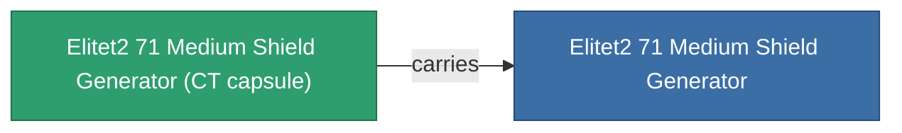

<!-- Generated by tools/generate from the live database (source: entitydefaults definition 6048, aggregatevalues via aggregatefields).
     Do not edit by hand; regenerate instead. -->

# Elitet2 71 Medium Shield Generator

|  |  |
|---|---|
| Definição | `def_elitet2_71_medium_shield_generator` |
| Nível | T2 (special) |
| Vida | 100 |
| Volume | 0.5 |
| Massa | 270 |
| Categoria | Modules / Shield |
| Nota | elite module |

## Estatísticas

| Campo | Valor |
|---|---|
| core_usage | 12.5 |
| cpu_usage | 57 |
| cycle_time | 7k |
| powergrid_usage | 214 |
| shield_absorbtion | 2.1277 |
| shield_radius | 12 |
| signature_radius | -0.4 |

## Cápsula de transporte

A transport capsule (CT) exists for this item — it is how the item moves between players and zones.

## Onde comprar

Fixed-price vendors that sell this item (see the [Item shop](/pt/content/shop/) for the full catalog).

| Vendor | Qty | TM Coin | Credits |
|---|---|---|---|
| Daoden outpost | ∞ | 2.5k | 375M |

<!-- production:generated -->
## Produção

**Produzido a partir de 2 componentes** — monte os componentes para construí-lo (lista completa em [Receitas](/pt/content/recipes/)):

**Plano:** [Elitet2 71 Medium Shield Generator Cprg](/content/items/elitet2-71-medium-shield-generator-cprg/)

<svg class="prod-card-icon" aria-hidden="true"><use href="#mi-grid"/></svg><a class="prod-card-name" href="/pt/content/items/material-boss-z71/">Material Boss Z71</a>

necessário: <b>300</b>

<svg class="prod-card-icon" aria-hidden="true"><use href="#mi-tree"/></svg><a class="prod-card-name" href="/pt/content/items/named1-medium-shield-generator/">Parsvaal-IIX medium shield generator</a>

necessário: <b>1</b>

