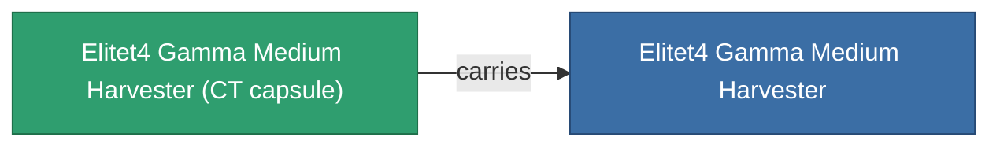

<!-- Generated by tools/generate from the live database (source: entitydefaults definition 6218, aggregatevalues via aggregatefields).
     Do not edit by hand; regenerate instead. -->

# Elitet4 Gamma Medium Harvester

|  |  |
|---|---|
| Definição | `def_elitet4_gamma_medium_harvester` |
| Nível | T4 (special) |
| Vida | 100 |
| Volume | 1.5 |
| Massa | 750 |
| Categoria | Modules / Harvesting |
| Nota | elite module |

## Estatísticas

| Campo | Valor |
|---|---|
| core_usage | 65 |
| cpu_usage | 52 |
| cycle_time | 9.4k |
| optimal_range | 4 |
| powergrid_usage | 150 |

## Cápsula de transporte

A transport capsule (CT) exists for this item — it is how the item moves between players and zones.

## Onde comprar

Fixed-price vendors that sell this item (see the [Item shop](/pt/content/shop/) for the full catalog).

| Vendor | Qty | Credits | UniCoin |
|---|---|---|---|
| Daoden outpost | ∞ | 500M | 25k |

<!-- production:generated -->
## Produção

**Produzido a partir de 4 componentes** — monte os componentes para construí-lo (lista completa em [Receitas](/pt/content/recipes/)):

**Plano:** [Elitet4 Gamma Medium Harvester Cprg](/pt/content/items/elitet4-gamma-medium-harvester-cprg/)

<svg class="prod-card-icon" aria-hidden="true"><use href="#mi-grid"/></svg><a class="prod-card-name" href="/pt/content/items/material-boss-gamma-nuimqol/">Material Boss Gamma Nuimqol</a>

necessário: <b>134</b>

<svg class="prod-card-icon" aria-hidden="true"><use href="#mi-grid"/></svg><a class="prod-card-name" href="/pt/content/items/material-boss-gamma-pelistal/">Material Boss Gamma Pelistal</a>

necessário: <b>134</b>

<svg class="prod-card-icon" aria-hidden="true"><use href="#mi-grid"/></svg><a class="prod-card-name" href="/pt/content/items/material-boss-gamma-thelodica/">Material Boss Gamma Thelodica</a>

necessário: <b>134</b>

<svg class="prod-card-icon" aria-hidden="true"><use href="#mi-grid"/></svg><a class="prod-card-name" href="/pt/content/items/named3-medium-harvester/">Protrim V-II medium harvester</a>

necessário: <b>1</b>

