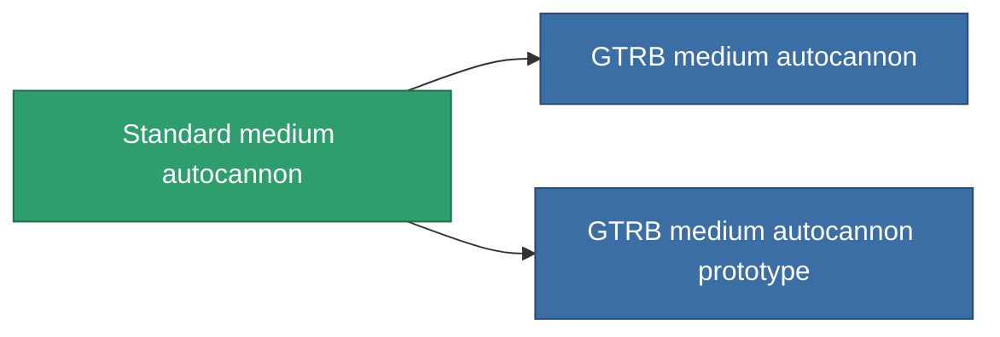

<!-- Generated by tools/generate from the live database (source: entitydefaults definition 1004, aggregatevalues via aggregatefields).
     Do not edit by hand; regenerate instead. -->

# Standard medium autocannon

|  |  |
|---|---|
| Definição | `def_longrange_standard_medium_autocannon` |
| Nível | T1 |
| Vida | 100 |
| Volume | 1.2 |
| Massa | 650 |
| Categoria | Modules / Weapons |

## Estatísticas

| Campo | Valor |
|---|---|
| accuracy | 18 |
| core_usage | 2 |
| cpu_usage | 12 |
| cycle_time | 8k |
| damage_modifier | 2 |
| falloff | 28 |
| least_optimal | 5 |
| optimal_range | 22 |
| powergrid_usage | 140 |

<!-- production:generated -->
## Produção

**Produzido a partir de 3 componentes, nível de pesquisa 3** — monte os componentes para construí-lo (lista completa em [Receitas](/pt/content/recipes/)):

**Plano:** [Standard medium autocannon CT](/pt/content/items/longrange-standard-medium-autocannon-cprg/)

<svg class="prod-card-icon" aria-hidden="true"><use href="#mi-grid"/></svg><a class="prod-card-name" href="/pt/content/items/axicol/">Cryoperine</a>

necessário: <b>100</b>

<svg class="prod-card-icon" aria-hidden="true"><use href="#mi-grid"/></svg><a class="prod-card-name" href="/pt/content/items/axicoline/">Axicoline</a>

necessário: <b>200</b>

<svg class="prod-card-icon" aria-hidden="true"><use href="#mi-grid"/></svg><a class="prod-card-name" href="/pt/content/items/titanium/">Titanium</a>

necessário: <b>100</b>

## Usado em produção

**Componente de 2 itens** — tudo que o usa na produção:

