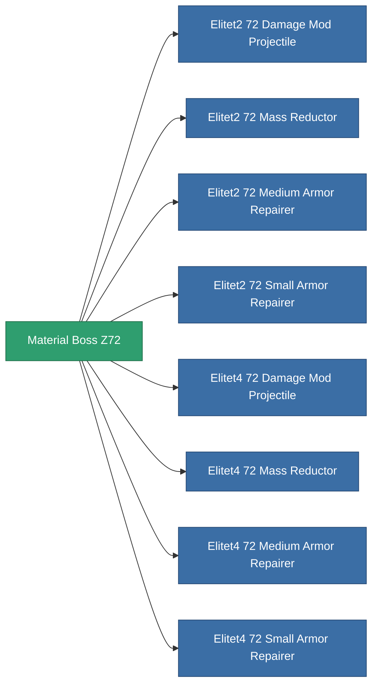

<!-- Generated by tools/generate from the live database (source: entitydefaults definition 6041, aggregatevalues via aggregatefields).
     Do not edit by hand; regenerate instead. -->

# Material Boss Z72

|  |  |
|---|---|
| Definição | `def_material_boss_z72` |
| Nível | – |
| Vida | 100 |
| Volume | 0.01 |
| Massa | 0.5 |
| Categoria | Materials |
| Nota | elite module material |

_Sem estatísticas — este item não carrega valores agregados._

<!-- production:generated -->
## Usado em produção

**Componente de 8 itens** — tudo que o usa na produção:

