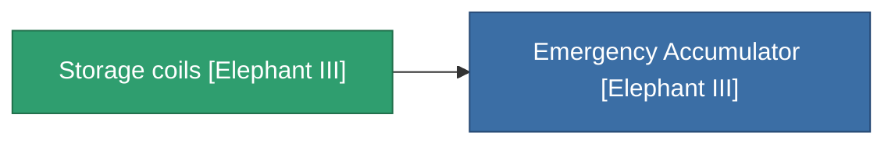

<!-- Generated by tools/generate from the live database (source: entitydefaults definition 4530, aggregatevalues via aggregatefields).
     Do not edit by hand; regenerate instead. -->

# Storage coils [Elephant III]

|  |  |
|---|---|
| Definição | `def_missionitem_tm_i_level00_exp3_03_t02` |
| Nível | – |
| Vida | 100 |
| Volume | 1 |
| Massa | 50 |
| Categoria | Mission items |

_Sem estatísticas — este item não carrega valores agregados._

<!-- production:generated -->
## Usado em produção

**Componente de 1 itens** — tudo que o usa na produção:

