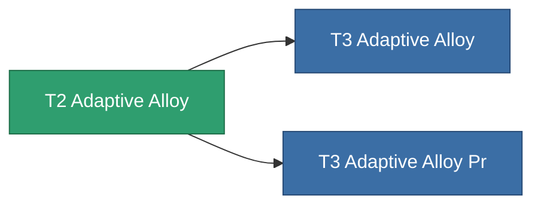

<!-- Generated by tools/generate from the live database (source: entitydefaults definition 8790, aggregatevalues via aggregatefields).
     Do not edit by hand; regenerate instead. -->

# T2 Adaptive Alloy

|  |  |
|---|---|
| Definição | `def_named1_adaptive_alloy` |
| Nível | T2 |
| Vida | 100 |
| Volume | 1.5 |
| Massa | 460 |
| Categoria | Modules / Enhancements |
| Tier line | [Standard Adaptive Alloy](/pt/content/items/standard-adaptive-alloy/) (T1) → **T2 Adaptive Alloy** (T2) → [T3 Adaptive Alloy](/pt/content/items/named2-adaptive-alloy/) (T3) → [T4 Adaptive Alloy](/pt/content/items/named3-adaptive-alloy/) (T4) |

## Estatísticas

| Campo | Valor |
|---|---|
| adaptive_resist_points | 60 |
| cpu_usage | 35 |
| powergrid_usage | 11 |

<!-- production:generated -->
## Produção

**Produzido a partir de 11 componentes** — monte os componentes para construí-lo (lista completa em [Receitas](/pt/content/recipes/)):

**Plano:** [T2 Adaptive Alloy Cprg](/content/items/named1-adaptive-alloy-cprg/)

<svg class="prod-card-icon" aria-hidden="true"><use href="#mi-grid"/></svg><a class="prod-card-name" href="/pt/content/items/axicol/">Cryoperine</a>

necessário: <b>200</b>

<svg class="prod-card-icon" aria-hidden="true"><use href="#mi-grid"/></svg><a class="prod-card-name" href="/pt/content/items/chollonin/">Chollonin</a>

necessário: <b>25</b>

<svg class="prod-card-icon" aria-hidden="true"><use href="#mi-grid"/></svg><a class="prod-card-name" href="/pt/content/items/isopropentol/">Isopropentol</a>

necessário: <b>65</b>

<svg class="prod-card-icon" aria-hidden="true"><use href="#mi-grid"/></svg><a class="prod-card-name" href="/pt/content/items/metachropin/">Metachropin</a>

necessário: <b>65</b>

<svg class="prod-card-icon" aria-hidden="true"><use href="#mi-grid"/></svg><a class="prod-card-name" href="/pt/content/items/plasteosine/">Plasteosine</a>

necessário: <b>500</b>

<svg class="prod-card-icon" aria-hidden="true"><use href="#mi-grid"/></svg><a class="prod-card-name" href="/pt/content/items/prilumium/">Prilumium</a>

necessário: <b>25</b>

<svg class="prod-card-icon" aria-hidden="true"><use href="#mi-crystal"/></svg><a class="prod-card-name" href="/pt/content/items/robotshard-common-basic/">Damaged common fragment</a>

necessário: <b>30</b>

<svg class="prod-card-icon" aria-hidden="true"><use href="#mi-crystal"/></svg><a class="prod-card-name" href="/pt/content/items/standard-adaptive-alloy/">Standard Adaptive Alloy</a>

necessário: <b>1</b>

<svg class="prod-card-icon" aria-hidden="true"><use href="#mi-grid"/></svg><a class="prod-card-name" href="/pt/content/items/statichnol/">Statichnol</a>

necessário: <b>65</b>

<svg class="prod-card-icon" aria-hidden="true"><use href="#mi-grid"/></svg><a class="prod-card-name" href="/pt/content/items/titanium/">Titanium</a>

necessário: <b>200</b>

<svg class="prod-card-icon" aria-hidden="true"><use href="#mi-grid"/></svg><a class="prod-card-name" href="/pt/content/items/vitricyl/">Vitricyl</a>

necessário: <b>25</b>

## Usado em produção

**Componente de 2 itens** — tudo que o usa na produção:

