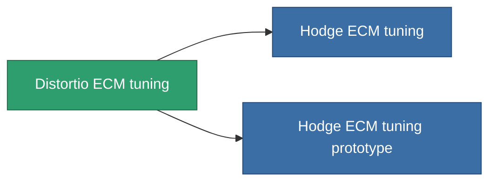

<!-- Generated by tools/generate from the live database (source: entitydefaults definition 4587, aggregatevalues via aggregatefields).
     Do not edit by hand; regenerate instead. -->

# Distortio ECM tuning

|  |  |
|---|---|
| Definição | `def_named1_ecm_booster` |
| Nível | T2 |
| Vida | 100 |
| Volume | 0.5 |
| Massa | 135 |
| Categoria | Modules / Enhancements |
| Tier line | [Standard ECM tuning](/pt/content/items/standard-ecm-booster/) (T1) → **Distortio ECM tuning** (T2) → [Hodge ECM tuning](/pt/content/items/named2-ecm-booster/) (T3) → [Sludge ECM tuning](/pt/content/items/named3-ecm-booster/) (T4) |

## Estatísticas

| Campo | Valor |
|---|---|
| core_usage_sensor_jammer_modifier | 1.1 |
| cpu_usage | 57 |
| ecm_strength_modifier | 1.25 |
| powergrid_usage | 22 |

<!-- production:generated -->
## Produção

**Produzido a partir de 6 componentes, nível de pesquisa 6** — monte os componentes para construí-lo (lista completa em [Receitas](/pt/content/recipes/)):

**Plano:** [Distortio ECM tuning CT](/pt/content/items/named1-ecm-booster-cprg/)

<svg class="prod-card-icon" aria-hidden="true"><use href="#mi-grid"/></svg><a class="prod-card-name" href="/pt/content/items/axicol/">Cryoperine</a>

necessário: <b>150</b>

<svg class="prod-card-icon" aria-hidden="true"><use href="#mi-grid"/></svg><a class="prod-card-name" href="/pt/content/items/chollonin/">Chollonin</a>

necessário: <b>150</b>

<svg class="prod-card-icon" aria-hidden="true"><use href="#mi-crystal"/></svg><a class="prod-card-name" href="/pt/content/items/robotshard-common-basic/">Damaged common fragment</a>

necessário: <b>15</b>

<svg class="prod-card-icon" aria-hidden="true"><use href="#mi-crystal"/></svg><a class="prod-card-name" href="/pt/content/items/robotshard-nuimqol-basic/">Damaged nuimqol fragment</a>

necessário: <b>15</b>

<svg class="prod-card-icon" aria-hidden="true"><use href="#mi-panel"/></svg><a class="prod-card-name" href="/pt/content/items/standard-ecm-booster/">Standard ECM tuning</a>

necessário: <b>1</b>

<svg class="prod-card-icon" aria-hidden="true"><use href="#mi-grid"/></svg><a class="prod-card-name" href="/pt/content/items/titanium/">Titanium</a>

necessário: <b>50</b>

## Usado em produção

**Componente de 2 itens** — tudo que o usa na produção:

