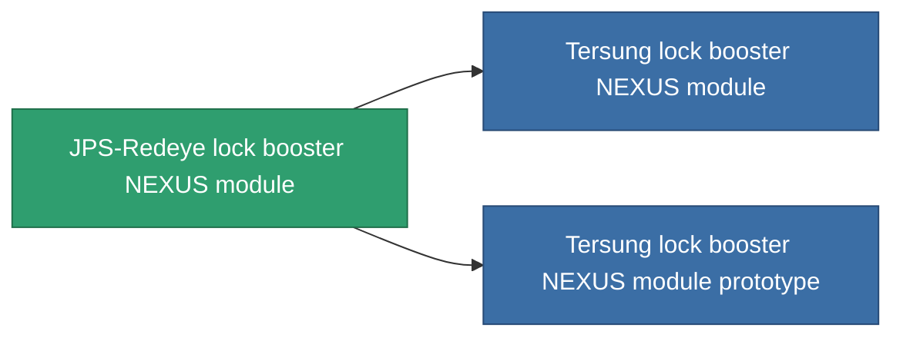

<!-- Generated by tools/generate from the live database (source: entitydefaults definition 2586, aggregatevalues via aggregatefields).
     Do not edit by hand; regenerate instead. -->

# JPS-Redeye lock booster NEXUS module

|  |  |
|---|---|
| Definição | `def_named1_gang_assist_shared_dataprocessing_module` |
| Nível | T2 |
| Vida | 100 |
| Volume | 0.2 |
| Massa | 50 |
| Categoria | Modules / Enhancements |
| Tier line | [Standard lock booster NEXUS module](/pt/content/items/standard-gang-assist-shared-dataprocessing-module/) (T1) → **JPS-Redeye lock booster NEXUS module** (T2) → [Tersung lock booster NEXUS module](/pt/content/items/named2-gang-assist-shared-dataprocessing-module/) (T3) → [JPS-Greeneye lock booster NEXUS module](/pt/content/items/named3-gang-assist-shared-dataprocessing-module/) (T4) |
| Nota | locking timet csokkent |

## Estatísticas

| Campo | Valor |
|---|---|
| core_usage | 31 |
| cpu_usage | 78 |
| cycle_time | 10k |
| default_effect_range | 100 |
| effect_locking_time_modifier | 0.98 |
| powergrid_usage | 31 |

<!-- production:generated -->
## Produção

**Produzido a partir de 7 componentes, nível de pesquisa 5** — monte os componentes para construí-lo (lista completa em [Receitas](/pt/content/recipes/)):

**Plano:** [JPS-Redeye lock booster NEXUS module CT](/pt/content/items/named1-gang-assist-shared-dataprocessing-module-cprg/)

<svg class="prod-card-icon" aria-hidden="true"><use href="#mi-grid"/></svg><a class="prod-card-name" href="/pt/content/items/axicol/">Cryoperine</a>

necessário: <b>250</b>

<svg class="prod-card-icon" aria-hidden="true"><use href="#mi-grid"/></svg><a class="prod-card-name" href="/pt/content/items/axicoline/">Axicoline</a>

necessário: <b>50</b>

<svg class="prod-card-icon" aria-hidden="true"><use href="#mi-grid"/></svg><a class="prod-card-name" href="/pt/content/items/phlobotil/">Phlobotil</a>

necessário: <b>50</b>

<svg class="prod-card-icon" aria-hidden="true"><use href="#mi-crystal"/></svg><a class="prod-card-name" href="/pt/content/items/robotshard-common-basic/">Damaged common fragment</a>

necessário: <b>30</b>

<svg class="prod-card-icon" aria-hidden="true"><use href="#mi-panel"/></svg><a class="prod-card-name" href="/pt/content/items/standard-gang-assist-shared-dataprocessing-module/">Standard lock booster NEXUS module</a>

necessário: <b>1</b>

<svg class="prod-card-icon" aria-hidden="true"><use href="#mi-grid"/></svg><a class="prod-card-name" href="/pt/content/items/titanium/">Titanium</a>

necessário: <b>50</b>

<svg class="prod-card-icon" aria-hidden="true"><use href="#mi-grid"/></svg><a class="prod-card-name" href="/pt/content/items/vitricyl/">Vitricyl</a>

necessário: <b>250</b>

## Usado em produção

**Componente de 2 itens** — tudo que o usa na produção:

