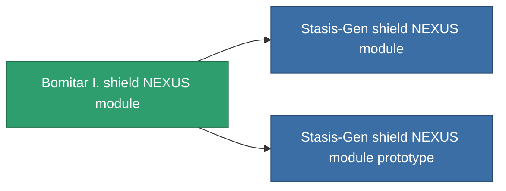

<!-- Generated by tools/generate from the live database (source: entitydefaults definition 2607, aggregatevalues via aggregatefields).
     Do not edit by hand; regenerate instead. -->

# Bomitar I. shield NEXUS module

|  |  |
|---|---|
| Definição | `def_named1_gang_assist_shield_calculation_module` |
| Nível | T2 |
| Vida | 100 |
| Volume | 0.2 |
| Massa | 50 |
| Categoria | Modules / Shield |
| Tier line | [Standard shield NEXUS module](/pt/content/items/standard-gang-assist-shield-calculation-module/) (T1) → **Bomitar I. shield NEXUS module** (T2) → [Stasis-Gen shield NEXUS module](/pt/content/items/named2-gang-assist-shield-calculation-module/) (T3) → [Bomitar II. shield NEXUS module](/pt/content/items/named3-gang-assist-shield-calculation-module/) (T4) |
| Nota | shield absorbtion ratiot javit |

## Estatísticas

| Campo | Valor |
|---|---|
| core_usage | 31 |
| cpu_usage | 78 |
| cycle_time | 10k |
| default_effect_range | 100 |
| effect_shield_absorbtion_modifier | 1.02 |
| powergrid_usage | 31 |

<!-- production:generated -->
## Produção

**Produzido a partir de 8 componentes, nível de pesquisa 5** — monte os componentes para construí-lo (lista completa em [Receitas](/pt/content/recipes/)):

**Plano:** [Bomitar I. shield NEXUS module CT](/pt/content/items/named1-gang-assist-shield-calculation-module-cprg/)

<svg class="prod-card-icon" aria-hidden="true"><use href="#mi-grid"/></svg><a class="prod-card-name" href="/pt/content/items/axicol/">Cryoperine</a>

necessário: <b>250</b>

<svg class="prod-card-icon" aria-hidden="true"><use href="#mi-grid"/></svg><a class="prod-card-name" href="/pt/content/items/isopropentol/">Isopropentol</a>

necessário: <b>50</b>

<svg class="prod-card-icon" aria-hidden="true"><use href="#mi-grid"/></svg><a class="prod-card-name" href="/pt/content/items/plasteosine/">Plasteosine</a>

necessário: <b>50</b>

<svg class="prod-card-icon" aria-hidden="true"><use href="#mi-crystal"/></svg><a class="prod-card-name" href="/pt/content/items/robotshard-pelistal-basic/">Damaged pelistal fragment</a>

necessário: <b>15</b>

<svg class="prod-card-icon" aria-hidden="true"><use href="#mi-crystal"/></svg><a class="prod-card-name" href="/pt/content/items/robotshard-thelodica-basic/">Damaged thelodica fragment</a>

necessário: <b>15</b>

<svg class="prod-card-icon" aria-hidden="true"><use href="#mi-tree"/></svg><a class="prod-card-name" href="/pt/content/items/standard-gang-assist-shield-calculation-module/">Standard shield NEXUS module</a>

necessário: <b>1</b>

<svg class="prod-card-icon" aria-hidden="true"><use href="#mi-grid"/></svg><a class="prod-card-name" href="/pt/content/items/titanium/">Titanium</a>

necessário: <b>50</b>

<svg class="prod-card-icon" aria-hidden="true"><use href="#mi-grid"/></svg><a class="prod-card-name" href="/pt/content/items/vitricyl/">Vitricyl</a>

necessário: <b>250</b>

## Usado em produção

**Componente de 2 itens** — tudo que o usa na produção:

