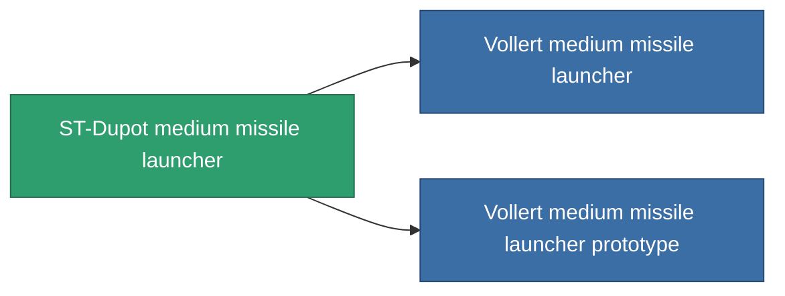

<!-- Generated by tools/generate from the live database (source: entitydefaults definition 852, aggregatevalues via aggregatefields).
     Do not edit by hand; regenerate instead. -->

# ST-Dupot medium missile launcher

|  |  |
|---|---|
| Definição | `def_named1_missile_launcher` |
| Nível | T2 |
| Vida | 100 |
| Volume | 2 |
| Massa | 450 |
| Categoria | Modules / Weapons |
| Tier line | [Standard medium missile launcher](/pt/content/items/standard-missile-launcher/) (T1) → **ST-Dupot medium missile launcher** (T2) → [Vollert medium missile launcher](/pt/content/items/named2-missile-launcher/) (T3) → [Pelistec-TR250 medium missile launcher](/pt/content/items/named3-missile-launcher/) (T4) |

## Estatísticas

| Campo | Valor |
|---|---|
| accuracy | 1 |
| core_usage | 2 |
| cpu_usage | 36 |
| cycle_time | 14k |
| damage_modifier | 1 |
| powergrid_usage | 135 |

<!-- production:generated -->
## Produção

**Produzido a partir de 6 componentes, nível de pesquisa 5** — monte os componentes para construí-lo (lista completa em [Receitas](/pt/content/recipes/)):

**Plano:** [ST-Dupot medium missile launcher CT](/content/items/named1-missile-launcher-cprg/)

<svg class="prod-card-icon" aria-hidden="true"><use href="#mi-grid"/></svg><a class="prod-card-name" href="/pt/content/items/axicoline/">Axicoline</a>

necessário: <b>100</b>

<svg class="prod-card-icon" aria-hidden="true"><use href="#mi-grid"/></svg><a class="prod-card-name" href="/pt/content/items/phlobotil/">Phlobotil</a>

necessário: <b>100</b>

<svg class="prod-card-icon" aria-hidden="true"><use href="#mi-crystal"/></svg><a class="prod-card-name" href="/pt/content/items/robotshard-common-basic/">Damaged common fragment</a>

necessário: <b>30</b>

<svg class="prod-card-icon" aria-hidden="true"><use href="#mi-crystal"/></svg><a class="prod-card-name" href="/pt/content/items/robotshard-pelistal-basic/">Damaged pelistal fragment</a>

necessário: <b>30</b>

<svg class="prod-card-icon" aria-hidden="true"><use href="#mi-star"/></svg><a class="prod-card-name" href="/pt/content/items/standard-missile-launcher/">Standard medium missile launcher</a>

necessário: <b>1</b>

<svg class="prod-card-icon" aria-hidden="true"><use href="#mi-grid"/></svg><a class="prod-card-name" href="/pt/content/items/titanium/">Titanium</a>

necessário: <b>100</b>

## Usado em produção

**Componente de 2 itens** — tudo que o usa na produção:

