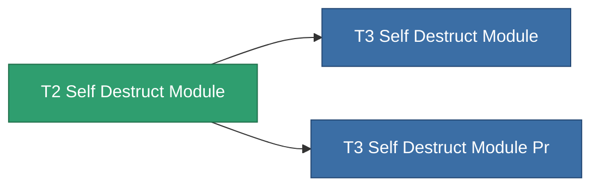

<!-- Generated by tools/generate from the live database (source: entitydefaults definition 8980, aggregatevalues via aggregatefields).
     Do not edit by hand; regenerate instead. -->

# T2 Self Destruct Module

|  |  |
|---|---|
| Definição | `def_named1_self_destruct_module` |
| Nível | T2 |
| Vida | 100 |
| Volume | 100 |
| Massa | 450 |
| Categoria | Modules / Enhancements |
| Tier line | [Standard Self Destruct Module](/pt/content/items/standard-self-destruct-module/) (T1) → **T2 Self Destruct Module** (T2) → [T3 Self Destruct Module](/pt/content/items/named2-self-destruct-module/) (T3) → [T4 Self Destruct Module](/pt/content/items/named3-self-destruct-module/) (T4) |
| Nota | Kamikaze self-destruct module: arms an un-cancellable delayed detonation that kills the owner. |

## Estatísticas

| Campo | Valor |
|---|---|
| core_usage | 55 |
| cpu_usage | 45 |
| powergrid_usage | 22 |

<!-- production:generated -->
## Produção

**Produzido a partir de 5 componentes** — monte os componentes para construí-lo (lista completa em [Receitas](/pt/content/recipes/)):

**Plano:** [T2 Self Destruct Module Cprg](/pt/content/items/named1-self-destruct-module-cprg/)

<svg class="prod-card-icon" aria-hidden="true"><use href="#mi-grid"/></svg><a class="prod-card-name" href="/pt/content/items/axicol/">Cryoperine</a>

necessário: <b>250</b>

<svg class="prod-card-icon" aria-hidden="true"><use href="#mi-grid"/></svg><a class="prod-card-name" href="/pt/content/items/axicoline/">Axicoline</a>

necessário: <b>200</b>

<svg class="prod-card-icon" aria-hidden="true"><use href="#mi-grid"/></svg><a class="prod-card-name" href="/pt/content/items/espitium/">Espitium</a>

necessário: <b>200</b>

<svg class="prod-card-icon" aria-hidden="true"><use href="#mi-panel"/></svg><a class="prod-card-name" href="/pt/content/items/standard-self-destruct-module/">Standard Self Destruct Module</a>

necessário: <b>1</b>

<svg class="prod-card-icon" aria-hidden="true"><use href="#mi-grid"/></svg><a class="prod-card-name" href="/pt/content/items/titanium/">Titanium</a>

necessário: <b>200</b>

## Usado em produção

**Componente de 2 itens** — tudo que o usa na produção:

