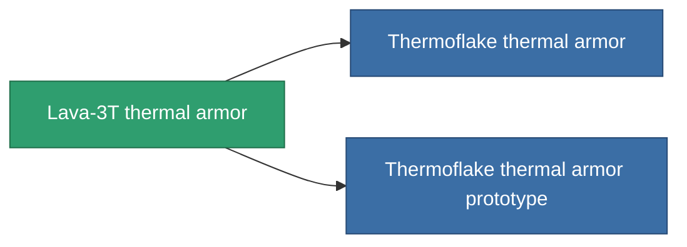

<!-- Generated by tools/generate from the live database (source: entitydefaults definition 711, aggregatevalues via aggregatefields).
     Do not edit by hand; regenerate instead. -->

# Lava-3T thermal armor

|  |  |
|---|---|
| Definição | `def_named1_thrm_armor_hardener` |
| Nível | T2 |
| Vida | 100 |
| Volume | 1 |
| Massa | 90 |
| Categoria | Modules / Armor |
| Tier line | [Standard thermal armor](/pt/content/items/standard-thrm-armor-hardener/) (T1) → **Lava-3T thermal armor** (T2) → [Thermoflake thermal armor](/pt/content/items/named2-thrm-armor-hardener/) (T3) → [Hephaistos-TSS thermal armor](/pt/content/items/named3-thrm-armor-hardener/) (T4) |

## Estatísticas

| Campo | Valor |
|---|---|
| core_usage | 11 |
| cpu_usage | 22 |
| cycle_time | 10k |
| effect_resist_thermal | 100 |
| powergrid_usage | 4 |
| resist_thermal | 25 |

<!-- production:generated -->
## Produção

**Produzido a partir de 8 componentes, nível de pesquisa 4** — monte os componentes para construí-lo (lista completa em [Receitas](/pt/content/recipes/)):

**Plano:** [Lava-3T thermal armor CT](/pt/content/items/named1-thrm-armor-hardener-cprg/)

<svg class="prod-card-icon" aria-hidden="true"><use href="#mi-grid"/></svg><a class="prod-card-name" href="/pt/content/items/axicol/">Cryoperine</a>

necessário: <b>50</b>

<svg class="prod-card-icon" aria-hidden="true"><use href="#mi-grid"/></svg><a class="prod-card-name" href="/pt/content/items/isopropentol/">Isopropentol</a>

necessário: <b>125</b>

<svg class="prod-card-icon" aria-hidden="true"><use href="#mi-grid"/></svg><a class="prod-card-name" href="/pt/content/items/plasteosine/">Plasteosine</a>

necessário: <b>125</b>

<svg class="prod-card-icon" aria-hidden="true"><use href="#mi-crystal"/></svg><a class="prod-card-name" href="/pt/content/items/robotshard-common-basic/">Damaged common fragment</a>

necessário: <b>15</b>

<svg class="prod-card-icon" aria-hidden="true"><use href="#mi-crystal"/></svg><a class="prod-card-name" href="/pt/content/items/robotshard-nuimqol-basic/">Damaged nuimqol fragment</a>

necessário: <b>15</b>

<svg class="prod-card-icon" aria-hidden="true"><use href="#mi-tree"/></svg><a class="prod-card-name" href="/pt/content/items/standard-thrm-armor-hardener/">Standard thermal armor</a>

necessário: <b>1</b>

<svg class="prod-card-icon" aria-hidden="true"><use href="#mi-grid"/></svg><a class="prod-card-name" href="/pt/content/items/titanium/">Titanium</a>

necessário: <b>100</b>

<svg class="prod-card-icon" aria-hidden="true"><use href="#mi-grid"/></svg><a class="prod-card-name" href="/pt/content/items/vitricyl/">Vitricyl</a>

necessário: <b>50</b>

## Usado em produção

**Componente de 2 itens** — tudo que o usa na produção:

