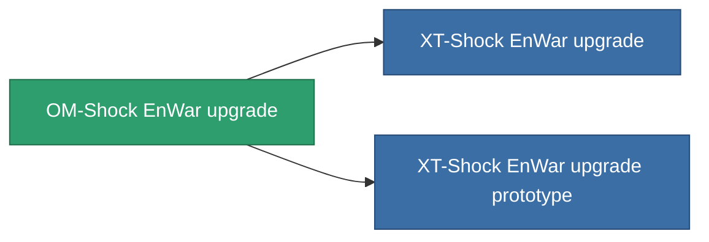

<!-- Generated by tools/generate from the live database (source: entitydefaults definition 4585, aggregatevalues via aggregatefields).
     Do not edit by hand; regenerate instead. -->

# OM-Shock EnWar upgrade

|  |  |
|---|---|
| Definição | `def_named2_energy_warfare_upgrade` |
| Nível | T3 |
| Vida | 100 |
| Volume | 1 |
| Massa | 250 |
| Categoria | Modules / Enhancements |
| Tier line | [Standard EnWar upgrade](/pt/content/items/standard-energy-warfare-upgrade/) (T1) → [Blister EnWar upgrade](/pt/content/items/named1-energy-warfare-upgrade/) (T2) → **OM-Shock EnWar upgrade** (T3) → [XT-Shock EnWar upgrade](/pt/content/items/named3-energy-warfare-upgrade/) (T4) |

## Estatísticas

| Campo | Valor |
|---|---|
| core_usage_energy_neutralizers_modifier | 1.1 |
| cpu_usage | 25 |
| energy_neutralized_amount_modifier | 1.225 |
| energy_vampired_amount_modifier | 1.125 |
| powergrid_usage | 45 |

<!-- production:generated -->
## Produção

**Produzido a partir de 10 componentes, nível de pesquisa 7** — monte os componentes para construí-lo (lista completa em [Receitas](/pt/content/recipes/)):

**Plano:** [OM-Shock EnWar upgrade CT](/content/items/named2-energy-warfare-upgrade-cprg/)

<svg class="prod-card-icon" aria-hidden="true"><use href="#mi-grid"/></svg><a class="prod-card-name" href="/pt/content/items/espitium/">Espitium</a>

necessário: <b>150</b>

<svg class="prod-card-icon" aria-hidden="true"><use href="#mi-grid"/></svg><a class="prod-card-name" href="/pt/content/items/hydrobenol/">Hydrobenol</a>

necessário: <b>50</b>

<svg class="prod-card-icon" aria-hidden="true"><use href="#mi-grid"/></svg><a class="prod-card-name" href="/pt/content/items/named1-energy-warfare-upgrade/">Blister EnWar upgrade</a>

necessário: <b>1</b>

<svg class="prod-card-icon" aria-hidden="true"><use href="#mi-grid"/></svg><a class="prod-card-name" href="/pt/content/items/phlobotil/">Phlobotil</a>

necessário: <b>50</b>

<svg class="prod-card-icon" aria-hidden="true"><use href="#mi-crystal"/></svg><a class="prod-card-name" href="/pt/content/items/robotshard-common-advanced/">Functional common fragment</a>

necessário: <b>10</b>

<svg class="prod-card-icon" aria-hidden="true"><use href="#mi-crystal"/></svg><a class="prod-card-name" href="/pt/content/items/robotshard-common-basic/">Damaged common fragment</a>

necessário: <b>10</b>

<svg class="prod-card-icon" aria-hidden="true"><use href="#mi-crystal"/></svg><a class="prod-card-name" href="/pt/content/items/robotshard-pelistal-advanced/">Functional pelistal fragment</a>

necessário: <b>10</b>

<svg class="prod-card-icon" aria-hidden="true"><use href="#mi-crystal"/></svg><a class="prod-card-name" href="/pt/content/items/robotshard-pelistal-basic/">Damaged pelistal fragment</a>

necessário: <b>10</b>

<svg class="prod-card-icon" aria-hidden="true"><use href="#mi-grid"/></svg><a class="prod-card-name" href="/pt/content/items/titanium/">Titanium</a>

necessário: <b>50</b>

<svg class="prod-card-icon" aria-hidden="true"><use href="#mi-grid"/></svg><a class="prod-card-name" href="/pt/content/items/vitricyl/">Vitricyl</a>

necessário: <b>150</b>

## Usado em produção

**Componente de 2 itens** — tudo que o usa na produção:

