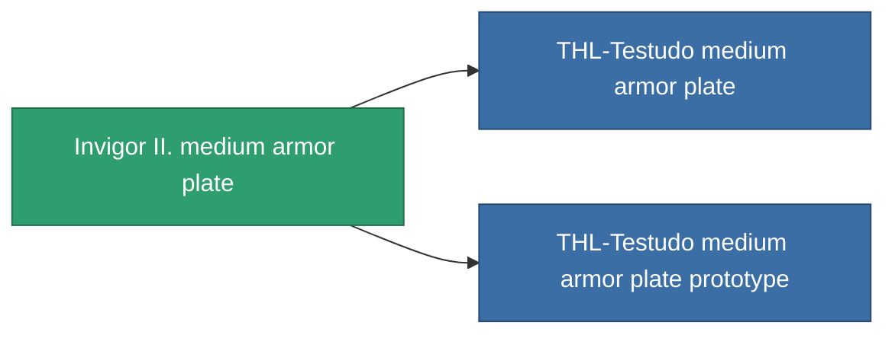

<!-- Generated by tools/generate from the live database (source: entitydefaults definition 688, aggregatevalues via aggregatefields).
     Do not edit by hand; regenerate instead. -->

# Invigor II. medium armor plate

|  |  |
|---|---|
| Definição | `def_named2_medium_armor_plate` |
| Nível | T3 |
| Vida | 100 |
| Volume | 2 |
| Massa | 3000 |
| Categoria | Modules / Armor |
| Tier line | [Standard medium armor plate](/pt/content/items/standard-medium-armor-plate/) (T1) → [Azilo-Protec Duoforge medium armor plate](/pt/content/items/named1-medium-armor-plate/) (T2) → **Invigor II. medium armor plate** (T3) → [THL-Testudo medium armor plate](/pt/content/items/named3-medium-armor-plate/) (T4) |

## Estatísticas

| Campo | Valor |
|---|---|
| armor_max | 1.45k |
| cpu_usage | 2 |
| massiveness | 0.13 |
| powergrid_usage | 75 |
| signature_radius | 1 |

<!-- production:generated -->
## Produção

**Produzido a partir de 6 componentes, nível de pesquisa 5** — monte os componentes para construí-lo (lista completa em [Receitas](/pt/content/recipes/)):

**Plano:** [Invigor II. medium armor plate CT](/content/items/named2-medium-armor-plate-cprg/)

<svg class="prod-card-icon" aria-hidden="true"><use href="#mi-grid"/></svg><a class="prod-card-name" href="/pt/content/items/alligior/">Alligior</a>

necessário: <b>350</b>

<svg class="prod-card-icon" aria-hidden="true"><use href="#mi-tree"/></svg><a class="prod-card-name" href="/pt/content/items/named1-medium-armor-plate/">Azilo-Protec Duoforge medium armor plate</a>

necessário: <b>1</b>

<svg class="prod-card-icon" aria-hidden="true"><use href="#mi-grid"/></svg><a class="prod-card-name" href="/pt/content/items/plasteosine/">Plasteosine</a>

necessário: <b>350</b>

<svg class="prod-card-icon" aria-hidden="true"><use href="#mi-crystal"/></svg><a class="prod-card-name" href="/pt/content/items/robotshard-common-advanced/">Functional common fragment</a>

necessário: <b>40</b>

<svg class="prod-card-icon" aria-hidden="true"><use href="#mi-crystal"/></svg><a class="prod-card-name" href="/pt/content/items/robotshard-common-basic/">Damaged common fragment</a>

necessário: <b>40</b>

<svg class="prod-card-icon" aria-hidden="true"><use href="#mi-grid"/></svg><a class="prod-card-name" href="/pt/content/items/titanium/">Titanium</a>

necessário: <b>500</b>

## Usado em produção

**Componente de 2 itens** — tudo que o usa na produção:

