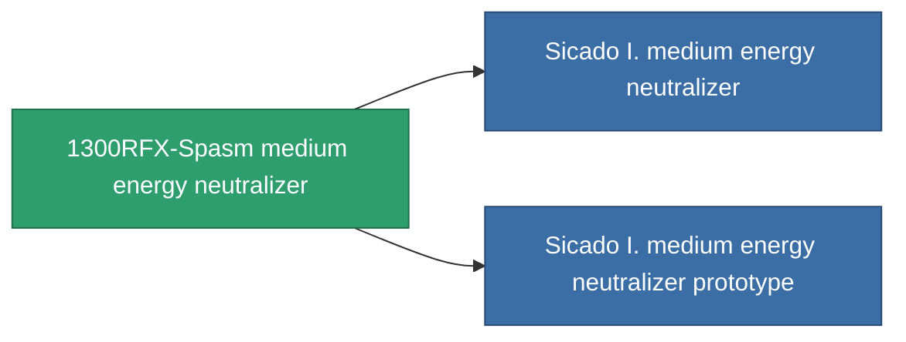

<!-- Generated by tools/generate from the live database (source: entitydefaults definition 757, aggregatevalues via aggregatefields).
     Do not edit by hand; regenerate instead. -->

# 1300RFX-Spasm medium energy neutralizer

|  |  |
|---|---|
| Definição | `def_named2_medium_energy_neutralizer` |
| Nível | T3 |
| Vida | 100 |
| Volume | 1 |
| Massa | 500 |
| Categoria | Modules / Shield |
| Tier line | [Standard medium energy neutralizer](/pt/content/items/standard-medium-energy-neutralizer/) (T1) → [Gox II. medium energy neutralizer](/pt/content/items/named1-medium-energy-neutralizer/) (T2) → **1300RFX-Spasm medium energy neutralizer** (T3) → [Sicado I. medium energy neutralizer](/pt/content/items/named3-medium-energy-neutralizer/) (T4) |

## Estatísticas

| Campo | Valor |
|---|---|
| core_usage | 225 |
| cpu_usage | 37 |
| cycle_time | 10k |
| energy_dispersion | 10 |
| energy_neutralized_amount | 270 |
| falloff | 0 |
| optimal_range | 25 |
| powergrid_usage | 210 |

<!-- production:generated -->
## Produção

**Produzido a partir de 10 componentes, nível de pesquisa 6** — monte os componentes para construí-lo (lista completa em [Receitas](/pt/content/recipes/)):

**Plano:** [1300RFX-Spasm medium energy neutralizer CT](/pt/content/items/named2-medium-energy-neutralizer-cprg/)

<svg class="prod-card-icon" aria-hidden="true"><use href="#mi-grid"/></svg><a class="prod-card-name" href="/pt/content/items/espitium/">Espitium</a>

necessário: <b>200</b>

<svg class="prod-card-icon" aria-hidden="true"><use href="#mi-grid"/></svg><a class="prod-card-name" href="/pt/content/items/hydrobenol/">Hydrobenol</a>

necessário: <b>100</b>

<svg class="prod-card-icon" aria-hidden="true"><use href="#mi-grid"/></svg><a class="prod-card-name" href="/pt/content/items/named1-medium-energy-neutralizer/">Gox II. medium energy neutralizer</a>

necessário: <b>1</b>

<svg class="prod-card-icon" aria-hidden="true"><use href="#mi-grid"/></svg><a class="prod-card-name" href="/pt/content/items/phlobotil/">Phlobotil</a>

necessário: <b>100</b>

<svg class="prod-card-icon" aria-hidden="true"><use href="#mi-crystal"/></svg><a class="prod-card-name" href="/pt/content/items/robotshard-common-advanced/">Functional common fragment</a>

necessário: <b>20</b>

<svg class="prod-card-icon" aria-hidden="true"><use href="#mi-crystal"/></svg><a class="prod-card-name" href="/pt/content/items/robotshard-common-basic/">Damaged common fragment</a>

necessário: <b>20</b>

<svg class="prod-card-icon" aria-hidden="true"><use href="#mi-crystal"/></svg><a class="prod-card-name" href="/pt/content/items/robotshard-pelistal-advanced/">Functional pelistal fragment</a>

necessário: <b>20</b>

<svg class="prod-card-icon" aria-hidden="true"><use href="#mi-crystal"/></svg><a class="prod-card-name" href="/pt/content/items/robotshard-pelistal-basic/">Damaged pelistal fragment</a>

necessário: <b>20</b>

<svg class="prod-card-icon" aria-hidden="true"><use href="#mi-grid"/></svg><a class="prod-card-name" href="/pt/content/items/titanium/">Titanium</a>

necessário: <b>100</b>

<svg class="prod-card-icon" aria-hidden="true"><use href="#mi-grid"/></svg><a class="prod-card-name" href="/pt/content/items/vitricyl/">Vitricyl</a>

necessário: <b>200</b>

## Usado em produção

**Componente de 2 itens** — tudo que o usa na produção:

