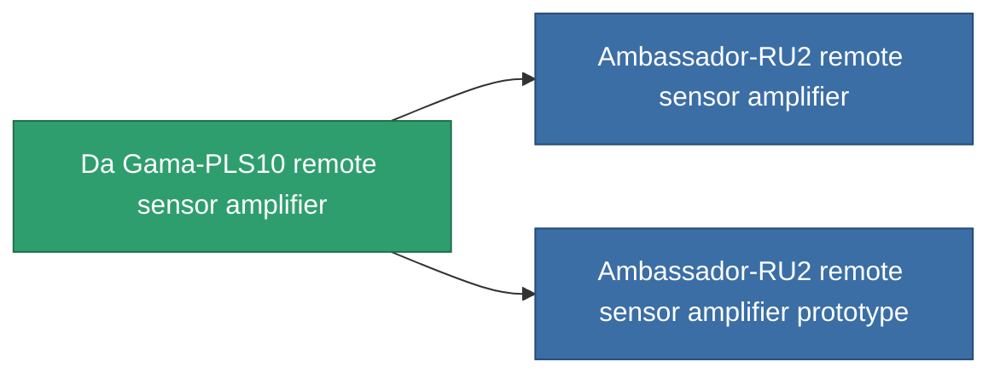

<!-- Generated by tools/generate from the live database (source: entitydefaults definition 772, aggregatevalues via aggregatefields).
     Do not edit by hand; regenerate instead. -->

# Da Gama-PLS10 remote sensor amplifier

|  |  |
|---|---|
| Definição | `def_named2_remote_sensor_booster` |
| Nível | T3 |
| Vida | 100 |
| Volume | 0.5 |
| Massa | 100 |
| Categoria | Modules / Sensors & scanning |
| Tier line | [Standard remote sensor amplifier](/pt/content/items/standard-remote-sensor-booster/) (T1) → [Occul remote sensor amplifier](/pt/content/items/named1-remote-sensor-booster/) (T2) → **Da Gama-PLS10 remote sensor amplifier** (T3) → [Ambassador-RU2 remote sensor amplifier](/pt/content/items/named3-remote-sensor-booster/) (T4) |

## Estatísticas

| Campo | Valor |
|---|---|
| core_usage | 14 |
| cpu_usage | 23 |
| cycle_time | 10k |
| effect_sensor_booster_locking_range_modifier | 1.4 |
| effect_sensor_booster_locking_time_modifier | 0.75 |
| falloff | 0 |
| optimal_range | 30 |
| powergrid_usage | 7 |

<!-- production:generated -->
## Produção

**Produzido a partir de 6 componentes, nível de pesquisa 5** — monte os componentes para construí-lo (lista completa em [Receitas](/pt/content/recipes/)):

**Plano:** [Da Gama-PLS10 remote sensor amplifier CT](/content/items/named2-remote-sensor-booster-cprg/)

<svg class="prod-card-icon" aria-hidden="true"><use href="#mi-grid"/></svg><a class="prod-card-name" href="/pt/content/items/axicol/">Cryoperine</a>

necessário: <b>200</b>

<svg class="prod-card-icon" aria-hidden="true"><use href="#mi-grid"/></svg><a class="prod-card-name" href="/pt/content/items/espitium/">Espitium</a>

necessário: <b>200</b>

<svg class="prod-card-icon" aria-hidden="true"><use href="#mi-grid"/></svg><a class="prod-card-name" href="/pt/content/items/named1-remote-sensor-booster/">Occul remote sensor amplifier</a>

necessário: <b>1</b>

<svg class="prod-card-icon" aria-hidden="true"><use href="#mi-crystal"/></svg><a class="prod-card-name" href="/pt/content/items/robotshard-common-advanced/">Functional common fragment</a>

necessário: <b>20</b>

<svg class="prod-card-icon" aria-hidden="true"><use href="#mi-crystal"/></svg><a class="prod-card-name" href="/pt/content/items/robotshard-common-basic/">Damaged common fragment</a>

necessário: <b>20</b>

<svg class="prod-card-icon" aria-hidden="true"><use href="#mi-grid"/></svg><a class="prod-card-name" href="/pt/content/items/titanium/">Titanium</a>

necessário: <b>100</b>

## Usado em produção

**Componente de 2 itens** — tudo que o usa na produção:

