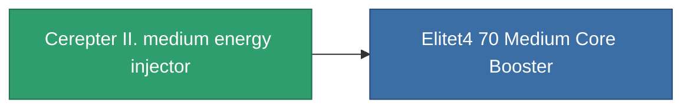

<!-- Generated by tools/generate from the live database (source: entitydefaults definition 827, aggregatevalues via aggregatefields).
     Do not edit by hand; regenerate instead. -->

# Cerepter II. medium energy injector

|  |  |
|---|---|
| Definição | `def_named3_medium_core_booster` |
| Nível | T4 |
| Vida | 100 |
| Volume | 1 |
| Massa | 200 |
| Categoria | Modules / Enhancements |
| Tier line | [Standard medium energy injector](/pt/content/items/standard-medium-core-booster/) (T1) → [Shoxit Parter I. medium energy injector](/pt/content/items/named1-medium-core-booster/) (T2) → [Follypsos medium energy injector](/pt/content/items/named2-medium-core-booster/) (T3) → **Cerepter II. medium energy injector** (T4) |

## Estatísticas

| Campo | Valor |
|---|---|
| core_usage | 0 |
| cpu_usage | 27 |
| cycle_time | 9k |
| powergrid_usage | 300 |

<!-- production:generated -->
## Produção

**Produzido a partir de 8 componentes, nível de pesquisa 7** — monte os componentes para construí-lo (lista completa em [Receitas](/pt/content/recipes/)):

**Plano:** [Cerepter II. medium energy injector CT](/pt/content/items/named3-medium-core-booster-cprg/)

<svg class="prod-card-icon" aria-hidden="true"><use href="#mi-grid"/></svg><a class="prod-card-name" href="/pt/content/items/axicol/">Cryoperine</a>

necessário: <b>200</b>

<svg class="prod-card-icon" aria-hidden="true"><use href="#mi-grid"/></svg><a class="prod-card-name" href="/pt/content/items/espitium/">Espitium</a>

necessário: <b>200</b>

<svg class="prod-card-icon" aria-hidden="true"><use href="#mi-grid"/></svg><a class="prod-card-name" href="/pt/content/items/named2-medium-core-booster/">Follypsos medium energy injector</a>

necessário: <b>1</b>

<svg class="prod-card-icon" aria-hidden="true"><use href="#mi-crystal"/></svg><a class="prod-card-name" href="/pt/content/items/robotshard-common-advanced/">Functional common fragment</a>

necessário: <b>60</b>

<svg class="prod-card-icon" aria-hidden="true"><use href="#mi-crystal"/></svg><a class="prod-card-name" href="/pt/content/items/robotshard-common-basic/">Damaged common fragment</a>

necessário: <b>30</b>

<svg class="prod-card-icon" aria-hidden="true"><use href="#mi-crystal"/></svg><a class="prod-card-name" href="/pt/content/items/robotshard-common-expert/">Perfect common fragment</a>

necessário: <b>90</b>

<svg class="prod-card-icon" aria-hidden="true"><use href="#mi-grid"/></svg><a class="prod-card-name" href="/pt/content/items/titanium/">Titanium</a>

necessário: <b>200</b>

<svg class="prod-card-icon" aria-hidden="true"><use href="#mi-grid"/></svg><a class="prod-card-name" href="/pt/content/items/unimetal/">Briochit</a>

necessário: <b>200</b>

## Usado em produção

**Componente de 1 itens** — tudo que o usa na produção:

