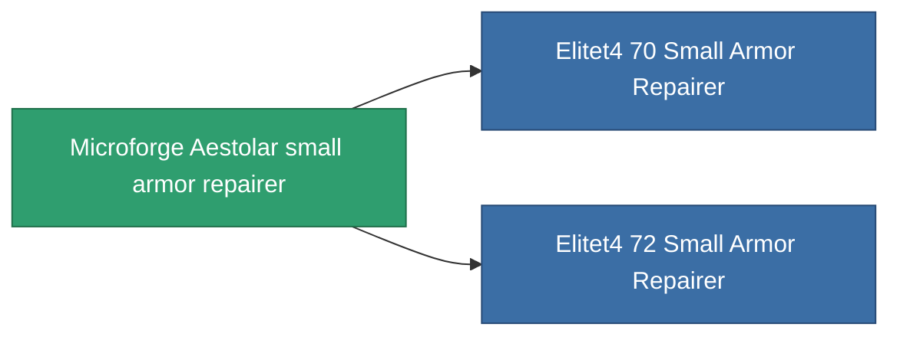

<!-- Generated by tools/generate from the live database (source: entitydefaults definition 695, aggregatevalues via aggregatefields).
     Do not edit by hand; regenerate instead. -->

# Microforge Aestolar small armor repairer

|  |  |
|---|---|
| Definição | `def_named3_small_armor_repairer` |
| Nível | T4 |
| Vida | 100 |
| Volume | 1 |
| Massa | 250 |
| Categoria | Modules / Repair |
| Tier line | [Standard small armor repairer](/pt/content/items/standard-small-armor-repairer/) (T1) → [A150 small armor repairer](/pt/content/items/named1-small-armor-repairer/) (T2) → [Quissot's small armor repairer](/pt/content/items/named2-small-armor-repairer/) (T3) → **Microforge Aestolar small armor repairer** (T4) |
| Nota | armor_hp += repair_amount * armor_repair_amount_modifier  rof = cycle_time * armor_repair_cycle_time_modifier   |

## Estatísticas

| Campo | Valor |
|---|---|
| armor_repair_amount | 75 |
| core_usage | 70 |
| cpu_usage | 40 |
| cycle_time | 12k |
| powergrid_usage | 27 |

<!-- production:generated -->
## Produção

**Produzido a partir de 9 componentes, nível de pesquisa 5** — monte os componentes para construí-lo (lista completa em [Receitas](/pt/content/recipes/)):

**Plano:** [Microforge Aestolar small armor repairer CT](/pt/content/items/named3-small-armor-repairer-cprg/)

<svg class="prod-card-icon" aria-hidden="true"><use href="#mi-grid"/></svg><a class="prod-card-name" href="/pt/content/items/alligior/">Alligior</a>

necessário: <b>200</b>

<svg class="prod-card-icon" aria-hidden="true"><use href="#mi-grid"/></svg><a class="prod-card-name" href="/pt/content/items/chollonin/">Chollonin</a>

necessário: <b>50</b>

<svg class="prod-card-icon" aria-hidden="true"><use href="#mi-grid"/></svg><a class="prod-card-name" href="/pt/content/items/espitium/">Espitium</a>

necessário: <b>50</b>

<svg class="prod-card-icon" aria-hidden="true"><use href="#mi-tree"/></svg><a class="prod-card-name" href="/pt/content/items/named2-small-armor-repairer/">Quissot's small armor repairer</a>

necessário: <b>1</b>

<svg class="prod-card-icon" aria-hidden="true"><use href="#mi-crystal"/></svg><a class="prod-card-name" href="/pt/content/items/robotshard-common-advanced/">Functional common fragment</a>

necessário: <b>30</b>

<svg class="prod-card-icon" aria-hidden="true"><use href="#mi-crystal"/></svg><a class="prod-card-name" href="/pt/content/items/robotshard-common-basic/">Damaged common fragment</a>

necessário: <b>15</b>

<svg class="prod-card-icon" aria-hidden="true"><use href="#mi-crystal"/></svg><a class="prod-card-name" href="/pt/content/items/robotshard-common-expert/">Perfect common fragment</a>

necessário: <b>45</b>

<svg class="prod-card-icon" aria-hidden="true"><use href="#mi-grid"/></svg><a class="prod-card-name" href="/pt/content/items/statichnol/">Statichnol</a>

necessário: <b>200</b>

<svg class="prod-card-icon" aria-hidden="true"><use href="#mi-grid"/></svg><a class="prod-card-name" href="/pt/content/items/unimetal/">Briochit</a>

necessário: <b>100</b>

## Usado em produção

**Componente de 2 itens** — tudo que o usa na produção:

