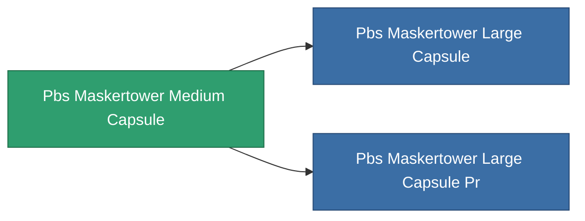

<!-- Generated by tools/generate from the live database (source: entitydefaults definition 4753, aggregatevalues via aggregatefields).
     Do not edit by hand; regenerate instead. -->

# Pbs Maskertower Medium Capsule

|  |  |
|---|---|
| Definição | `def_pbs_maskertower_medium_capsule` |
| Nível | T2 |
| Vida | 100 |
| Volume | 37 |
| Massa | 37000 |
| Categoria | Special & other / Miscellaneous |

## Estatísticas

| Campo | Valor |
|---|---|
| armor_max | 65k |
| core_max | 27.5k |
| resist_chemical | 75 |
| resist_explosive | 75 |
| resist_kinetic | 75 |
| resist_thermal | 75 |
| signature_radius | 25 |
| stealth_strength | 50 |

<!-- production:generated -->
## Produção

**Produzido a partir de 10 componentes** — monte os componentes para construí-lo (lista completa em [Receitas](/pt/content/recipes/)):

**Plano:** [Advanced masker foundation CT](/pt/content/items/pbs-maskertower-medium-capsule-cprg/)

<svg class="prod-card-icon" aria-hidden="true"><use href="#mi-grid"/></svg><a class="prod-card-name" href="/pt/content/items/axicol/">Cryoperine</a>

necessário: <b>250</b>

<svg class="prod-card-icon" aria-hidden="true"><use href="#mi-grid"/></svg><a class="prod-card-name" href="/pt/content/items/axicoline/">Axicoline</a>

necessário: <b>125</b>

<svg class="prod-card-icon" aria-hidden="true"><use href="#mi-grid"/></svg><a class="prod-card-name" href="/pt/content/items/espitium/">Espitium</a>

necessário: <b>500</b>

<svg class="prod-card-icon" aria-hidden="true"><use href="#mi-grid"/></svg><a class="prod-card-name" href="/pt/content/items/gamma-buildblock/">Coalimin</a>

necessário: <b>125</b>

<svg class="prod-card-icon" aria-hidden="true"><use href="#mi-grid"/></svg><a class="prod-card-name" href="/pt/content/items/gamma-energyblock/">Tiraizin</a>

necessário: <b>250</b>

<svg class="prod-card-icon" aria-hidden="true"><use href="#mi-grid"/></svg><a class="prod-card-name" href="/pt/content/items/gamma-offenseblock/">Turilium</a>

necessário: <b>125</b>

<svg class="prod-card-icon" aria-hidden="true"><use href="#mi-grid"/></svg><a class="prod-card-name" href="/pt/content/items/hydrobenol/">Hydrobenol</a>

necessário: <b>250</b>

<svg class="prod-card-icon" aria-hidden="true"><use href="#mi-home"/></svg><a class="prod-card-name" href="/pt/content/items/pbs-maskertower-small-capsule/">Pbs Maskertower Small Capsule</a>

necessário: <b>1</b>

<svg class="prod-card-icon" aria-hidden="true"><use href="#mi-grid"/></svg><a class="prod-card-name" href="/pt/content/items/titanium/">Titanium</a>

necessário: <b>125</b>

<svg class="prod-card-icon" aria-hidden="true"><use href="#mi-grid"/></svg><a class="prod-card-name" href="/pt/content/items/unimetal/">Briochit</a>

necessário: <b>250</b>

## Usado em produção

**Componente de 2 itens** — tudo que o usa na produção:

