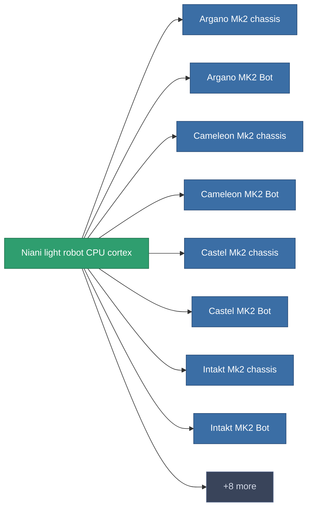

<!-- Generated by tools/generate from the live database (source: entitydefaults definition 2943, aggregatevalues via aggregatefields).
     Do not edit by hand; regenerate instead. -->

# Niani light robot CPU cortex

|  |  |
|---|---|
| Definição | `def_reactore_core_runner` |
| Nível | – |
| Vida | 100 |
| Volume | 0.5 |
| Massa | 1000 |
| Categoria | Materials |

_Sem estatísticas — este item não carrega valores agregados._

<!-- production:generated -->
## Usado em produção

**Componente de 16 itens** — uma amostra do que pode ser produzido com ele (lista completa em [Receitas](/pt/content/recipes/)).

