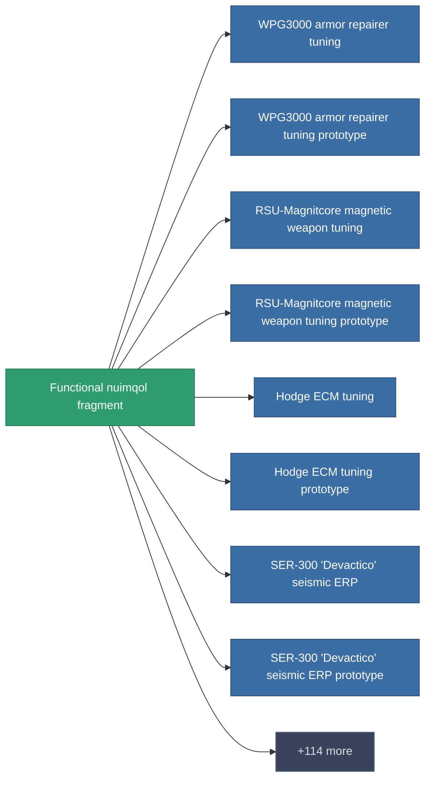

<!-- Generated by tools/generate from the live database (source: entitydefaults definition 1987, aggregatevalues via aggregatefields).
     Do not edit by hand; regenerate instead. -->

# Functional nuimqol fragment

|  |  |
|---|---|
| Definição | `def_robotshard_nuimqol_advanced` |
| Nível | – |
| Vida | 100 |
| Volume | 0.01 |
| Massa | 1 |
| Categoria | Materials |

_Sem estatísticas — este item não carrega valores agregados._

<!-- production:generated -->
## Produção

**Produzido a partir de 3 componentes** — monte os componentes para construí-lo (lista completa em [Receitas](/pt/content/recipes/)):

<svg class="prod-card-icon" aria-hidden="true"><use href="#mi-grid"/></svg><a class="prod-card-name" href="/pt/content/items/chollonin/">Chollonin</a>

necessário: <b>2</b>

<svg class="prod-card-icon" aria-hidden="true"><use href="#mi-grid"/></svg><a class="prod-card-name" href="/pt/content/items/polynitrocol/">Polynitrocol</a>

necessário: <b>2</b>

<svg class="prod-card-icon" aria-hidden="true"><use href="#mi-grid"/></svg><a class="prod-card-name" href="/pt/content/items/statichnol/">Statichnol</a>

necessário: <b>2</b>

## Usado em produção

**Componente de 122 itens** — uma amostra do que pode ser produzido com ele (lista completa em [Receitas](/pt/content/recipes/)).

