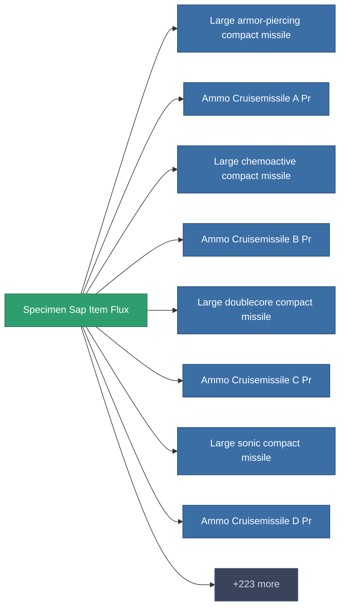

<!-- Generated by tools/generate from the live database (source: entitydefaults definition 5690, aggregatevalues via aggregatefields).
     Do not edit by hand; regenerate instead. -->

# Specimen Sap Item Flux

|  |  |
|---|---|
| Definição | `def_specimen_sap_item_flux` |
| Nível | – |
| Vida | 100 |
| Volume | 0.1 |
| Massa | 0.1 |
| Categoria | Materials |
| Nota | Specimen Item Material |

_Sem estatísticas — este item não carrega valores agregados._

<!-- production:generated -->
## Produção

**Produzido a partir de 1 componente** — monte os componentes para construí-lo (lista completa em [Receitas](/pt/content/recipes/)):

<svg class="prod-card-icon" aria-hidden="true"><use href="#mi-crystal"/></svg><a class="prod-card-name" href="/pt/content/ores/fluxore/">Fluxore</a>

necessário: <b>350</b>

## Usado em produção

**Componente de 231 itens** — uma amostra do que pode ser produzido com ele (lista completa em [Receitas](/pt/content/recipes/)).

