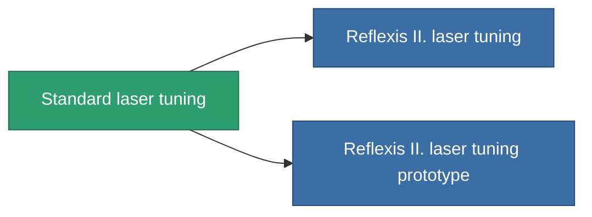

<!-- Generated by tools/generate from the live database (source: entitydefaults definition 911, aggregatevalues via aggregatefields).
     Do not edit by hand; regenerate instead. -->

# Standard laser tuning

|  |  |
|---|---|
| Definição | `def_standard_damage_mod_laser` |
| Nível | T1 |
| Vida | 100 |
| Volume | 0.5 |
| Massa | 100 |
| Categoria | Modules / Weapons |
| Tier line | **Standard laser tuning** (T1) → [Reflexis II. laser tuning](/pt/content/items/named1-damage-mod-laser/) (T2) → [Kauska Optibrace laser tuning](/pt/content/items/named2-damage-mod-laser/) (T3) → [Oqulus laser tuning](/pt/content/items/named3-damage-mod-laser/) (T4) |

## Estatísticas

| Campo | Valor |
|---|---|
| cpu_usage | 20 |
| damage_laser_modifier | 0.15 |
| powergrid_usage | 10 |

<!-- production:generated -->
## Produção

**Produzido a partir de 5 componentes, nível de pesquisa 3** — monte os componentes para construí-lo (lista completa em [Receitas](/pt/content/recipes/)):

**Plano:** [Standard laser tuning CT](/content/items/standard-damage-mod-laser-cprg/)

<svg class="prod-card-icon" aria-hidden="true"><use href="#mi-grid"/></svg><a class="prod-card-name" href="/pt/content/items/axicol/">Cryoperine</a>

necessário: <b>100</b>

<svg class="prod-card-icon" aria-hidden="true"><use href="#mi-grid"/></svg><a class="prod-card-name" href="/pt/content/items/axicoline/">Axicoline</a>

necessário: <b>50</b>

<svg class="prod-card-icon" aria-hidden="true"><use href="#mi-grid"/></svg><a class="prod-card-name" href="/pt/content/items/polynucleit/">Polynucleit</a>

necessário: <b>50</b>

<svg class="prod-card-icon" aria-hidden="true"><use href="#mi-grid"/></svg><a class="prod-card-name" href="/pt/content/items/prilumium/">Prilumium</a>

necessário: <b>100</b>

<svg class="prod-card-icon" aria-hidden="true"><use href="#mi-grid"/></svg><a class="prod-card-name" href="/pt/content/items/titanium/">Titanium</a>

necessário: <b>50</b>

## Usado em produção

**Componente de 2 itens** — tudo que o usa na produção:

