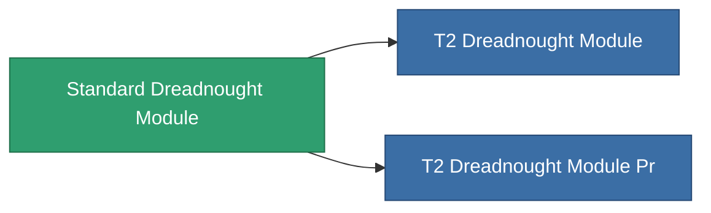

<!-- Generated by tools/generate from the live database (source: entitydefaults definition 8799, aggregatevalues via aggregatefields).
     Do not edit by hand; regenerate instead. -->

# Standard Dreadnought Module

|  |  |
|---|---|
| Definição | `def_standard_dreadnought_module` |
| Nível | T1 |
| Vida | 100 |
| Volume | 2.5 |
| Massa | 2000 |
| Categoria | Modules / Enhancements |
| Tier line | **Standard Dreadnought Module** (T1) → [T2 Dreadnought Module](/pt/content/items/named1-dreadnought-module/) (T2) → [T3 Dreadnought Module](/pt/content/items/named2-dreadnought-module/) (T3) → [T4 Dreadnought Module](/pt/content/items/named3-dreadnought-module/) (T4) |

## Estatísticas

| Campo | Valor |
|---|---|
| core_usage | 165 |
| cpu_usage | 450 |
| cycle_time | 180k |
| effect_dreadnought_blob_emission_modifier | 2 |
| effect_dreadnought_detection_strength_modifier | 150 |
| effect_dreadnought_optimal_range_modifier | 1.6 |
| effect_dreadnought_stealth_strength_modifier | -30 |
| effect_dreadnought_weapon_cycle_time_modifier | 0.9 |
| effect_dreadnought_weapon_damage_modifier | 1.3 |
| powergrid_usage | 1.35k |

<!-- production:generated -->
## Produção

**Produzido a partir de 2 componentes, nível de pesquisa 5** — monte os componentes para construí-lo (lista completa em [Receitas](/pt/content/recipes/)):

**Plano:** [Standard Dreadnought Module Cprg](/pt/content/items/standard-dreadnought-module-cprg/)

<svg class="prod-card-icon" aria-hidden="true"><use href="#mi-grid"/></svg><a class="prod-card-name" href="/pt/content/items/axicol/">Cryoperine</a>

necessário: <b>1.6k</b>

<svg class="prod-card-icon" aria-hidden="true"><use href="#mi-grid"/></svg><a class="prod-card-name" href="/pt/content/items/titanium/">Titanium</a>

necessário: <b>2.4k</b>

## Usado em produção

**Componente de 2 itens** — tudo que o usa na produção:

