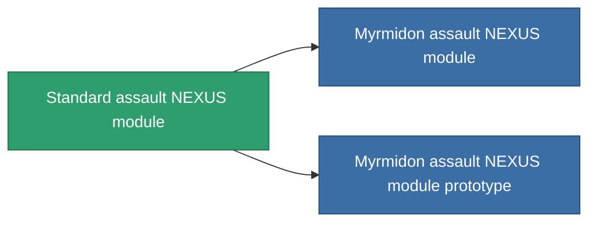

<!-- Generated by tools/generate from the live database (source: entitydefaults definition 876, aggregatevalues via aggregatefields).
     Do not edit by hand; regenerate instead. -->

# Standard assault NEXUS module

|  |  |
|---|---|
| Definição | `def_standard_gang_assist_siege_module` |
| Nível | T1 |
| Vida | 100 |
| Volume | 0.2 |
| Massa | 10 |
| Categoria | Modules / Enhancements |
| Tier line | **Standard assault NEXUS module** (T1) → [Myrmidon assault NEXUS module](/pt/content/items/named1-gang-assist-siege-module/) (T2) → [Mobba assault NEXUS module](/pt/content/items/named2-gang-assist-siege-module/) (T3) → ['Scorch' assault NEXUS module](/pt/content/items/named3-gang-assist-siege-module/) (T4) |
| Nota | weapon cycletime 1.0% / ext lvl |

## Estatísticas

| Campo | Valor |
|---|---|
| core_usage | 35 |
| cpu_usage | 85 |
| cycle_time | 10k |
| default_effect_range | 100 |
| effect_weapon_cycle_time_modifier | 0.98 |
| powergrid_usage | 35 |

<!-- production:generated -->
## Produção

**Produzido a partir de 5 componentes, nível de pesquisa 4** — monte os componentes para construí-lo (lista completa em [Receitas](/pt/content/recipes/)):

**Plano:** [Standard assault NEXUS module CT](/content/items/standard-gang-assist-siege-module-cprg/)

<svg class="prod-card-icon" aria-hidden="true"><use href="#mi-grid"/></svg><a class="prod-card-name" href="/pt/content/items/axicol/">Cryoperine</a>

necessário: <b>250</b>

<svg class="prod-card-icon" aria-hidden="true"><use href="#mi-grid"/></svg><a class="prod-card-name" href="/pt/content/items/axicoline/">Axicoline</a>

necessário: <b>50</b>

<svg class="prod-card-icon" aria-hidden="true"><use href="#mi-grid"/></svg><a class="prod-card-name" href="/pt/content/items/chollonin/">Chollonin</a>

necessário: <b>250</b>

<svg class="prod-card-icon" aria-hidden="true"><use href="#mi-grid"/></svg><a class="prod-card-name" href="/pt/content/items/polynitrocol/">Polynitrocol</a>

necessário: <b>50</b>

<svg class="prod-card-icon" aria-hidden="true"><use href="#mi-grid"/></svg><a class="prod-card-name" href="/pt/content/items/titanium/">Titanium</a>

necessário: <b>50</b>

## Usado em produção

**Componente de 2 itens** — tudo que o usa na produção:

