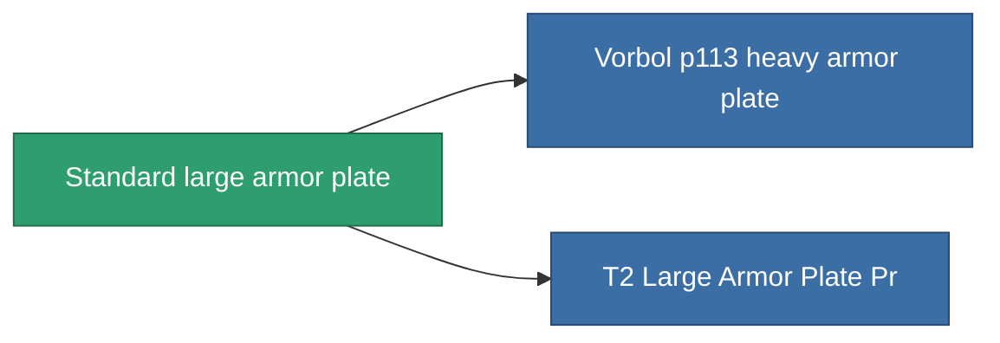

<!-- Generated by tools/generate from the live database (source: entitydefaults definition 17, aggregatevalues via aggregatefields).
     Do not edit by hand; regenerate instead. -->

# Standard large armor plate

|  |  |
|---|---|
| Definição | `def_standard_large_armor_plate` |
| Nível | T1 |
| Vida | 100 |
| Volume | 4 |
| Massa | 9000 |
| Categoria | Modules / Armor |
| Tier line | **Standard large armor plate** (T1) → [Vorbol p113 heavy armor plate](/pt/content/items/named1-large-armor-plate/) (T2) → [Invigor III. heavy armor plate](/pt/content/items/named2-large-armor-plate/) (T3) → [Halc heavy armor plate](/pt/content/items/named3-large-armor-plate/) (T4) |

## Estatísticas

| Campo | Valor |
|---|---|
| armor_max | 4.05k |
| cpu_usage | 60 |
| massiveness | 0.144 |
| powergrid_usage | 1.05k |
| signature_radius | 3 |

<!-- production:generated -->
## Produção

**Produzido a partir de 3 componentes** — monte os componentes para construí-lo (lista completa em [Receitas](/pt/content/recipes/)):

**Plano:** [Standard Large Armor Plate Cprg](/pt/content/items/standard-large-armor-plate-cprg/)

<svg class="prod-card-icon" aria-hidden="true"><use href="#mi-grid"/></svg><a class="prod-card-name" href="/pt/content/items/plasteosine/">Plasteosine</a>

necessário: <b>1.1k</b>

<svg class="prod-card-icon" aria-hidden="true"><use href="#mi-grid"/></svg><a class="prod-card-name" href="/pt/content/items/specimen-sap-item-flux/">Specimen Sap Item Flux</a>

necessário: <b>15</b>

<svg class="prod-card-icon" aria-hidden="true"><use href="#mi-grid"/></svg><a class="prod-card-name" href="/pt/content/items/titanium/">Titanium</a>

necessário: <b>750</b>

## Usado em produção

**Componente de 2 itens** — tudo que o usa na produção:

