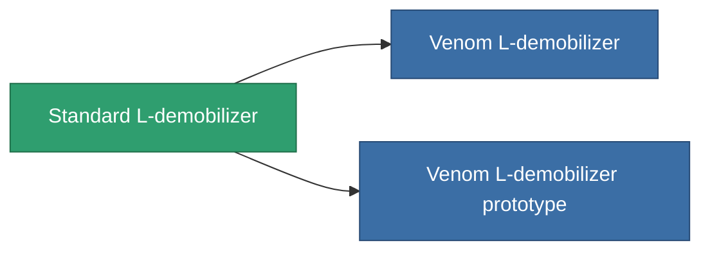

<!-- Generated by tools/generate from the live database (source: entitydefaults definition 3514, aggregatevalues via aggregatefields).
     Do not edit by hand; regenerate instead. -->

# Standard L-demobilizer

|  |  |
|---|---|
| Definição | `def_standard_longrange_webber` |
| Nível | T1 |
| Vida | 100 |
| Volume | 0.5 |
| Massa | 100 |
| Categoria | Modules / Enhancements |
| Tier line | **Standard L-demobilizer** (T1) → [Venom L-demobilizer](/pt/content/items/named1-longrange-webber/) (T2) → [GLOO L-demobilizer](/pt/content/items/named2-longrange-webber/) (T3) → [TDR25 L-demobilizer](/pt/content/items/named3-longrange-webber/) (T4) |

## Estatísticas

| Campo | Valor |
|---|---|
| core_usage | 35 |
| cpu_usage | 55 |
| cycle_time | 5k |
| effect_massivness_speed_max_modifier | 0.99 |
| falloff | 0 |
| optimal_range | 25 |
| powergrid_usage | 15 |

<!-- production:generated -->
## Produção

**Produzido a partir de 3 componentes, nível de pesquisa 6** — monte os componentes para construí-lo (lista completa em [Receitas](/pt/content/recipes/)):

**Plano:** [Standard L-demobilizer CT](/pt/content/items/standard-longrange-webber-cprg/)

<svg class="prod-card-icon" aria-hidden="true"><use href="#mi-grid"/></svg><a class="prod-card-name" href="/pt/content/items/axicol/">Cryoperine</a>

necessário: <b>500</b>

<svg class="prod-card-icon" aria-hidden="true"><use href="#mi-grid"/></svg><a class="prod-card-name" href="/pt/content/items/axicoline/">Axicoline</a>

necessário: <b>150</b>

<svg class="prod-card-icon" aria-hidden="true"><use href="#mi-grid"/></svg><a class="prod-card-name" href="/pt/content/items/titanium/">Titanium</a>

necessário: <b>100</b>

## Usado em produção

**Componente de 2 itens** — tudo que o usa na produção:

