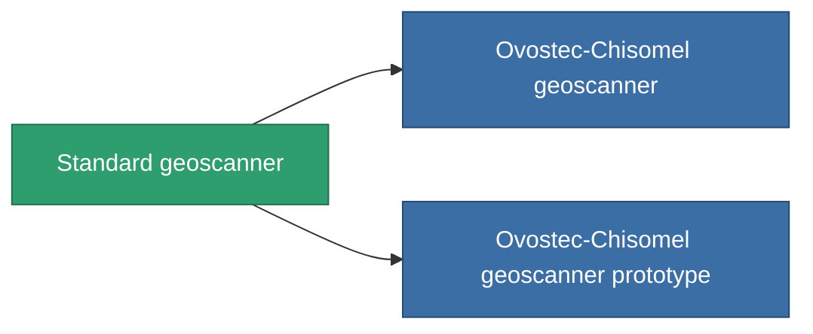

<!-- Generated by tools/generate from the live database (source: entitydefaults definition 228, aggregatevalues via aggregatefields).
     Do not edit by hand; regenerate instead. -->

# Standard geoscanner

|  |  |
|---|---|
| Definição | `def_standard_mining_probe_module` |
| Nível | T1 |
| Vida | 100 |
| Volume | 1 |
| Massa | 200 |
| Categoria | Modules / Enhancements |
| Tier line | **Standard geoscanner** (T1) → [Ovostec-Chisomel geoscanner](/pt/content/items/named1-mining-probe-module/) (T2) → [Syverz geoscanner](/pt/content/items/named2-mining-probe-module/) (T3) → [Eksplor-q3000 geoscanner](/pt/content/items/named3-mining-probe-module/) (T4) |

## Estatísticas

| Campo | Valor |
|---|---|
| core_usage | 60 |
| cpu_usage | 45 |
| cycle_time | 15k |
| mining_probe_accuracy | 0.5 |
| powergrid_usage | 50 |

<!-- production:generated -->
## Produção

**Produzido a partir de 2 componentes, nível de pesquisa 1** — monte os componentes para construí-lo (lista completa em [Receitas](/pt/content/recipes/)):

**Plano:** [Standard geoscanner CT](/pt/content/items/standard-mining-probe-module-cprg/)

<svg class="prod-card-icon" aria-hidden="true"><use href="#mi-grid"/></svg><a class="prod-card-name" href="/pt/content/items/axicol/">Cryoperine</a>

necessário: <b>350</b>

<svg class="prod-card-icon" aria-hidden="true"><use href="#mi-grid"/></svg><a class="prod-card-name" href="/pt/content/items/titanium/">Titanium</a>

necessário: <b>50</b>

## Usado em produção

**Componente de 2 itens** — tudo que o usa na produção:

