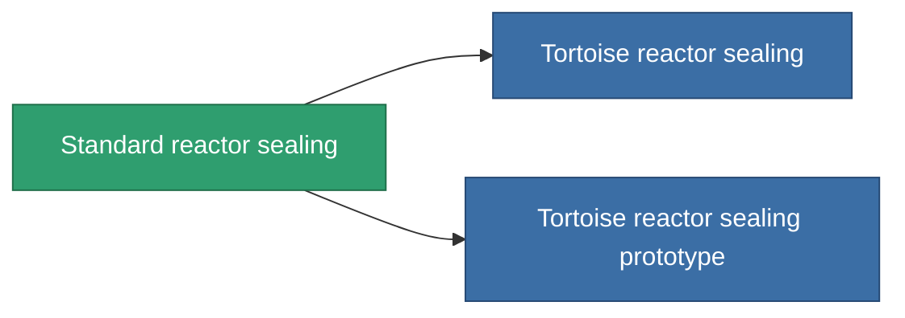

<!-- Generated by tools/generate from the live database (source: entitydefaults definition 4576, aggregatevalues via aggregatefields).
     Do not edit by hand; regenerate instead. -->

# Standard reactor sealing

|  |  |
|---|---|
| Definição | `def_standard_reactor_sealing` |
| Nível | T1 |
| Vida | 100 |
| Volume | 1 |
| Massa | 150 |
| Categoria | Modules / Enhancements |
| Tier line | **Standard reactor sealing** (T1) → [Tortoise reactor sealing](/pt/content/items/named1-reactor-sealing/) (T2) → [GRIP-250 reactor sealing](/pt/content/items/named2-reactor-sealing/) (T3) → [GRIP-500p reactor sealing](/pt/content/items/named3-reactor-sealing/) (T4) |

## Estatísticas

| Campo | Valor |
|---|---|
| cpu_usage | 15 |
| powergrid_usage | 75 |
| reactor_radiation_modifier | 0.75 |

<!-- production:generated -->
## Produção

**Produzido a partir de 3 componentes, nível de pesquisa 3** — monte os componentes para construí-lo (lista completa em [Receitas](/pt/content/recipes/)):

**Plano:** [Standard reactor sealing CT](/pt/content/items/standard-reactor-sealing-cprg/)

<svg class="prod-card-icon" aria-hidden="true"><use href="#mi-grid"/></svg><a class="prod-card-name" href="/pt/content/items/axicol/">Cryoperine</a>

necessário: <b>150</b>

<svg class="prod-card-icon" aria-hidden="true"><use href="#mi-grid"/></svg><a class="prod-card-name" href="/pt/content/items/plasteosine/">Plasteosine</a>

necessário: <b>250</b>

<svg class="prod-card-icon" aria-hidden="true"><use href="#mi-grid"/></svg><a class="prod-card-name" href="/pt/content/items/titanium/">Titanium</a>

necessário: <b>100</b>

## Usado em produção

**Componente de 2 itens** — tudo que o usa na produção:

