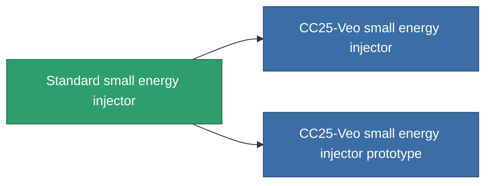

<!-- Generated by tools/generate from the live database (source: entitydefaults definition 648, aggregatevalues via aggregatefields).
     Do not edit by hand; regenerate instead. -->

# Standard small energy injector

|  |  |
|---|---|
| Definição | `def_standard_small_core_booster` |
| Nível | T1 |
| Vida | 100 |
| Volume | 0.5 |
| Massa | 100 |
| Categoria | Modules / Enhancements |
| Tier line | **Standard small energy injector** (T1) → [CC25-Veo small energy injector](/pt/content/items/named1-small-core-booster/) (T2) → [Joffret-Refiller small energy injector](/pt/content/items/named2-small-core-booster/) (T3) → [Cerepter I. small energy injector](/pt/content/items/named3-small-core-booster/) (T4) |

## Estatísticas

| Campo | Valor |
|---|---|
| core_usage | 0 |
| cpu_usage | 20 |
| cycle_time | 20k |
| powergrid_usage | 50 |

<!-- production:generated -->
## Produção

**Produzido a partir de 2 componentes, nível de pesquisa 2** — monte os componentes para construí-lo (lista completa em [Receitas](/pt/content/recipes/)):

**Plano:** [Standard small energy injector CT](/pt/content/items/standard-small-core-booster-cprg/)

<svg class="prod-card-icon" aria-hidden="true"><use href="#mi-grid"/></svg><a class="prod-card-name" href="/pt/content/items/axicol/">Cryoperine</a>

necessário: <b>100</b>

<svg class="prod-card-icon" aria-hidden="true"><use href="#mi-grid"/></svg><a class="prod-card-name" href="/pt/content/items/titanium/">Titanium</a>

necessário: <b>100</b>

## Usado em produção

**Componente de 2 itens** — tudo que o usa na produção:

