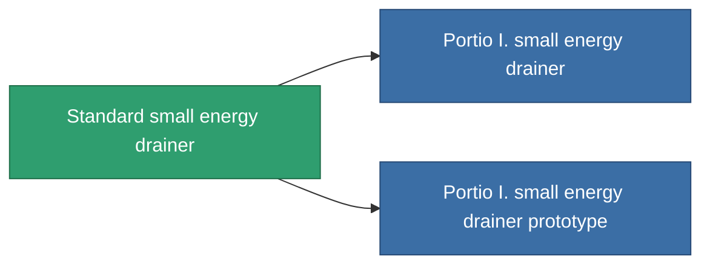

<!-- Generated by tools/generate from the live database (source: entitydefaults definition 35, aggregatevalues via aggregatefields).
     Do not edit by hand; regenerate instead. -->

# Standard small energy drainer

|  |  |
|---|---|
| Definição | `def_standard_small_energy_vampire` |
| Nível | T1 |
| Vida | 100 |
| Volume | 0.5 |
| Massa | 100 |
| Categoria | Modules / Shield |
| Tier line | **Standard small energy drainer** (T1) → [Portio I. small energy drainer](/pt/content/items/named1-small-energy-vampire/) (T2) → [Ekcept small energy drainer](/pt/content/items/named2-small-energy-vampire/) (T3) → [Io-trail SVU small energy drainer](/pt/content/items/named3-small-energy-vampire/) (T4) |
| Nota | range = optimal_range *  energy_transferers_optimal_range_modifier    cel core -= energy_vampired_amount  sajat core += energy_vampired_amount    csak akkor mukodik ha a cel coreja nagyobb mint a tied. |

## Estatísticas

| Campo | Valor |
|---|---|
| core_usage | 5 |
| cpu_usage | 45 |
| cycle_time | 8k |
| energy_dispersion | 4 |
| energy_vampired_amount | 20 |
| falloff | 0 |
| optimal_range | 12.5 |
| powergrid_usage | 35 |

<!-- production:generated -->
## Produção

**Produzido a partir de 3 componentes, nível de pesquisa 2** — monte os componentes para construí-lo (lista completa em [Receitas](/pt/content/recipes/)):

**Plano:** [Standard small energy drainer CT](/pt/content/items/standard-small-energy-vampire-cprg/)

<svg class="prod-card-icon" aria-hidden="true"><use href="#mi-grid"/></svg><a class="prod-card-name" href="/pt/content/items/axicol/">Cryoperine</a>

necessário: <b>200</b>

<svg class="prod-card-icon" aria-hidden="true"><use href="#mi-grid"/></svg><a class="prod-card-name" href="/pt/content/items/axicoline/">Axicoline</a>

necessário: <b>100</b>

<svg class="prod-card-icon" aria-hidden="true"><use href="#mi-grid"/></svg><a class="prod-card-name" href="/pt/content/items/titanium/">Titanium</a>

necessário: <b>100</b>

## Usado em produção

**Componente de 2 itens** — tudo que o usa na produção:

