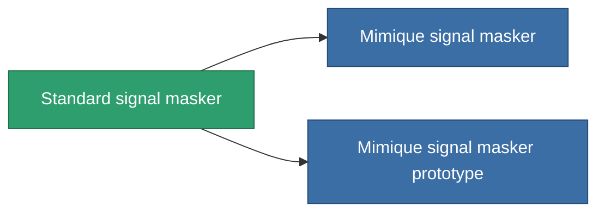

<!-- Generated by tools/generate from the live database (source: entitydefaults definition 2897, aggregatevalues via aggregatefields).
     Do not edit by hand; regenerate instead. -->

# Standard signal masker

|  |  |
|---|---|
| Definição | `def_standard_stealth_modul` |
| Nível | T1 |
| Vida | 100 |
| Volume | 0.5 |
| Massa | 250 |
| Categoria | Modules / Enhancements |
| Tier line | **Standard signal masker** (T1) → [Mimique signal masker](/pt/content/items/named1-stealth-modul/) (T2) → [MSMD signal masker](/pt/content/items/named2-stealth-modul/) (T3) → [Longlag signal masker](/pt/content/items/named3-stealth-modul/) (T4) |

## Estatísticas

| Campo | Valor |
|---|---|
| core_usage | 2 |
| cpu_usage | 100 |
| cycle_time | 10k |
| effect_stealth_strength_modifier | 35 |
| powergrid_usage | 5 |

<!-- production:generated -->
## Produção

**Produzido a partir de 3 componentes, nível de pesquisa 6** — monte os componentes para construí-lo (lista completa em [Receitas](/pt/content/recipes/)):

**Plano:** [Standard signal masker CT](/content/items/standard-stealth-modul-cprg/)

<svg class="prod-card-icon" aria-hidden="true"><use href="#mi-grid"/></svg><a class="prod-card-name" href="/pt/content/items/axicol/">Cryoperine</a>

necessário: <b>450</b>

<svg class="prod-card-icon" aria-hidden="true"><use href="#mi-grid"/></svg><a class="prod-card-name" href="/pt/content/items/plasteosine/">Plasteosine</a>

necessário: <b>50</b>

<svg class="prod-card-icon" aria-hidden="true"><use href="#mi-grid"/></svg><a class="prod-card-name" href="/pt/content/items/titanium/">Titanium</a>

necessário: <b>200</b>

## Usado em produção

**Componente de 2 itens** — tudo que o usa na produção:

