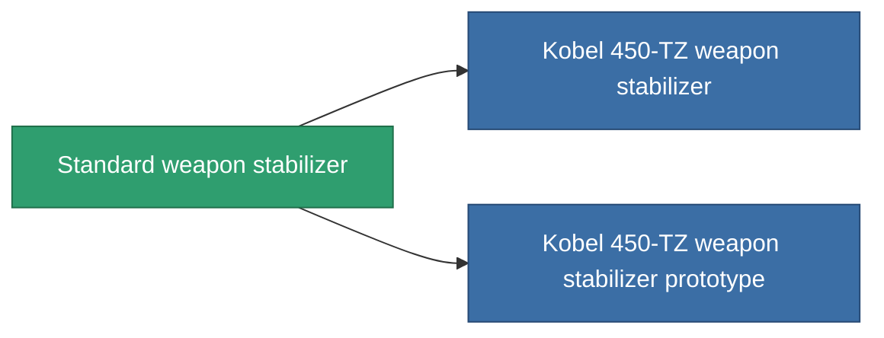

<!-- Generated by tools/generate from the live database (source: entitydefaults definition 3257, aggregatevalues via aggregatefields).
     Do not edit by hand; regenerate instead. -->

# Standard weapon stabilizer

|  |  |
|---|---|
| Definição | `def_standard_weapon_stabilizer` |
| Nível | T1 |
| Vida | 100 |
| Volume | 1 |
| Massa | 500 |
| Categoria | Modules / Weapons |
| Tier line | **Standard weapon stabilizer** (T1) → [Kobel 450-TZ weapon stabilizer](/pt/content/items/named1-weapon-stabilizer/) (T2) → [Sharpsy weapon stabilizer](/pt/content/items/named2-weapon-stabilizer/) (T3) → [Kobel 300-XZ weapon stabilizer](/pt/content/items/named3-weapon-stabilizer/) (T4) |

## Estatísticas

| Campo | Valor |
|---|---|
| accuracy_modifier | 0.9 |
| cpu_usage | 35 |
| explosion_radius_modifier | 0.9 |
| massiveness | -0.05 |
| powergrid_usage | 20 |

<!-- production:generated -->
## Produção

**Produzido a partir de 3 componentes, nível de pesquisa 4** — monte os componentes para construí-lo (lista completa em [Receitas](/pt/content/recipes/)):

**Plano:** [Standard weapon stabilizer CT](/pt/content/items/standard-weapon-stabilizer-cprg/)

<svg class="prod-card-icon" aria-hidden="true"><use href="#mi-grid"/></svg><a class="prod-card-name" href="/pt/content/items/axicol/">Cryoperine</a>

necessário: <b>350</b>

<svg class="prod-card-icon" aria-hidden="true"><use href="#mi-grid"/></svg><a class="prod-card-name" href="/pt/content/items/axicoline/">Axicoline</a>

necessário: <b>150</b>

<svg class="prod-card-icon" aria-hidden="true"><use href="#mi-grid"/></svg><a class="prod-card-name" href="/pt/content/items/titanium/">Titanium</a>

necessário: <b>150</b>

## Usado em produção

**Componente de 2 itens** — tudo que o usa na produção:

