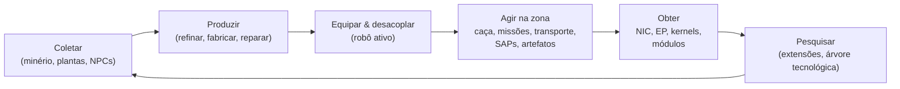

# O Que Você Pode Fazer no Jogo

Todas as ações dos jogadores, organizadas por sistema. O nome do comando é o
identificador do lado do servidor — o cliente apresenta essas ações em sua própria interface. O texto detalhado
de cada ação encontra-se nas páginas individuais de cada sistema.

O jogo em um único ciclo: obtenha recursos e invista para subir na escala de níveis tecnológicos.

## Sistemas

| Sistema | Página | O que abrange |
|---|---|---|
| Primeiros passos | [getting-started](/pt/features/getting-started/) | criação/seleção de personagens, primeiro robô, conceitos básicos da conta |
| Movimentação | [movement](/pt/features/movement/) | zonas, acoplagem, fila, teletransportes, saltos de centelha, portais |
| Coleta | [gathering](/pt/features/gathering/) | escaneamento, colheita, coleta de recursos |
| Combate | [combat](/pt/features/combat/) | batalhas, tipos de dano, interferência, alarmes, relatórios de eliminação, SOS |
| NPCs e caça PVE | [npcs](/pt/features/npcs/) | patentes e facções de NPCs, fraquezas, tipos de spawn, TAPs, táticas |
| Exploração | [exploration](/pt/features/exploration/) | artefatos e relíquias |
| Robôs e equipagem | [robots](/pt/features/robots/) | seleção de robôs, módulos, munição, predefinições, tonalidades |
| Módulos e equipagem | [modules](/pt/features/modules/) | famílias de módulos e regras práticas de equipagem |
| Centelhas | [sparks](/pt/features/sparks/) | autorização de centelhas, troca, bônus de habilidades |
| Pesquisa | [research](/pt/features/research/) | extensões (árvore de habilidades), EP, árvore tecnológica |
| Personagem | [character](/pt/features/character/) | janela de personagem: aba de extensões (árvore de habilidades) e centelhas |
| Produção | [production](/pt/features/production/) | linhas de produção, refino, reparo, reprocessamento, protótipos, CPRG |
| Mercado e comércio | [market](/pt/features/market/) | ordens de mercado, trocas diretas, loja de itens, créditos |
| Grupos | [groups](/pt/features/groups/) | corporações, alianças, gangues (frotas) |
| Estações-base de energia (PBS) | [pbs](/pt/features/pbs/) | estruturas PBS, territórios, conexões |
| Missões | [missions](/pt/features/missions/) | missões de campo, agentes, terminais |
| Transporte | [transport](/pt/features/transport/) | envio de itens entre bases |
| Itens e inventário | [items](/pt/features/items/) | contêineres, empilhamento, nomes de itens, resgatáveis, pacotes de brindes |
| Social | [social](/pt/features/social/) | correio, canais, amigos, reputações, páginas amarelas, notícias, enquetes |
| Intrusão | [intrusion](/pt/features/intrusion/) | o modo de assalto a instalações de NPCs |
| Postos avançados e SAP | [outposts](/pt/features/outposts/) | posse de postos avançados, estabilidade, os quatro tipos de SAP |
| Sondas de proximidade | [probes](/pt/features/probes/) | sondas de vigilância de zona |
| Servidor e referência | [server](/pt/features/server/) | informações do servidor, recordes, dados de referência, compras |
| Perguntas frequentes (FAQ) | [faq](/pt/features/faq/) | o tutorial, escolha de facção, primeiros passos, jargões |
| História do universo | [lore](/pt/features/lore/) | o cenário: Nia, os Nians, o Sindicato |
| Configuração do cliente e PC | [client-setup](/pt/features/client-setup/) | execução do cliente, multi-boxing, dimensionamento de interface |

### Referência

| Página | O que abrange |
|---|---|
| [Visão geral da interface do cliente](/pt/features/ui/) | A interface no estilo EVE: barra superior, botão Mobilizar/Acoplar, categorias de ação, painel de status desacoplado e as convenções usadas nesta wiki |

Tabelas com atributos de entidades encontram-se na seção gerada de [Conteúdo](/content/).

## Inventário Completo de Ações

### Primeiros passos e conta

| Ação | Comando |
|---|---|
| Criar um personagem | `characterCreate` |
| Selecionar (jogar com) um personagem | `characterSelect` |
| Excluir um personagem | `characterDelete` |
| Renomear um personagem | `characterRename` |
| Verificar disponibilidade de nome | `characterCheckNick` |
| Solicitar o robô inicial | `requestStarterRobot` |
| Solicitar a caixa inicial | `requestInfiniteBox` |
| Dados de configuração de novo personagem | `characterWizardData` |
| Visualizar meu perfil | `characterGetMyProfile` |
| Visualizar perfil de outros personagens | `characterGetProfiles` |
| Procurar personagens | `characterSearch` |
| Listar personagens | `characterList` |
| Obter/definir configurações do personagem | `characterSettingsGet`, `characterSettingsSet` |
| Definir avatar | `characterSetAvatar` |
| Definir mensagem de status/humor | `characterSetMoodmessage` |
| Definir nota privada em um personagem | `characterSetNote` / `characterGetNote` |
| Definir / limpar base principal | `characterSetHomeBase`, `characterClearHomeBase` |
| Transferir créditos entre personagens próprios | `characterTransferCredit` |
| Bloquear/permitir trocas em um personagem | `characterSetBlockTrades` |
| Alterar e-mail / senha da conta | `changeSessionEmail`, `changeSessionPassword` |
| Ver histórico de EP por atividade | `accountEpForActivityHistory` |
| Ver histórico de transações da conta | `accountGetTransactionHistory` |
| Desconectar / manutenção de conexão | `signOut`, `connectionStart`, `connectionEnd`, `ping`, `quit`, `isOnline`, `transferData`, `welcome` |
| Quem está online | `getCharactersOnline`, `getAccountsWithCharacters` |
| Históricos do personagem | `characterNickHistory`, `characterCorporationHistory`, `characterTransactionHistory`, `characterListNpcDeath` |

### Movimentação e zonas

| Ação | Comando |
|---|---|
| Acoplar a uma base / PBS | `dock` |
| Desacoplar | `undock` |
| Acoplagem forçada (emergência) | `forceDock` |
| Consultar fila de entrada na zona | `zoneGetQueueInfo` |
| Definir preferência de tamanho da fila | `zoneSetQueueLength` |
| Cancelar espera na fila | `zoneCancelEnterQueue` |
| Obter informações da zona | `getZoneInfo` |
| Listar setores de uma zona | `zoneSectorList` |
| Listar edifícios da zona | `zoneGetBuildings` |
| Enviar SOS (pedido de socorro) | `zoneSOS` |
| Listar teletransportes disponíveis | `teleportList` |
| Usar um teletransporte | `teleportUse` |
| Teletransportar para um objeto da zona | `teleportToZoneObject` |
| Listar canais de teletransporte | `teleportGetChannelList` |
| Consultar canais de teletransporte globais | `teleportQueryWorldChannels` |
| Listar cargas de centelha | `sparkList` |
| Alterar centelha ativa | `sparkChange` |
| Remover uma centelha | `sparkRemove` |
| Desbloquear uma centelha | `sparkUnlock` |
| Listar / definir / usar / excluir teletransportes de centelha | `sparkTeleportList`, `sparkTeleportSet`, `sparkTeleportUse`, `sparkTeleportDelete` |
| Renomear um portal | `gateSetName` |
| Informações da base / propriedade / instalações / meus itens na base | `baseGetInfo`, `baseGetOwnershipInfo`, `baseListFacilities`, `baseGetMyItems` |
| Definir permissões de acoplagem na base | `baseSetDockingRights` |

### Coleta e escaneamento

| Ação | Comando |
|---|---|
| Escanear a zona (minério/planta/dispositivos instaláveis) | `zoneUploadScanResult` |
| Listar meus resultados de escaneamento mineral | `mineralScanResultList` |
| Criar um item a partir de um resultado de escaneamento | `mineralScanResultCreateItem` |
| Excluir um resultado de escaneamento | `mineralScanResultDelete` |
| Mover resultados de escaneamento entre contêineres | `mineralScanResultMove` |
| Enviar dados de escaneamento a partir de um item | `mineralScanResultUploadFromItem` |
| Contar itens em uma zona (verificação de visibilidade) | `itemCountOnZone`, `itemCount` |
| Quiosque: visualizar / entregar itens | `kioskInfo`, `kioskSubmitItem` |
| Usar um item (genérico — incluindo colhíveis) | `useItem` |

### Combate

| Ação | Comando |
|---|---|
| Acionar / desativar alarme de combate | `alarmStart` (o término do alarme é determinado pelo servidor) |
| Visualizar meus relatórios de eliminação | `getMyKillReports` |
| Visualizar meus recordes | `getMyHighScores` |
| Visualizar recordes do servidor | `getHighScores` |

### Robôs e equipagem

| Ação | Comando |
|---|---|
| Selecionar robô ativo | `selectActiveRobot` |
| Esvaziar um robô (descarregar tudo) | `robotEmpty` |
| Obter informações do robô | `getRobotInfo` |
| Obter informações de equipagem do robô | `getRobotFittingInfo` |
| Equipar um módulo | `equipModule` |
| Remover um módulo | `removeModule` |
| Trocar módulos | `changeModule` |
| Equipar munição | `equipAmmo` |
| Trocar munição | `changeAmmo` |
| Desequipar munição | `unEquipAmmo` |
| Definir tonalidade do robô | `setRobotTint` |
| Salvar / listar / aplicar / excluir predefinições de equipagem | `fittingPresetSave`, `fittingPresetList`, `fittingPresetApply`, `fittingPresetDelete` |

### Pesquisa (extensões e árvore tecnológica)

| Ação | Comando |
|---|---|
| Listar categorias de extensões | `extensionCategoryList` |
| Obter todas as extensões | `extensionGetAll` |
| Listar extensões aprendidas | `extensionLearntList` |
| Listar pré-requisitos | `extensionPrerequireList` |
| Comprar uma extensão com pontos | `extensionBuyForPoints` |
| Comprar um impulso de EP | `extensionBuyEpBoost` |
| Obter pontos disponíveis | `extensionGetAvailablePoints` |
| Obter parâmetros de pontos | `extensionGetPointParameters` |
| Histórico de extensões | `extensionHistory` |
| Remover um nível de extensão | `extensionRemoveLevel` |
| Redefinir extensões do personagem | `extensionResetCharacter` |
| Liberar EP bloqueado | `extensionFreeLockedEp` |
| Ver registro diário de EP por atividade | `epForActivityDailyLog` |
| Obter níveis de pesquisa | `getResearchLevels` |
| Árvore tecnológica: pesquisar um nó | `techTreeResearch` |
| Árvore tecnológica: desbloquear um nó | `techTreeUnlock` |
| Árvore tecnológica: doar | `techTreeDonate` |
| Árvore tecnológica: informações / registros | `techTreeInfo`, `techTreeGetLogs` |

### Produção

| Ação | Comando |
|---|---|
| Listar linhas de produção | `productionLineList` |
| Iniciar uma linha | `productionLineStart` |
| Calibrar uma linha | `productionLineCalibrate` |
| Definir ciclos em uma linha | `productionLineSetRounds` |
| Excluir uma linha | `productionLineDelete` |
| Consultar próximo ciclo de uma linha | `productionQueryLineNextRound` |
| Cancelar produção | `productionCancel` |
| Refinar (consultar + executar) | `productionRefine`, `productionRefineQuery` |
| Reparar (consultar + executar) | `productionRepair`, `productionRepairQuery` |
| Reprocessar (consultar + executar) | `productionReprocess`, `productionReprocessQuery` |
| Pesquisar componentes (consultar + executar) | `productionResearch`, `productionResearchQuery` |
| Prototipar (iniciar + consultar) | `productionPrototypeStart`, `productionPrototypeQuery` |
| Mesclar kits de pesquisa (executar + consultar) | `productionMergeResearchKitsMulti`, `productionMergeResearchKitsMultiQuery` |
| Forjar CPRG (executar + consultar) | `productionCPRGForge`, `productionCPRGForgeQuery` |
| Informações de CPRG | `productionCPRGInfo` |
| Obter CPRG de uma linha (obter + consultar) | `productionGetCPRGFromLine`, `productionGetCPRGFromLineQuery` |
| Seguro de produção: comprar / listar / consultar / excluir | `productionInsuranceBuy`, `productionInsuranceList`, `productionInsuranceQuery`, `productionInsuranceDelete` |
| Listar componentes de produção | `productionComponentsList` |
| Informações / descrição da instalação | `productionFacilityInfo`, `productionFacilityDescription` |
| O que está em andamento (próprio / corporação) | `productionInProgress`, `productionInProgressCorporation` |
| Histórico de produção | `productionHistory` |
| Informações do servidor de produção | `productionServerInfo` |

### Mercado e comércio

| Ação | Comando |
|---|---|
| Criar uma ordem de venda | `marketCreateSellOrder` |
| Criar uma ordem de compra | `marketCreateBuyOrder` |
| Modificar uma ordem | `marketModifyOrder` |
| Cancelar um item / ordem | `marketCancelItem` |
| Comprar um item diretamente | `marketBuyItem` |
| Listar itens do mercado | `marketItemList` |
| Listar itens disponíveis para mim | `marketAvailableItems` |
| Listar itens dentro de um alcance | `marketItemsInRange` |
| Listar meus itens no mercado | `marketGetMyItems` |
| Informações do mercado | `marketGetInfo` |
| Preços médios (mercado / definição / global) | `marketGetAveragePrices`, `marketGetDefinitionAveragePrice`, `marketGlobalAveragePrices` |
| Alterar taxa de mercado / ver registro de taxas | `marketTaxChange`, `marketTaxLogList` |
| Iniciar uma troca | `tradeBegin` |
| Definir / retirar minha oferta | `tradeSetOffer`, `tradeRetractOffer` |
| Aceitar uma troca | `tradeAccept` |
| Cancelar uma troca | `tradeCancel` |
| Troca concluída / estado | `tradeFinished`, `tradeState` |
| Loja de itens: listar / comprar | `itemShopList`, `itemShopBuy` |
| Transferir créditos para outro personagem | `characterTransferCredit` |

### Grupos (corporações, alianças, gangues)

| Ação | Comando |
|---|---|
| Criar uma corporação | `corporationCreate` |
| Candidatar-se a / convidar para uma corporação | `corporationApply`, `corporationCharacterInvite` |
| Aceitar candidatura / listar candidaturas | `corporationAcceptApplication`, `corporationListApplications` |
| Minhas candidaturas: listar / excluir | `corporationListMyApplications`, `corporationDeleteMyApplication` |
| Excluir uma candidatura (oficial) | `corporationDeleteApplication` |
| Responder a convite | `corporationInviteReply` |
| Sair / cancelar saída | `corporationLeave`, `corporationCancelLeave` |
| Remover um membro / definir cargo de membro | `corporationRemoveMember`, `corporationSetMemberRole` |
| Renunciar a todos os meus cargos | `corporationDropRoles` |
| Definir membros como neutros | `corporationSetMembersNeutral` |
| Informações da corporação / minhas informações / busca | `corporationInfo`, `corporationGetMyInfo`, `corporationSearch` |
| Reputações / classificação da corporação | `corporationGetMyStandings`, `corporationGetReputation` |
| Doar para / efetuar saque da corporação | `corporationDonate`, `corporationPayOut` |
| Transferir créditos da corporação | `corporationTransfer` |
| Renomear / definir cor / definir informações | `corporationRename`, `corporationSetColor`, `corporationSetInfo` |
| Obter delegados | `corporationGetDelegates` |
| Status de sucessão de CEO / voluntariar-se para CEO | `corporationCEOTakeOverStatus`, `corporationVolunteerForCEO` |
| Votações da corporação: iniciar / definir tópico / listar / votar / excluir | `corporationVoteStart`, `corporationVoteSetTopic`, `corporationVoteList`, `corporationVoteCast`, `corporationVoteDelete` |
| Mural de avisos: iniciar / listar / novas entradas / publicar / moderar / excluir | `corporationBulletinStart`, `corporationBulletinList`, `corporationBulletinNewEntries`, `corporationBulletinEntry`, `corporationBulletinModerate`, `corporationBulletinDelete`, `corporationBulletinEntryDelete`, `corporationBulletinDetails` |
| Hangar: alugar / pagar aluguel / preço do aluguel / fechar | `corporationRentHangar`, `corporationHangarPayRent`, `corporationHangarRentPrice`, `corporationHangarClose` |
| Hangar: listar (todos / na base) | `corporationHangarListAll`, `corporationHangarListOnBase` |
| Hangar: pastas (criar / excluir) | `corporationHangarFolderCreate`, `corporationHangarFolderDelete` |
| Hangar: definir acesso / definir nome | `corporationHangarSetAccess`, `corporationHangarSetName` |
| Registros de hangar: listar / definir / limpar | `corporationHangarLogList`, `corporationHangarLogSet`, `corporationHangarLogClear` |
| Documentos da corporação: configurar / criar / listar / abrir / excluir / transferir / alugar / monitorar / desmonitorar / atualizar corpo / lista de registros / definir registro | `corporationDocumentConfig`, `corporationDocumentCreate`, `corporationDocumentList`, `corporationDocumentOpen`, `corporationDocumentDelete`, `corporationDocumentTransfer`, `corporationDocumentRent`, `corporationDocumentMonitor`, `corporationDocumentUnmonitor`, `corporationDocumentUpdateBody`, `corporationDocumentRegisterList`, `corporationDocumentRegisterSet` |
| Históricos: registro / funções de membro / funções corporativas / funções / nome / transações | `corporationLogHistory`, `corporationMemberRoleHistory`, `corporationRoleHistory`, `corporationNameHistory`, `corporationTransactionHistory` |
| Informações da aliança / padrões / histórico de cargos | `allianceGetMyInfo`, `allianceGetDefaults`, `allianceRoleHistory` |
| Gangue (frota): criar / excluir / informações | `gangCreate`, `gangDelete`, `gangInfo` |
| Gangue: convidar / responder / expulsar / sair | `gangInvite`, `gangInviteReply`, `gangKick`, `gangLeave` |
| Gangue: definir líder / definir função | `gangSetLeader`, `gangSetRole` |

### Estações-base de energia (PBS) e territórios

| Ação | Comando |
|---|---|
| Obter rede PBS | `PBSGetNetwork` |
| Informações do nó PBS | `PBSNodeInfo` |
| Renomear um nó PBS | `PBSRenameNode` |
| Estabelecer / desfazer uma conexão PBS | `PBSMakeConnection`, `PBSBreakConnection` |
| Definir peso da conexão | `PBSSetConnectionWeight` |
| Definir estado online da PBS | `PBSSetOnline` |
| Definir um efeito da PBS | `PBSSetEffect` |
| Verificar instalação (posso instalar aqui?) | `PBSCheckDeployment` |
| Listar meus territórios | `PBSGetTerritories` |
| Definir visibilidade do território | `PBSSetTerritoryVisibility` |
| Definir limite de reputação | `PBSSetStandingLimit` |
| Definir deslocamento de reforço | `PBSSetReinforceOffset` |
| Obter / definir informações de reembolso | `PBSGetReimburseInfo`, `PBSSetReimburseInfo` |
| Abastecer itens em uma PBS | `PBSFeedableInfo`, `PBSFeedItems` |
| Definir desconstrução de base | `PBSSetBaseDeconstruct` |
| Registros de PBS | `PBSGetLog` |

### Missões

| Ação | Comando |
|---|---|
| Iniciar uma missão | `missionStart` |
| Iniciar uma missão a partir de uma zona | `missionStartFromZone` |
| Abortar uma missão | `missionAbort` |
| Entregar (entrega de missão) | `missionDeliver` |
| Dados / opções / suprimentos da missão | `missionData`, `missionGetOptions`, `missionGetSupply` |
| Listar agentes de missão | `missionListAgents` |
| Listar minhas missões em andamento | `missionListRunning` |
| Registro de missões | `missionLogList` |
| Adicionar um participante a uma missão | `missionPlayerAddsParticipant` |
| Informações do terminal de campo | `fieldTerminalInfo` |

### Transporte (envio de itens)

| Ação | Comando |
|---|---|
| Enviar um transporte | `transportAssignmentSubmit` |
| Aceitar um transporte (como transportador) | `transportAssignmentTake` |
| Listar transportes | `transportAssignmentList` |
| Listar conteúdo do transporte | `transportAssignmentListContent` |
| Informações do contêiner para transporte | `transportAssignmentContainerInfo` |
| Entregar um transporte | `transportAssignmentDeliver` |
| Recuperar meu transporte | `transportAssignmentRetrieve` |
| Cancelar / desistir de um transporte | `transportAssignmentCancel`, `transportAssignmentGiveUp` |
| O transporte está em andamento? | `transportAssignmentRunning` |
| Registro de transportes | `transportAssignmentLog` |

### Itens e inventário

| Ação | Comando |
|---|---|
| Listar um contêiner | `listContainer` |
| Empacotar itens (em uma bolsa/caixa) | `packItems` |
| Desempacotar itens | `unpackItems` |
| Juntar itens em pilhas | `stackItems`, `stackTo`, `stackSelection` |
| Separar uma quantidade da pilha | `unStackAmount` |
| Mover itens entre contêineres | `relocateItems` |
| Descartar itens | `trashItems` |
| Renomear um item | `setItemName` |
| Usar um item | `useItem` |
| Usar um item de loteria | `useLotteryItem` |
| Resgatáveis: listar / resgatar / ativar | `redeemableItemList`, `redeemableItemRedeem`, `redeemableItemActivate` |
| Pacotes de brindes: listar / resgatar | `goodiePackList`, `goodiePackRedeem` |
| Abrir um presente | `giftOpen` |
| Reembolsar um item | `ReimburseItem` |

### Social

| Ação | Comando |
|---|---|
| Correio: listar / abrir / enviar / excluir / contagem de novos / pastas utilizadas / mover para pasta / excluir pasta | `mailList`, `mailOpen`, `mailSend`, `mailDelete`, `mailNewCount`, `mailUsedFolders`, `mailMoveToFolder`, `mailDeleteFolder` |
| Correio em massa (corporação): enviar / listar / abrir / excluir / contagem de novos | `massMailSend`, `massMailList`, `massMailOpen`, `massMailDelete`, `massMailNewCount` |
| Amigos: enviar / responder / confirmar / excluir / bloquear / listar | `socialFriendRequest`, `socialFriendRequestReply`, `socialConfirmPendingFriendRequest`, `socialDeleteFriend`, `socialBlockFriend`, `socialGetMyList` |
| Canais de conversa: criar / entrar / sair / falar | `channelCreate`, `channelJoin`, `channelLeave`, `channelTalk` |
| Canais: listar (todos / meus) | `channelList`, `channelMyList`, `channelListAll` |
| Canais: expulsar / banir / desbanir / funções / silenciar / senha / tópico / notificação | `channelKick`, `channelBan`, `channelRemoveBan`, `channelModifyMemberRole`, `channelGlobalMute`, `channelGetMutedCharacters`, `channelGetBannedMembers`, `channelSetPassword`, `channelSetTopic`, `channelNotification` |
| Conversa direta | `chat` |
| Reputações: listar / histórico | `standingList`, `standingHistory` |
| Definir reputação (quando permitido) | `setStanding` |
| Reputações padrão (alianças / corporações) | `getStandingForDefaultAlliances`, `getStandingForDefaultCorporations` |
| Páginas amarelas: obter / cadastrar / excluir / pesquisar | `yellowPagesGet`, `yellowPagesSubmit`, `yellowPagesDelete`, `yellowPagesSearch` |
| Notícias: categorias / listar / contagem de novas | `newsCategory`, `getNews`, `freshNewsCount` |
| Enquetes: visualizar / responder | `pollGet`, `pollAnswer` |

### Intrusão

| Ação | Comando |
|---|---|
| Entregar um item SAP | `intrusionSAPSubmitItem` |
| Obter informações do item SAP | `intrusionSAPGetItemInfo`, `intrusionSAPItemInfo` |
| Definir limite de defesa | `intrusionSetDefenseThreshold` |
| Definir bônus de efeito da instalação | `intrusionSiteSetEffectBonus` |
| Aprimorar uma instalação | `intrusionUpgradeFacility` |
| Informações da instalação | `getIntrusionSiteInfo` |
| Registros: meus / públicos / minhas instalações / estabilidade | `getIntrusionLog`, `getIntrusionPublicLog`, `getIntrusionMySitesLog`, `getIntrusionStabilityLog` |
| Limiares de bônus de estabilidade | `getStabilityBonusThresholds` |
| Definir mensagem da instalação | `setIntrusionSiteMessage` |

### Sondas de proximidade

| Ação | Comando |
|---|---|
| Listar minhas sondas | `proximityProbeList` |
| Informações de registro da sonda | `proximityProbeGetRegistrationInfo` |
| Definir registro em uma sonda | `proximityProbeRegisterSet` |
| Remover registro de sonda | `proximityProbeRemove` |
| Nomear uma sonda | `proximityProbeSetName` |

### Servidor e referência

| Ação | Comando |
|---|---|
| Informações do servidor | `serverInfoGet`, `systemInfo` |
| Recordes (servidor / meus) | `getHighScores`, `getMyHighScores` |
| Lista de fendas (rifts) | `getRifts` |
| Dados de referência: efeitos / enumerações / padrões de entidade / campos agregados / configuração de definições / distâncias | `getEffects`, `getEnums`, `getEntityDefaults`, `getAggregateFields`, `getDefinitionConfigUnits`, `getDistances` |
| Resumo de itens (dados de referência do cliente) | `getItemSummary` |
| Listar comandos do servidor (referência do lado do cliente) | `getCommands` |
| Loja: listar produtos / iniciar / concluir transação | `steamGetProducts`, `steamStartTransaction`, `steamFinishTransaction` |