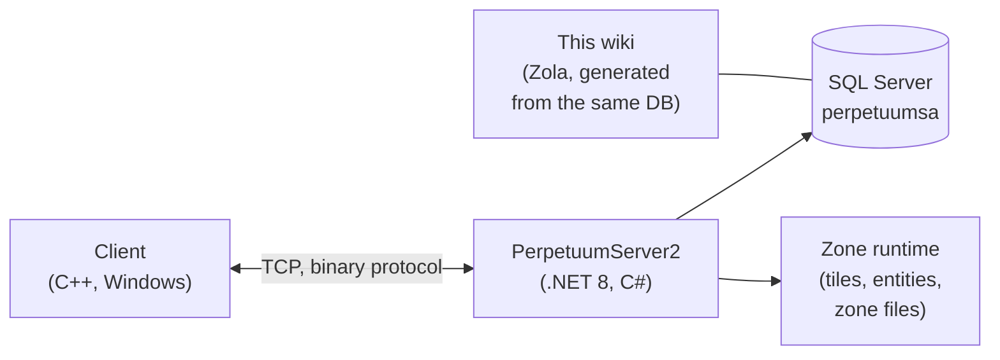

# Página inicial do desenvolvedor

Um mapa de alto nível de como o jogo funciona, do ponto de vista de um desenvolvedor/devops.
Páginas dedicadas a análises aprofundadas estão a caminho — por enquanto, esta é a orientação inicial.

## Os componentes

- **Cliente** — o cliente de jogo do Perpetuum (Windows; consulte [Client & PC
  setup](/pt/features/client-setup/) para instruções de execução, inclusive no Linux). Ele se comunica com o
  servidor por meio de um protocolo TCP binário; cada ação do jogador é um *comando* nomeado
  (os mesmos nomes que esta wiki usa no [action inventory](/pt/features/#inventario-completo-de-acoes)).
- **Servidor (PerpetuumServer2)** — uma base de código em C#/.NET 8. Um único processo executa
  todo o servidor: a camada de conexão, a lógica do jogo (robôs, zonas, missões,
  mercado, produção, pesquisa) e o runtime de zona que processa cada ciclo (*tick*) do
  mundo baseado em tiles de cada zona (terreno, entidades, teletransportes).
- **Banco de dados** — SQL Server, banco de dados `perpetuumsa`. Conteúdo estático do jogo (padrões
  de entidades, receitas, extensões, árvore tecnológica, loja, descrições de teleporte) e todo
  o estado dinâmico (personagens, robôs, contêineres, mercado, estado da zona).
- **Arquivos de zona** — as zonas são grades de tiles (altitude + camadas de controle, 2 bytes/
  tile) distribuídas em arquivos `.gbf` e editáveis por zona; consulte o
  [zone file format](/pt/formats/zone-files/).
- **Dados de referência** — o cliente baixa tabelas de atributos do servidor durante
  a inicialização (consulte [Server & reference](/pt/features/server/)).

## Executando o projeto

- O servidor é executado no Docker Compose juntamente com o SQL Server
  (o projeto `perpetuumserver2`); o contêiner do banco de dados é a fonte de leitura do gerador
  desta wiki.
- O conteúdo estático é validado em relação aos arquivos de regras **plantrules**; o gerador
  em C# da wiki (`make generate`) é executado no mesmo ecossistema e lê o mesmo
  banco de dados, de modo que cada tabela gerada neste site reflete dados em tempo real do servidor.
- Os mapas de teletransporte de zona nesta wiki são renderizados a partir das mesmas camadas de altitude
  que o próprio jogo utiliza.

## Próximos passos

- **[Formats](/pt/formats/)** — referência de campos para desenvolvedores: como cada campo de atributo é
  armazenado (coluna do banco de dados, chave do arquivo de regras, byte de camada binária) e consumido, com
  exemplos práticos.
- **[Server & reference](/pt/features/server/)** — os meta-sistemas: informações do servidor,
  pontuações máximas, os dados de referência baixados pelo cliente e a loja do jogo.

> Mais páginas para desenvolvedores (protocolo, ciclo de vida da zona, implantação) estão planejadas —
> esta página serve como ponto de partida para elas.