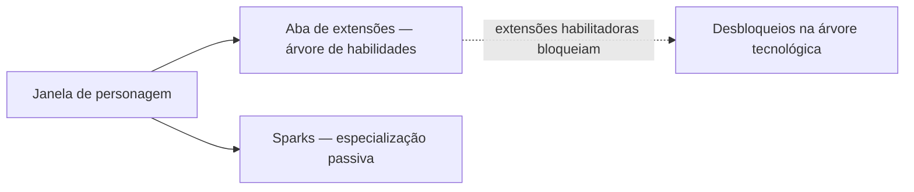

# Personagem

A **janela de personagem** (barra superior → **Personagem**, no canto superior esquerdo) é onde
fica a progressão do seu personagem: perfil, créditos, as **extensões** (habilidades) e configurações.
Tudo nesta página é por personagem — as contas podem ter vários, cada um com sua própria árvore.
As localizações na interface seguem a [visão geral da interface do cliente](/pt/features/ui/).

## Extensões

A **aba de extensões** é a árvore de habilidades do personagem: níveis de habilidade individuais
que desbloqueiam mecânicas de jogo e ajustam atributos — principalmente as **extensões habilitadoras**
necessárias para pilotar uma classe de robô. O nível 1 custa créditos, cada nível subsequente
custa Pontos de Extensão (EP), e os pré-requisitos determinam o caminho de aprendizado.

- [Categorias principais](/content/extensions/#categories) — as 15 categorias em resumo:
  quais categorias abrem o acesso a quais (clique em uma caixa para ir aos seus cartões)
- [Extensões por categoria](/content/extensions/#table) — todas as extensões: patente,
  preço, bônus, pré-requisitos
- Como funcionam o EP e a árvore tecnológica: [Pesquisa](/pt/features/research/)

## Sparks

Seu **spark** é a especialização de nanorrobôs instalada no personagem — enquanto estiver
ativo, seus bônus se aplicam a todos os robôs que você pilotar. A troca de sparks tem um custo;
autorizações liberam o acesso às linhas superiores. Detalhes em [Sparks](/pt/features/sparks/).
