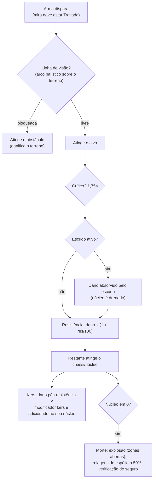

# Combate

O combate acontece **em zonas**, com o seu robô ativo. Você luta contra outros jogadores (PvP),
NPCs e estruturas hostis. Esta página cobre as mecânicas confirmadas no
lado do servidor; interações detalhadas de dano e montagem encontram-se em [robôs e montagem](/pt/features/robots/).

> Os locais da interface seguem a [visão geral da interface do cliente](/pt/features/ui/): o **escudo/armadura/chassi e a
> energia** do seu robô são exibidos no painel de status desatracado. Os controles de mira e armas em combate
> ainda não estão documentados em detalhes.

## Entrando em combate

- Você só pode lutar enquanto estiver **desatracado** — você é o seu robô ativo.
- Disparar uma arma ofensiva contra outro jogador em uma zona aberta (PvP) ativa o
  **sinalizador de PvP (PvP flag)** no atacante. Revidar ou usar um módulo de suporte em um
  jogador já sinalizado ativa o sinalizador em você também. O sinalizador dura **5 minutos**
  (a definição `effect_pvp`, 300.000 ms) e é renovado a cada novo ato
  de agressão.
- Enquanto o sinalizador estiver ativo:
  - você **não pode usar teletransportadores** (incluindo os móveis), e
  - você **não pode atracar normalmente** — a única saída é a **atracação forçada (force dock)**, que
    deliberadamente não é bloqueada pelo sinalizador.

## O que você pode enfrentar

- **Robôs de outros jogadores** (PvP).
- **NPCs** — os NPCs da zona são organizados em **bandos (flocks)** (grupos com comportamento compartilhado).
- **Estruturas hostis / itens implantáveis** na zona.

## Quando seu robô é destruído

Seu robô é **destruído** e um **contêiner de espólio (loot)** surge no local onde ele foi abatido. O espólio é
sorteado por item, cada rolagem com 50% de chance:

| O que | Destino |
|---|---|
| Cada **módulo** instalado | 50% de chance de cair **danificado** (reparável); caso contrário, destruído |
| A **munição** carregada em cada módulo | 50% de chance de cair (apenas se o módulo tiver caído) |
| **Carga** (pacotes/caixas) | o conteúdo cai como espólio, o pacote em si é destruído |
| Outros **itens empilháveis** no compartimento de carga | 50% de chance de cair, com uma quantidade reduzida aleatoriamente (o restante é destruído) |
| Sua **pintura/tingimento** | 50% de chance de cair como item de tinta |
| O **próprio robô** | destruído — a menos que tivesse um **seguro** ativo, caso em que a indenização é paga a você em créditos (o robô ainda é perdido) |

O **seguro** (adquirido na instalação de seguros de uma base, atracado — veja
[produção → seguros](/pt/features/production/)) cobre um robô por **15 dias** (mais
dias de bônus por extensão). Cada robô tem uma **taxa** e uma **indenização** definidas pelo conteúdo (a
tabela `insuranceprices` — 67 definições de robôs); a taxa pode ser reduzida por um bônus de extensão
e paga da carteira da sua corporação. Robôs iniciais não podem ser segurados. Você pode manter
seguro em 1 + (bônus de extensão) robôs simultaneamente.

Após uma destruição, você fica **sem nenhum robô ativo**. Para voltar ao jogo, você pode:

- **selecionar outro robô** que você possua e para o qual tenha as extensões habilitadoras necessárias, ou
- **solicitar um robô inicial** enquanto estiver atracado — porém há um breve bloqueio após ser abatido:
  **3 minutos se você foi morto por um jogador, 1 minuto se foi por um NPC**. Se um **NPC** abateu
  você, a base também disponibiliza um **robô inicial gratuito** automaticamente ao retornar.

## Escapando

Quando uma batalha corre mal:

- **Atracação forçada (Force dock)** — a saída de emergência. Tira você da zona e atraca você na
  base principal (TMA) imediatamente, mesmo no meio da luta.
- **SOS** — uma saída alternativa: atraca você na base atual após o atraso normal
  de desatracação (7 segundos).

Ambos são suas redes de segurança; a atracação forçada é o botão de emergência "estou prestes a morrer".

## Travamento de mira, alcance e acerto

- **Trave a mira primeiro.** As armas só disparam contra alvos *travados* — e somente depois que o travamento
  estiver concluído. Travar um alvo consome o **tempo de travamento** do seu robô (uma estatística em ms);
  disparar enquanto o travamento ainda está em andamento é rejeitado. Você pode manter vários alvos travados ao
  mesmo tempo (limitado pela estatística de **máximo de alvos travados**), mas apenas um é o *primário*, e
  algumas armas disparam apenas no alvo primário.
- **Alcance ideal + queda (optimal range + falloff).** Dentro do **alcance ideal** de uma arma, você causa dano
  total. Além dele, o dano diminui suavemente ao longo da distância de **queda (falloff)** —
  aproximadamente metade do dano no ponto médio da queda, e zero em seu limite externo. Além do
  alcance ideal + queda, você não causa nenhum dano.
- **Tamanho da dispersão vs. tamanho do alvo.** Armas de fogo convencionais não "erram": a estatística de **precisão**
  de uma arma funciona como um raio de dispersão, e um alvo cuja **assinatura** for menor do que esse raio
  recebe proporcionalmente menos dano. Mísseis *podem* errar completamente (a chance de erro
  vem da estatística de precisão de mísseis do robô), mas quando acertam, explodem em seu
  **raio de explosão** — e, assim como nas armas de fogo, um alvo pequeno recebe menos impacto
  da detonação.
- **Acertos críticos.** Cada disparo rola sua **chance de acerto crítico**; um acerto crítico
  multiplica o dano total por 1,75×, e cada acerto também varia aleatoriamente em ±10%.
- **Linha de visão.** Os projéteis viajam em linha reta, e terrenos, obstáculos e
  plantas os bloqueiam. Mísseis realizam uma trajetória em arco e podem superar coberturas baixas — mas o arco é
  limitado, de modo que terrenos elevados ainda bloqueiam.
- **Seu próprio escudo bloqueia suas próprias armas.** Enquanto seu escudo estiver ativo, suas
  armas não dispararão.

### Tipos de dano

A munição transporta o dano: cada munição tem um valor para um ou mais tipos de dano —
geralmente um tipo dominante mais um secundário menor (munição de míssil causa dano explosivo
mais cinético ou químico; cristais de laser causam dano térmico mais químico; projéteis de canhão eletromagnético (railgun)
causam dano cinético mais térmico). Os tipos são:

| Tipo | Observações |
|---|---|
| **Químico** | O componente comum da munição de armas de fogo e lasers |
| **Cinético** | Munição de canhões de trilho (railgun), projéteis convencionais e mísseis |
| **Térmico** | Lasers, algumas munições de projéteis |
| **Explosivo** | Mísseis |
| **Tóxico** | Algumas munições de armas de fogo; danifica apenas plantas e terrenos |
| **Elétrico** | Efeitos especiais (ex.: o queimador / scorcher) — **penetra escudos** |

O dano recebido é reduzido por tipo pela **resistência** do alvo a esse tipo:
uma resistência de 50% reduz o dano em 50/(50+100) ≈ 33%. As resistências se aplicam apenas ao que
consegue *atravessar* o escudo — o escudo absorve primeiro, e isso é descontado da
energia do escudo: quanto mais forte o golpe, mais energia custa. Módulos **Kers**
permitem que uma fração de um tipo de dano queime a energia do escudo diretamente, mesmo após
a resistência. [Liga adaptativa](/pt/features/modules/#the-module-families)
redistribui suas resistências em favor do tipo que está efetivamente atingindo você.

## Detecção, ocultação e velocidade

- **Detecção vs. ocultação (masking).** Você pode avistar uma unidade dentro de um alcance que aumenta com
  sua estatística de **detecção** e diminui com a estatística de **ocultação (masking)** do alvo —
  aproximadamente 100 m × detecção ÷ ocultação. Uma unidade que travou a mira em você é sempre
  visível para você, independentemente de sua ocultação. Módulos de camuflagem (stealth) aumentam temporariamente
  sua própria ocultação (veja [módulos](/pt/features/modules/)); minas utilizam um alcance de
  detecção próprio dedicado.
- **Blob.** Algumas unidades e estruturas emitem um campo de *blob*. Enquanto você permanecer dentro
  do raio de um emissor, o nível de blob na sua unidade sobe; entre as duas estatísticas de limiar
  de blob, ele **aumenta seu tempo de travamento** (em até 6× o valor base)
  e **reduz seu alcance de mira e força de sensores** (pela metade).
- **Velocidade.** A velocidade máxima cai com a massa: velocidade = base × (massa de projeto ÷ massa
  real) — cada tonelada extra de módulos, armadura e carga que você equipa deixa você mais lento.
- **Desmobilização ("demob").** O efeito do desacelerador (webber) reduz a velocidade máxima de um alvo.
  A intensidade do impacto varia de acordo com a **massividade** do alvo — unidades mais pesadas sofrem
  uma desmobilização mais intensa, de modo que alvos grandes e lentos sentem mais o efeito.

## Alarmes

Um **alarme** é acionado em uma zona por um **interruptor de alarme** (uma estrutura
relacionada a missões). Quando iniciado:

- Ele dura por um **período de alarme** fixo (definido pela missão; curto por padrão).
- Você precisa **permanecer dentro do alcance do interruptor** durante todo o período — isso é
  verificado a cada dois segundos, e se afastar cancela o alarme.
- Você só pode ter **um alarme ativo por vez**.

Os alarmes estão vinculados ao conteúdo de missões — veja [missões](/pt/features/missions/).

## Relatórios de abates (Kill reports)

Seu histórico de combate está disponível como **relatórios de abates**:

- Filtrar por **janela de tempo**.
- Filtrar por **papel**: como **vítima**, **atacante** ou **executor**.

Use-os para analisar como você morreu ou quem você destruiu.

## Recordes (High scores)

- **Recordes do servidor** — melhores resultados em todo o servidor.
- **Meus recordes** — seus recordes pessoais.

## Notas práticas

- **Não morra por descuido** — um robô destruído significa tempo de inatividade enquanto você remonta ou
  solicita outro.
- **Atracação forçada é instantânea** — se você estiver em desvantagem, vá para a TMA imediatamente; você pode remontar o robô depois.
- **PvP bloqueia teletransportes** — planeje suas fugas; você não pode fugir de um combate num piscar de olhos.
- **Alarmes são um sinal** — um alarme ativo indica que um evento de missão está em andamento naquela área.

<!--
Developer notes: rewritten 2026 from backend sources; no community-wiki text reused.
Verified against:
- Locking: Zones/Locking/LockHandler.cs (locking time in ms from
  AggregateField.locking_time; MaxLockedTargetsProperty; one primary lock;
  lock states Inprogress -> Locked), Zones/Locking/Locks/Lock.cs,
  Zones/Locking/LockValidator.cs (dead/not-lockable/out-of-range validation);
  ZoneSession.cs (weapons take an existing lock id; firing a weapon whose lock is
  not fully Locked raises LockIsInProgress — there is NO auto-lock on fire).
- Damage: Modules/Weapons/Damage.cs (CalculateDamages: crit = attacker.
  CriticalHitChance, CRITICALHIT_MOD 1.75, random 0.9-1.1; falloff =
  cos(x*PI)/2+0.5 with x=(distance-optimal)/falloff; zero beyond optimal+falloff;
  explosion modifier = target.SignatureRadius/explosionRadius clamped 0..1;
  toxic excluded from unit damage), Modules/Weapons/WeaponAmmo.cs (damage values
  per type live on the ammo: damage_chemical/thermal/kinetic/explosive/toxic;
  firearm adds damage_toxic to plants).
- Weapons: Modules/Weapons/FirearmWeaponModule.cs (CheckAccuracy always false —
  firearms never miss; WithExplosionRadius(Accuracy) — accuracy IS the blast
  radius), Modules/Weapons/MissileWeaponModule.cs (miss when rnd >
  robot.MissileHitChance; missile_miss property), WeaponModule.cs (shield active
  => ShieldIsActive error; LOS check before firing).
- Resistances: Units/Unit.cs GetResistByDamageType = resist/(resist+100);
  Zones/DamageProcessors/DamageProcessor.cs (shield absorbs first, paid from
  core: coreDamage = damage * AbsorbtionModifier; Electric damage penetrates as
  coreDamage; kers = damage * type kers modifier, scaled by
  (sin(core/coreMax*PI)/2)+0.5, added to target core);
  EffectModules/ShieldGeneratorModule.cs (AbsorbtionModifier =
  max(SigRadius/shieldRadius,1)/shieldAbsorbtion).
- Damage types: Modules/Weapons/DamageType.cs — Chemical, Kinetic, Thermal,
  Explosive, Toxic, Electric (no "seismic"; missile damage is Explosive).
  Electric is only produced by ScorcherModule.cs in this backend.
- Detection: Units/Unit.Visibility.cs (IsDetected: range = 100/max(1,
  target.StealthStrength)*max(1, DetectionStrength); locked-on-you always
  visible; mine detection range separate); stealth_strength property includes
  effect_stealth_strength_modifier (stealth modules raise masking).
- Speed: Units/UnitProperties/SpeedMaxProperty.cs (speed_max * Mass/ActualMass;
  dreadnought => 0.05; massiveness/drone/highway effect modifiers).
- Demob: Modules/EffectModules/WebberModule.cs (effect_demobilizer; effect
  property = module value + target.Massiveness, clamped at 1.0 — heavier targets
  get the full effect; longrange webbers additionally require LOS; accuracy
  check via optimal-range modifier).
- Blob: Zones/Blobs/BlobHandler.cs (emitters raise blob level inside
  BlobEmissionRadius; between blob_level_low/high the multiplier scales:
  locking_time modifier -5, i.e. lock time x(1+5*m) — up to 6x base at full blob, max_targeting_range *0.5,
  sensor_strength *0.5).
- LOS: Zones/LineOfSight.cs (raycast vs terrain blocks incl. Plant flag;
  ballistic arc for missiles: max amplitude 16 m over 40 m);
  Zones/Terrains/BlockingFlags.cs (Obstacle/Plant/Decor/Island block).
Corrections vs ingested page: "seismic" damage type does not exist (explosive
does); "firearms lose damage instead of missing" verified (accuracy = explosion
radius); auto-lock on fire NOT in backend (lock must be created and completed
first); "interference" (emission/minimum/peak, emitters, anomaly degradation)
has NO equivalent in this backend — only a comment in Services/RiftSystem/Rift.cs
— section removed; shield "absorbs" is core-energy based, and Electric damage
penetrates it.
Developer files: Zones/Locking/*; Zones/Locks via Zones/Locking/Locks/*;
Modules/Weapons/*.cs; Zones/DamageProcessors/*.cs; Units/Unit.Visibility.cs;
Units/Unit.cs; Units/UnitProperties/SpeedMaxProperty.cs;
Modules/EffectModules/ShieldGeneratorModule.cs, WebberModule.cs,
StealthModule.cs; Modules/ScorcherModule.cs; Zones/Blobs/*.cs;
Zones/LineOfSight.cs; Zones/ZoneSession.cs (lock/fire packet handling).
Previously verified (kept as-is): PvP flag = effect_pvp 300000 ms
(effect_pvp definition), raised by attack/aggro/support (Player.cs
ApplyPvPEffect); blocks teleport + normal dock (CantDockThisState), ForceDock.cs
has no PvP check; death loot 50% rolls (Player.cs OnUnitDeath,
Services/Looting/LootHelper.cs DROP_CHANCE 0.5); insurance (InsuraceFacility.cs,
InsuranceHelper.cs, insuranceprices 67 defs); starter-robot lock 3 min PvP /
1 min NPC; alarms (Zone/AlarmStart.cs, AlarmSwitch.cs); kill reports
(GetMyKillReports.cs); high scores (GetHighScores.cs / GetMyHighScores.cs).
-->
