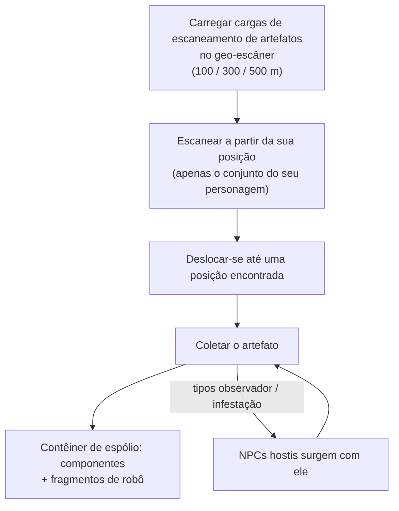

# Exploração (artefatos & relíquias)

A exploração consiste em encontrar valor oculto no terreno — uma excelente atividade solo em
qualquer nível. Ela ocorre de duas formas: **artefatos**, que são pessoais e ocultos,
e **relíquias**, que são abertas e disputadas no mundo.

## Busca de artefatos (Artifacting)

Os artefatos são pontos que existem **por personagem**: o servidor mantém um conjunto de artefatos
separado para cada personagem em cada ilha, de modo que o que você encontra pertence exclusivamente
a você. Eles são invisíveis até que você faça um escaneamento para encontrá-los.

1. Carregue **cargas de escaneamento de artefatos** em um módulo de geo-escâner. Há três
   graus de cargas com diferentes alcances de varredura (100 / 300 / 500 m).
2. Escaneie a partir da posição do seu robô — o escâner retorna as posições dos artefatos
   dentro do alcance (a estatística de precisão do geo-escâner refina a posição reportada).
3. Desloque-se até a posição encontrada e colete o artefato; isso gera um **contêiner de
   espólio** no local.

Duas características tornam a busca de artefatos uma atividade tanto de combate quanto de coleta:

- Alguns tipos de artefato **fazem surgir NPCs junto com você** — as variantes "observador" (observer) e
  "infestação" (infestation) invocam inimigos no momento em que o artefato é encontrado, portanto
  pilote algo capaz de lutar.
- O espólio é aleatório por tipo de artefato: componentes de módulos (placas de blindagem, reforçadores,
  geradores, reparadores…) e **fragmentos de robô** (shards) — os ingredientes de pesquisa e produção
  específicos de cada facção, o que faz da busca de artefatos uma carreira industrial fundamental.

Os tipos de artefato são divididos em níveis (níveis 1 a 3, com mais espólio em níveis mais altos) e existem em
variantes neutras e específicas de cada facção.

## Caça a relíquias

As relíquias são de **mundo aberto**: a zona as gera em posições aleatórias (em um ciclo de
ressurgimento de aproximadamente 90 minutos com variação aleatória); são objetos visíveis com um
feixe de luz, e quem chegar primeiro fica com o espólio. O espólio consiste em uma rolagem de
NIC mais **fragmentos de robô**, escalonados pelo nível da relíquia e pelo nível de valor da ilha — os
mesmos fragmentos gerados pela busca de artefatos.

Os tipos de relíquias são categorizados por ilha (níveis 1 a 3, com diferentes valores de EP por
nível) e surgem em variantes neutras, de facções e industriais. Algumas relíquias
estão ligadas a [postos avançados](/pt/features/outposts/) — a atividade SAP gera suas próprias
relíquias, que permanecem ativas por até 12 horas — e em ilhas de PvP aberto os pontos de surgimento
ficam em território disputado, portanto espere encontrar outros caçadores.

## Missões também pagam por isso

As [missões](/pt/features/missions/) também podem oferecer trabalhos de artefatos,
onde você recebe o pagamento diretamente e os itens vão para o contratante em vez de irem para o seu
inventário.

<!--
Written from scratch against the server backend, 2026-09-27:
Zones/Artifacts/Repositories/ZoneArtifactRepository.cs (per-character artifact
rows), Zones/Scanning/Scanners/Scanner.Artifact.cs (scan range + accuracy),
Zones/Artifacts/Generators/Loot/ (random loot per type),
Services/Relics/RelicManagers/ZoneRelicManager.cs (~1.5 h respawn + random
window) and SAPRelic.cs (12 h lifespan),
artifacttypes/artifactloot/relictypes/relicloot tables,
ammo_artifact_scan_a/b/c (scan ranges 100/300/500).
An earlier version of this page was adapted from the Open Perpetuum
community wiki (perpetuum.miraheze.org) and has been fully rewritten from
backend sources; no text was reused.
-->
