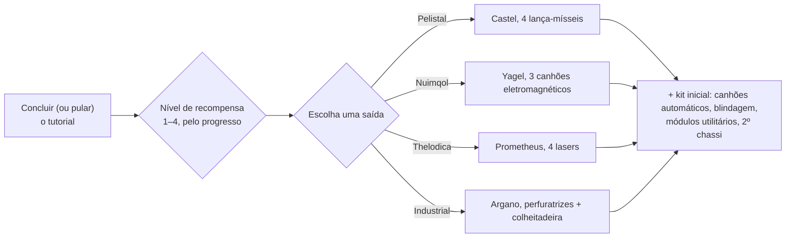

# FAQ

## Posso pular o tutorial?

Você pode sair da zona de treinamento mais cedo, mas abrirá mão das recompensas concedidas
ao concluí-lo. Quando um personagem sai do tutorial, o servidor:

- paga o **NIC inicial** mais um bônus **por nível de recompensa** alcançado no
  tutorial (existem quatro níveis de recompensa),
- transfere você para a **corporação padrão** da raça e escola escolhidas,
- concede suas **extensões iniciais** (habilidades) e seu **spark**,
- cria seu **robô inicial**, atraca você na base de atracação de New Virginia e
  a define como sua **base inicial (home base)** — o local onde você reaparece quando seu robô
  é destruído,
- deposita seus **itens de recompensa** em um contêiner público naquela base de atracação e
  envia um e-mail de boas-vindas.

## Como concluo o tutorial?

Siga os objetivos em ordem; a **Lista do Novato (Rookie Checklist)** do cliente (menu Ajuda
na barra superior) acompanha o progresso e pode ser fixada na barra inferior. O quanto você
avança determina seu nível de recompensa, que define quais categorias de recompensa você
recebe ao sair — uma saída no nível 1 recebe apenas a primeira categoria, enquanto a conclusão total
concede todas as quatro.

## O que cada saída me concede?

Sua escolha determina três coisas: o **robô inicial** que você pilota, os **itens de recompensa**
que você recebe e a **corporação padrão e habilidades iniciais** atribuídas.
Todo o resto — qualquer habilidade, qualquer robô, qualquer equipamento de facção — pode ser
treinado e comprado posteriormente com EP e NIC, portanto a escolha é um kit inicial, não uma limitação permanente.

| Saída | Robô inicial (equipado) | Tema da recompensa |
|---|---|---|
| **Pelistal** | Castel — quatro lança-mísseis | mísseis + canhões automáticos |
| **Nuimqol** | Yagel — três canhões eletromagnéticos (railguns) | munição de railgun + canhões automáticos |
| **Thelodica** | Prometheus — quatro lasers | cristais de laser + canhões automáticos |
| **Industrial** | Argano — duas perfuratrizes, uma colheitadeira, uma sonda de mineração | munição de mineração, colheita e escaneamento de artefatos |

Cada saída também inclui um conjunto de canhões automáticos pequenos com munição, módulos de blindagem
e utilitários (reparador de blindagem, intensificador de sensor ou redutor de massa, recarregador
de núcleo, modificadores de dano), um segundo chassi (vazio) e uma cápsula de bomba de parede
nos níveis máximos de recompensa.

## O que devo fazer depois de sair?

Quase qualquer atividade rende EP para habilidades e NIC para equipamentos:

- Minere, colha, procure artefatos — e venda os recursos nos [mercados](/pt/features/market/).
- Abata NPCs e venda o [espólio](/pt/features/npcs/).
- Colete ou compre materiais e [fabrique](/pt/features/production/) itens.
- Realize [missões](/pt/features/missions/) — qualquer missão oferecida em um terminal ou
  posto avançado pode ser completada por você sozinho no mundo.

Novo no PvP de mundo aberto? Leia primeiro as [dicas de sobrevivência em Primeiros
passos](/pt/features/getting-started/#survival).

## Posso visitar a zona de treinamento novamente?

Não. A zona de treinamento é destinada a novos personagens e não há retorno após
saí-la. A Lista do Novato permanece disponível no menu Ajuda se você quiser reler os
objetivos, e você sempre pode criar outro personagem e deixá-lo no tutorial como um ambiente de testes.

## Abreviações

Termos e siglas comuns em bate-papos, anúncios de mercado e montagens. A maioria dos termos possui
uma página própria (vinculada onde apropriado) — os nomes de itens são localizáveis na busca do site.

| Termo | Significado |
|---|---|
| **EP** | [Pontos de Extensão (Extension Points)](/pt/features/research/#ep-sources) — a moeda de habilidades no nível da conta usada para aprimorar [extensões](/pt/features/character/#extensions) (as regras de ganho estão na [página de pesquisa](/pt/features/research/#ep-sources)). |
| **NIC** | Nian Credit — a moeda do jogo (o saldo de `credit` do seu personagem). |
| **CT** | [CPRG — Programa de Calibração (Calibration Program)](/pt/features/production/#cprg-calibration-programs) — o programa com o qual uma linha de produção é calibrada antes de produzir (um por item, com eficiências de material/tempo). |
| **Proto** | Um item protótipo — a variante de alta patente de um módulo/robô, fabricada na [instalação de protótipos](/pt/features/production/#the-item-lifecycle-the-circular-process) (consome um exemplar da patente anterior; veja [progressão de patentes](/pt/features/production/#tier-progression)). |
| **LWF** | Lightweight frame (chassi leve) — um módulo de blindagem redutor de massa (o cliente os nomeia como "… lightweight frame", ex.: *Niani lightweight frame*). Torna o robô mais leve, ao custo de blindagem. |
| **TP / tele** | [Teletransporte](/pt/features/movement/) — viagem rápida entre pontos fixos ou para um dispositivo de teletransporte móvel implantado. |
| **SAP** | Service Access Point — a atividade de [estabilidade](/pt/features/outposts/) de postos avançados. |
| **Stab** | Weapon Stabilizer — estabilizador de armas, aumenta a precisão de acerto de uma arma. |
| **Demob** | Demobilizer — desmobilizador, um módulo que reduz a velocidade de outro robô (e de seus módulos). |
| **EWar** | Módulos de Guerra Eletrônica (Electronic Warfare) (interferência, supressão de sensores, camuflagem). |
| **EnWar** | Módulos de Guerra de Energia (Energy Warfare) (injetores de núcleo, drenadores, neutralizadores, transferidores). |
| **Tuning** | Nome dado no cliente aos módulos de melhoria que aprimoram outros módulos — modificadores de dano para armas, *ajuste industrial (industrial tuning)* para mineradores e colheitadeiras, ajustes de reparador de blindagem, etc. |
| **MK2** | Uma variante aprimorada de um robô (chassis `_mk2`) — maiores capacidades, linha de pesquisa própria. |

As classes de robôs seguem os agrupamentos internos do cliente — consulte a nota em
[Classes de robôs](/content/robots/#robot-classes).

<!--
Written from scratch against the server backend, 2026-09-27:
Zones/Teleporting/Strategies/TrainingExitStrategy.cs (exit rewards, NIC,
corporation, extensions, spark, starter robot, home base, reward items),
Zones/Training/Reward/TrainingReward*.cs + trainingrewards/robottemplates
(reward levels 1-4, per-race starter packs and items),
Robots/Robot.Properties.cs (race ids 1=Pelistal, 2=Nuimqol, 3=Thelodica, 5=industrial).
An earlier version of this page was adapted from the Open Perpetuum
community wiki (perpetuum.miraheze.org) and has been fully rewritten from
backend sources; no text was reused.
-->
