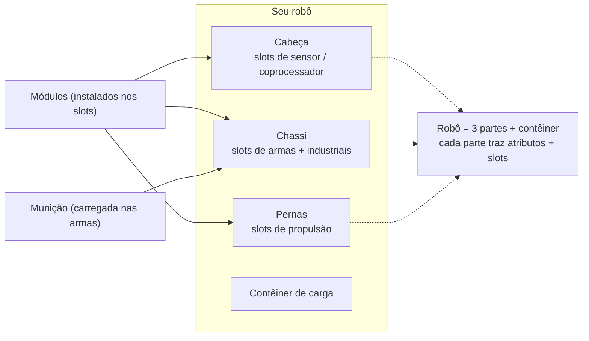

# Montagem (Fitting)

Montagem (fitting) significa instalar **módulos** nos compartimentos (slots) de componentes do robô e carregar **munição** em suas
armas. Toda a montagem é feita **exclusivamente atracado** — você não pode alterar equipamentos em uma zona.

> Os locais da interface seguem a [visão geral da interface do cliente](/pt/features/ui/) (a categoria **Equipar** na
> barra superior). As mecânicas abaixo são confirmadas pelo servidor.

## Instalando módulos

Um robô possui vários **componentes** (arma, escudo, armadura, propulsão, sensor, etc.), cada
um com um conjunto de **compartimentos (slots)**.

- **Equipar um módulo** — pegue um módulo de um contêiner e coloque-o em um slot de componente
  específico. O tipo de módulo deve ser válido para aquele slot naquela classe de robô.
  Se o slot estiver ocupado, o módulo existente será retornado ao contêiner.
- **Trocar módulos** — mova um módulo entre dois slots do mesmo componente.
- **Remover um módulo** — retire um módulo de um slot de volta para um contêiner.

O servidor recalcula as estatísticas do robô após cada alteração (os módulos afetam os valores
exibidos no painel de status desatracado — veja [combate](/pt/features/combat/)).

## Carregando munição

- **Equipar munição** — carregue um item de munição compatível em um módulo ativo (arma). O módulo
  deve **aceitar aquele tipo de munição**, e ele é abastecido até a **capacidade de munição** do módulo.
  Qualquer munição carregada anteriormente é retornada ao contêiner primeiro.
- **Trocar munição** — substitua a munição carregada por outro tipo compatível.
- **Desequipar munição** — devolva a munição carregada para um contêiner.

## Pré-definições de montagem (Presets)

Uma **pré-definição (preset)** é uma configuração salva que você pode reaplicar rapidamente:

- **Salvar** — armazena a montagem atual de um robô com um nome específico.
- **Listar** — visualize suas configurações salvas.
- **Aplicar** — carrega uma pré-definição em um robô (diferente) a partir de um contêiner.
- **Excluir** — remove uma pré-definição salva.

As pré-definições são muito úteis para remontar robôs rapidamente após uma batalha ou ao alternar funções.

## Notas práticas

- **Não é possível montar em uma zona** — tudo aqui exige que você esteja atracado.
- **Extensão habilitadora primeiro** — sem a classe de robô pesquisada, você não pode selecioná-lo nem pilotá-lo.
- **A munição deve corresponder à arma** — uma definição de munição incompatível será recusada.
- **Robôs reempacotados não podem ser usados** — desempacote um robô antes de selecioná-lo ou equipá-lo.
- **Use pré-definições para remontar rapidamente** — salve uma configuração confiável e aplique-a após sofrer perdas.

## Categorias de slots

Os componentes de um robô (cabeça, chassi, pernas) fornecem **slots**, e cada slot possui um conjunto
de sinalizadores de categoria. Um módulo cabe em um slot somente se os próprios sinalizadores do módulo forem um **subconjunto** dos
sinalizadores do slot. As categorias de sinalizadores são:

`small`, `medium`, `large`, `turret`, `missile`, `melee`, `industrial`,
`ew_and_engineering`, `specialized` (um slot especializado aceita apenas módulos
especializados), além dos slots estruturais `head` / `chassis` / `leg`.

Os módulos também podem ser restritos a robôs específicos, e alguns possuem o sinalizador **unique** (único), de
modo que apenas um daquele tipo pode ser instalado por vez. Os efeitos de estatísticas por módulo podem ser consultados na
[tabela de robôs](/content/robots/) gerada.
