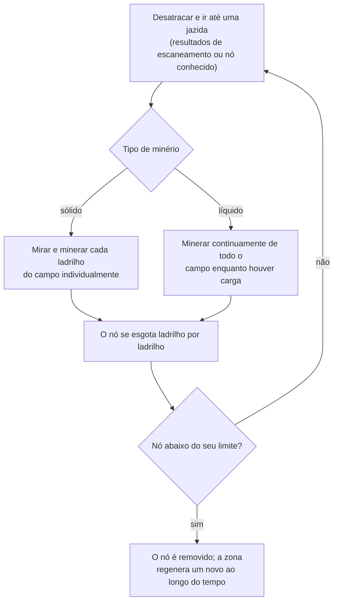
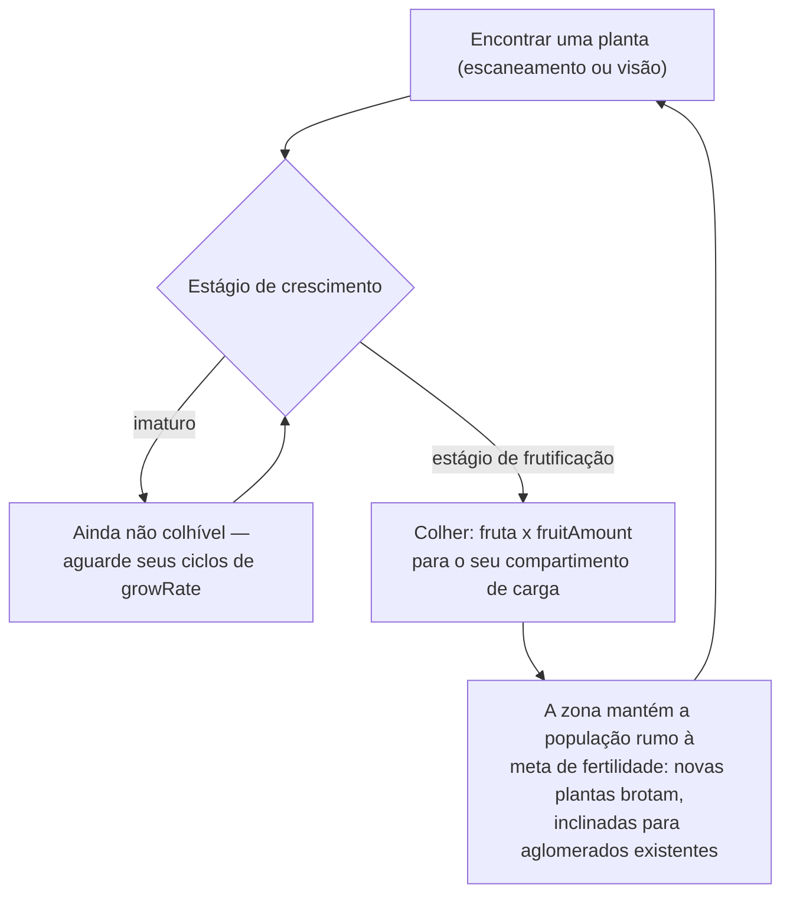
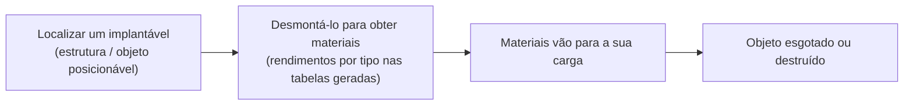

# Coleta & escaneamento

Os recursos no jogo são provenientes de três fontes em uma zona: **jazidas de minério**, **plantas**
e **implantáveis**. Esta página explica como cada um funciona e como se desenvolve o ciclo de coleta.

> As localizações na interface seguem a [visão geral da interface do cliente](/pt/features/ui/): as ações
> de escaneamento e colheita ficam na lista de **ações desatracado** (canto superior direito enquanto estiver
> em uma zona). Os números de rendimento por tipo de recurso estão nas tabelas geradas:
> [Conteúdo → Minérios](/content/ores/) e [Conteúdo → Plantas](/content/plants/).
> As mecânicas abaixo foram confirmadas com a implementação do servidor.

## O ciclo básico

1. **Desatracar** e deslocar-se para uma zona (consulte [movimento](/pt/features/movement/)).
2. **Escanear** a área com o módulo de escaneamento do seu robô.
3. **Coletar** — extrair minério, colher frutos de plantas ou desmontar implantáveis.
4. **Atracar** e descarregar sua carga em um contêiner de base.

## Jazidas de minério

- O minério existe no solo na forma de **jazidas (nós)** espalhadas pela zona.
- Para encontrá-las e registrá-las, você precisa de um **módulo de geo-escaneamento** equipado no seu robô ativo.
  Um escaneamento produz um **resultado de escaneamento**; em seguida, você o **envia (upload)**, armazenando-o
  na sua lista pessoal de escaneamento mineral.
- Seus resultados de escaneamento armazenados podem ser **listados, movidos, excluídos ou convertidos em itens**
  (os itens de "escaneamento mineral" usados para processamento/produção).

- As jazidas são **finitas**: cada nó possui uma quantidade total limitada. Quando um nó é
  minerado abaixo do seu limite, ele é removido e a zona **regenera novos nós** ao longo do
  tempo até a quantidade máxima configurada. Como os nós são posicionados e como as populações de plantas
  são mantidas — com zonas reais como exemplos práticos — encontra-se em
  [Zonas → Geração](/zones/generation/).
- **Minérios sólidos vs líquidos.** Minérios sólidos se esgotam ladrilho por ladrilho — você mira e minera
  cada ladrilho do campo até que esteja vazio. Minérios líquidos extraem de todo o campo, portanto seu
  minerador pode operar continuamente enquanto houver espaço de carga. Essa facilidade é exatamente o motivo
  pelo qual os minérios líquidos costumam valer menos: exigem menos habilidade e atenção para minerar.

### Estatísticas de plantas e minérios em resumo

O comportamento de minérios e plantas é regido por regras de dados por tipo. Os campos que importam
para o jogador:

| Campo | O que significa no jogo |
|---|---|
| `fertility` | Quão comum é o tipo — valor mais alto = a zona tenta manter mais exemplares ativos |
| `growRate` | Quantos ciclos de crescimento uma planta deve passar em cada estágio antes de avançar (maior = mais lento) |
| `spreading` | Se o tipo cresce em aglomerados (grupos) ou disperso |
| `killDistance` | Espaçamento mínimo entre duas plantas do mesmo tipo |
| `slope` / `minSlope` | A inclinação do terreno em que a planta consegue crescer |
| `allowedAltitudeLow/High` | A faixa de altitude onde a planta pode crescer |
| `allowedWaterLevelLow/High` | Faixa de distância da margem (cria vegetação costeira) |
| `fruitingState` | Qual estágio de crescimento a planta deve atingir antes de produzir (tornar-se colhível) |
| `fruitDefinition` / `fruitAmount` | O que a planta rende e a quantidade base |
| `maxAmount` | Limite máximo de exemplares desse tipo em uma área de processamento |
| `health` | Pontos de vida por estágio de crescimento (estágios avançados podem ser mais resistentes) |
| `damageScale` | Resistência a dano da planta |
| `playerSeeded` | A planta só existe onde um jogador a plantou |
| `onlyOnUnprotectedZone` | Só cresce em zonas desprotegidas (classes beta/gamma) |

A referência completa campo por campo (tipos, valores padrão, armazenamento e como o tick da zona
os utiliza) encontra-se em [Formatos → Campos de plantas](/pt/formats/plant-fields/).

## Plantas

- As plantas **crescem com o tempo** por meio de uma sequência de estágios. Cada estágio leva um número de
  ciclos de crescimento (`growRate`) antes que a planta avance aleatoriamente.
- Uma planta só **produz frutos ao atingir seu estágio de frutificação** — plantas imaturas
  não podem ser colhidas.
- A zona mantém populações de plantas visando uma **meta de fertilidade**: se um trecho de terreno
  estiver com menos plantas do que seu nível de fertilidade suporta, novas plantas brotam; o tipo escolhido
  pondera a `fertility` de cada espécie, e o `spreading` direciona o novo crescimento para os aglomerados
  existentes.

- Algumas plantas são **plantadas por jogadores (player-seeded)** (existem apenas em jardins de jogadores) e algumas são
  **exclusivas de zonas desprotegidas**.
- As plantas podem ser **danificadas e destruídas**; seus valores de `health` e `damageScale` determinam
  quão difícil isso é.

## Implantáveis

Implantáveis são objetos posicionados em uma zona (consulte [Estações base de energia](/pt/features/pbs/) para
a parte estrutural). Alguns podem ser **desmontados** para obtenção de materiais. As regras de desmontagem e
os rendimentos por tipo estão nas tabelas geradas: [Conteúdo → Minérios](/content/ores/) e [Conteúdo → Plantas](/content/plants/).

## Quiosques

Um **quiosque** é uma estrutura relacionada a missões: você **envia itens** para ele (dentro do alcance) como
parte de uma missão. Ele não é uma fonte de coleta por si só — consulte [missões](/pt/features/missions/).

## Notas práticas

- **Escanear requer o módulo** — sem geo-scanner instalado, sem resultados de escaneamento.
- **Os resultados de escaneamento são seus** — eles pertencem a cada personagem e não são compartilhados.
- **Nós de minério reaparecem, mas devagar** — se uma área estiver vazia, a jazida acabou, não está oculta.
  A regeneração restaura a contagem de nós, mas não de forma instantânea.
- **Colha o que estiver maduro** — plantas em estágio de frutificação concedem o rendimento integral; estágios
  mais jovens não fornecem nada.

<!-- TODO: only the client UI flow remains (scan screen, harvest interaction, cargo UI) —
     needs a running client. Per-type ore yields are at /content/ores/ and plant fruit
     definitions at /content/plants/ (generated from the live DB).
     Developer notes: Zone/ZoneUploadScanResult.cs (GeoScannerModule required);
     MineralScanResult*.cs (per-character repository);
     Zones/Terrains/Materials/Plants/PlantRule.cs (all plant rule fields);
     Zones/Terrains/NatureCube.cs (GrowPlants, fertility/spreading/killDistance logic);
     Zones/Terrains/Materials/Minerals/MineralLayer.cs (ore node lifecycle);
     Zone/UseItem.cs + UseItemVisitor.cs (IUsableItem harvest path);
     Zone/KioskSubmitItem.cs (mission item submission, range-limited). -->
