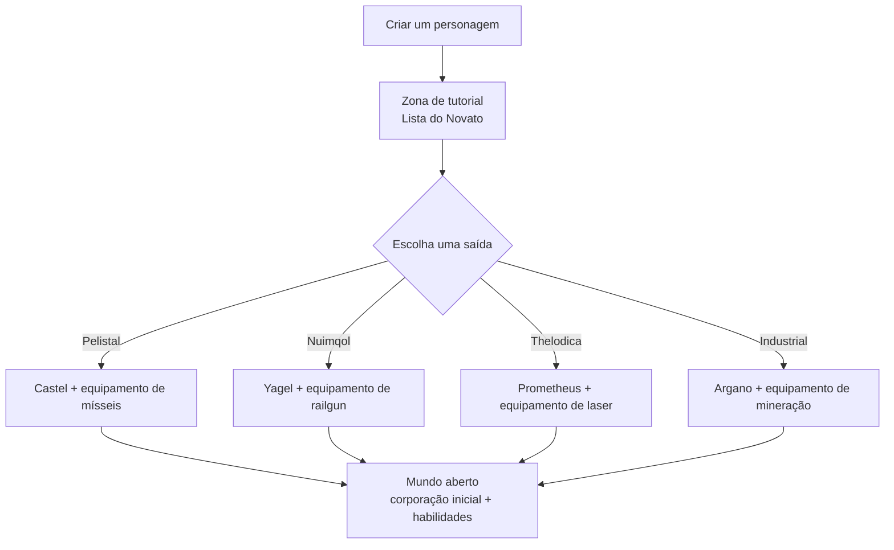

# Primeiros passos

Esta página aborda as primeiras etapas: criar um personagem, obter seu primeiro robô
e as configurações de nível de personagem que você utilizará no início.

> As localizações na interface seguem a [visão geral da interface do cliente](/pt/features/ui/). As mecânicas
> abaixo foram confirmadas com a implementação do servidor.

## Obtenha o jogo

Perpetuum é gratuito no [Steam](https://store.steampowered.com/app/223410/Perpetuum/).

  <a class="steam-card-link" href="https://store.steampowered.com/app/223410/Perpetuum/" target="_blank" rel="noopener">
    
    Perpetuum no Steam — gratuito para jogar
  </a>

## Assista primeiro

Guias do Open Perpetuum Project. Clique em um cartão para reproduzi-lo aqui.

  

    
    &#9654;
    
Perpetuum Online Tutorial Walkthrough. + Extension Advice and lots more.

  

  

    
    &#9654;
    
Syndicate Careers Help — Artifacting

  

  

    
    &#9654;
    
Open Perpetuum Tutorial — How to run multiple clients

  

## Criando um personagem

- Você pode **verificar se um nome está disponível** antes de criá-lo (`characterCheckNick`).
- **Crie o personagem** — ele fica vinculado à sua conta. Uma conta pode ter vários
  personagens; você joga com um de cada vez.
- **Selecione um personagem** para jogar. Trocar de personagem desseleciona o atual.
- Você pode **renomear** um personagem posteriormente (o novo nome deve estar disponível).
- Você pode **excluir** um personagem que não usa mais.

## Seu primeiro robô

- Enquanto estiver **atracado em uma base**, você pode **solicitar o robô inicial** (instalações da base —
  consulte a [visão geral da interface do cliente](/pt/features/ui/) para saber onde ficam as ações da base).
  - A base precisa ter robôs iniciais em estoque — em bases movimentadas o estoque pode esgotar,
    fazendo a solicitação falhar.
  - Há um **tempo de recarga de 5 minutos** entre solicitações de robô inicial por personagem.
  - O novo robô é entregue no contêiner público da base.

- Enquanto estiver atracado, você também pode **solicitar uma "caixa infinita"**: um contêiner especial adicionado ao
  seu inventário por uma **taxa de 5.000 créditos**. Trata-se de um contêiner de conveniência, não de uma
  fonte de recursos gratuitos.

## Configurações do personagem

- **Avatar** — a aparência do seu personagem.
- **Mensagem de humor** — uma linha curta exibida para outros jogadores.
- **Nota privada** — uma nota que só você visualiza em um dos seus próprios personagens.
- **Base inicial (Home base)** — defina ou limpe sua base inicial; é o seu ponto de atracação padrão quando o jogo
  precisa colocar você em um local seguro.
- **Configurações** — preferências individuais do personagem (consultar/definir).
- **Bloquear trocas** — ative ou desative as trocas para um personagem.
- **Créditos** — transfira créditos entre seus próprios personagens; veja o histórico de transações.
- **Nível da conta** — altere e-mail/senha da sessão, veja o histórico de transações da conta e o histórico
  de EP por atividades.

## Saindo / retornando

- **Encerrar sessão** finaliza o jogo; **selecionar personagem** inicia novamente.
- Se o servidor desconectar você (por exemplo, retorno forçado à base), você reaparecerá atracado — consulte [movimento](/pt/features/movement/).

## O tutorial

Novos personagens começam na zona de treinamento com uma **Lista do Novato** — conclua-a:
ela ensina o básico e fornece vários robôs com módulos e munição. Você pode
pulá-la (desatracando e indo até uma saída de facção), mas perderá as recompensas e não
poderá retornar à zona de treinamento depois. O que as quatro saídas de facção concedem está
no [FAQ](/pt/features/faq/#o-que-cada-saida-me-concede).

## Sobrevivência

Perpetuum é um sandbox de risco e recompensa: quando seu robô é destruído, você o perde —
atracado ou não, abatido por jogador ou NPC — e reaparece na sua [base inicial](#configuracoes-do-personagem)
(você pode solicitar um robô inicial gratuito lá se chegar sem nada). Algumas regras
que mantêm as perdas sob controle:

- **Arrisque apenas o que puder repor.** Desatracar é uma aposta: se o robô for
  destruído, ele e seus módulos equipados serão perdidos (ou virarão espólio). Antes de lançar,
  certifique-se de que a perda seja tolerável.
- **Conheça as zonas.** As ilhas protegidas (PvE) são seguras contra jogadores; as
  ilhas de PvP aberto são livres para combate, sem sistema de crime/punição. Consulte
  [zonas](/zones/) para visualizar o mapa.
- **Conheça os NPCs.** Marcadores laranjas só atacam quando provocados; marcadores vermelhos
  atacam por aproximação. Corra e quebre a linha de visão para perder a hostilidade (aggro). Veja
  [NPCs & caça PVE](/pt/features/npcs/).
- **Atenue o risco, não apenas aceite-o.** Ir para uma ilha de PvP aberto com seu melhor
  robô equipado em T4 é como robôs morrem. Equipamentos mais baratos e fáceis de repor que se pagam
  em poucas viagens superam a máquina cara que leva vinte viagens para se pagar.
- **Construa um ciclo sustentável.** Tudo o que você faz — missões, coleta, caça,
  produção, transporte — rende NIC para alguém. Mantenha reservas para que um dia ruim
  não zere sua renda.

## O que fazer a seguir

1. Selecione seu robô inicial e conheça a tela de [hangar & montagem](/pt/features/robots/).
2. Desatraque e entre na zona — consulte [movimento](/pt/features/movement/).
3. Escaneie o solo e comece a coletar recursos — consulte [coleta](/pt/features/gathering/).
4. Pesquise suas primeiras extensões — consulte [pesquisa](/pt/features/research/).
5. Escolha uma carreira — o [FAQ](/pt/features/faq/#o-que-devo-fazer-depois-de-sair) traz as opções.

<!-- TODO(Phase 1): verify client UI flow (account creation screen, character wizard).
     UI model: see features/ui.md (EVE-style, project-provided).
     Developer notes: Perpetuum.RequestHandlers.Characters/* (CharacterCreate,
     CharacterSelect, CharacterRename, CharacterSetHomeBase, ...);
     RequestStarterRobot (5-minute cooldown, base stock), RequestInfiniteBox
     (5000 credits, docked-only). -->