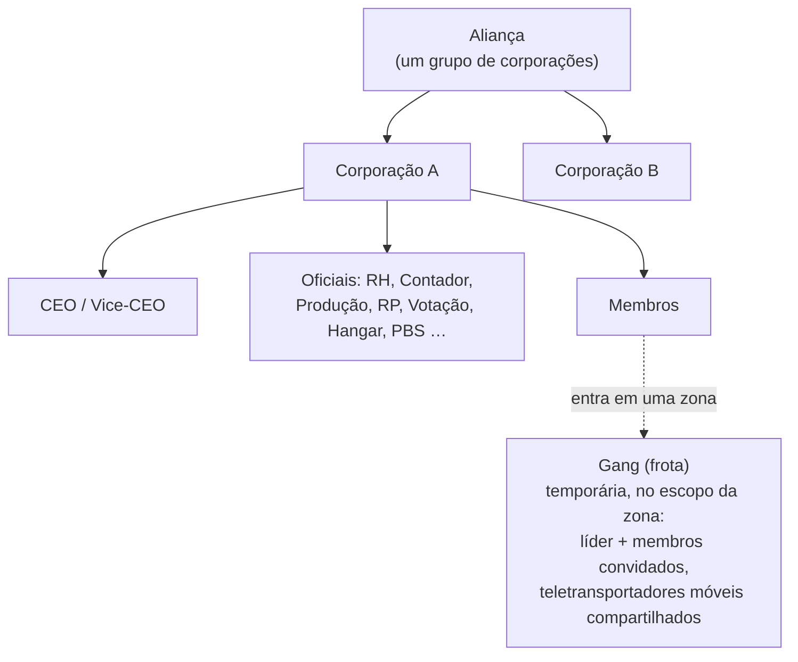

# Grupos

Existem três tipos de agrupamentos: **corporações** (sua organização principal), **alianças** (grupos de
corporações) e **gangs/esquadrões** (frotas temporárias para atuação nas zonas).

> Os locais da interface seguem a [visão geral da interface do cliente](/pt/features/ui/) (o botão **Corporação** no canto superior esquerdo;
> a categoria **Armazenamento da Corp**; frotas têm sua própria janela). As mecânicas abaixo são
> confirmadas no servidor.

## Corporações

### Entrada e saída
- **Criar** uma corporação — requer a extensão básica de gerenciamento de corporação
  (nível 1) e uma taxa de fundação de **250.000 NIC**. Você escolhe o nome oficial,
  uma **sigla/ID curto** (máx. 6 caracteres, exibida no terreno para identificar seus membros)
  e a **taxa de imposto** — uma porcentagem dos ganhos dos membros (notadamente pagamentos de missões) que vai
  para a conta da corporação automaticamente.
- **Candidatar-se** a uma corporação, ou **convidar** um personagem para entrar.
- **Aceitar uma candidatura** / **listar candidaturas** (oficiais).
- **Responder** a um convite recebido.
- **Sair**, ou **cancelar** uma saída pendente.
- **Remover um membro**, **definir a função de um membro**, **renunciar às suas próprias funções** ou definir membros
  como neutros.

### Funções (Roles)
As corporações possuem uma hierarquia de funções. As funções determinam o que você pode fazer — por exemplo, desbloquear
nós da árvore tecnológica da corporação, gerenciar o hangar ou editar o PBS (veja
[pbs](/pt/features/pbs/)). As funções definidas pelo servidor (`CorporationRole`):

- **CEO** — controle total.
- **Vice-CEO (Deputy CEO)** — segundo em comando.
- **Gerente de RH (HR Manager)** — gestão de membros (candidatar/convidar/remover).
- **Delegado da Corporação / Delegado da Aliança** — agem em nome da organização.
- **Contador (Accountant)** — fundos da corporação.
- **Gerente de Produção (Production Manager)** — produção corporativa.
- **Administrador de Votações (Vote Admin)** — votações.
- **Gerente de Relações Públicas (PR Manager)** — relações públicas / quadro de avisos.
- **Acesso ao Hangar (baixo / médio / alto / seguro)** — permissões em níveis para o hangar, com
  níveis correspondentes de **remoção de itens do hangar** e uma função de **operador de hangar**.
- **Visualizar PBS / Editar PBS** — visualizar ou modificar estruturas PBS da corporação.
- **Listar / Desbloquear Árvore Tecnológica** — visualizar ou desbloquear tecnologias da árvore corporativa.

Alguns requisitos típicos de permissão: ações de membresia (candidatar/convidar/remover, definir funções) exigem
**CEO / Vice-CEO / Gerente de RH**; o quadro de avisos e RP exigem **CEO / Vice-CEO / Gerente de RP**;
dinheiro da corporação e aprimoramentos de instalações exigem **CEO / Vice-CEO / Contador** (a produção inclui o
**Gerente de Produção**); implantação de PBS exige **CEO / Vice-CEO / Editar PBS**.

Você pode consultar o **histórico de funções** de si mesmo e de outros membros. O espaço de hangar é alugado (configuração
padrão do servidor: 50.000 créditos a cada período de 7 dias).

### Informações e busca
- **Informações da corporação / Minhas informações** — detalhes e seu status de membro.
- **Buscar** corporações.
- **Relações / Reputação (Standings)** — nível de relacionamento e reputação da sua corporação.
- **Delegados** — personagens que atuam em nome da corporação.

### Finanças
- **Doar** para a carteira da corporação.
- **Realizar pagamentos** a partir dela.
- **Transferir** fundos entre carteiras.

### Aparência e perfil
- **Renomear**, **definir cor**, **definir informações** (perfil público).
- **Logotipo** — até 5 símbolos de um conjunto fixo, cada um editável (tamanho, transparência,
  camadas); apenas membros autorizados podem criar ou alterá-lo.
- **Histórico de nomes** — nomes anteriores utilizados.

### CEO
- **Voluntariar-se para CEO**, ou verificar o **status de tomada de posse do CEO**.
- **Tomada de posse na prática**: quando um CEO fica offline por **30 dias**, um Vice-CEO
  pode iniciar a tomada de posse — uma **contagem regressiva de 48 horas** tem início, anunciada na
  janela da corporação. O CEO ou qualquer outro Vice-CEO pode aplicar um **veto** instantaneamente (um veto não
  impede a próxima tentativa se o CEO continuar sem fazer login). Se a contagem regressiva chegar a
  zero, o Vice-CEO torna-se o novo CEO com privilégios totais.

### Votações
As corporações podem realizar **votações**:
- **Iniciar** uma votação, **definir seu tema**, **listar** votações, **votar**, **excluir** uma votação.

## O quadro de avisos (Bulletin board)
Um mural de avisos mantido pela corporação:
- **Iniciar**, **listar** publicações, ver **novas publicações**, **publicar** um aviso, **moderar**
  (editar/remover avisos de outros membros) e visualizar **detalhes**.

## Hangar da corporação (Armazenamento)
Uma área de armazenamento compartilhado da corporação localizada nas bases:
- **Alugar** uma seção de hangar, **pagar aluguel**, consultar o **preço do aluguel**, **fechar** a seção.
- **Listar** conteúdos (todos ou em uma base específica).
- **Pastas** — criar/excluir subpastas.
- **Definir acesso** (quem pode utilizá-lo) e **definir um nome**.
- **Registros (Logs)** — visualizar, configurar e limpar o registro de acessos do hangar.

Nota: você **não pode selecionar um robô do hangar corporativo** diretamente como seu robô ativo
(veja [robôs](/pt/features/robots/)).

## Documentos corporativos
Um sistema de documentos de texto compartilhado e com controle de versão para a corporação. Existem dois
tipos de documento:

- **Plano PBS** — um plano/projeto estrutural para a rede PBS da corporação.
- **Projeto de terraformação** — um registro de projeto de modificação do terreno.

Operações: **criar**, **listar**, **abrir**, **atualizar corpo** (com controle de versão), **excluir**,
**transferir** posse, **alugar** (estender o período de validade), **monitorar** / **desmonitorar**
(receber notificações de alterações), além de uma **lista de registro** (até 25 membros) que controla quem
pode trabalhar no documento.

## Alianças

Uma aliança agrupa múltiplas corporações:
- **Informações da minha aliança**, **alianças padrão** e **histórico de funções da aliança**.
- Relações (standings) podem ter alianças como alvo (veja [social](/pt/features/social/)).

## Gangs (Frotas)

Uma **gang** é um grupo temporário para atividades na zona (ex.: compartilhar um teletransportador móvel ou lutar
em equipe):
- **Criar**, **excluir**, **informações**.
- **Convidar**, **responder** a convites, **expulsar**, **sair**.
- **Definir líder**, **definir função**.

O pertencimento a uma frota é crucial para **teletransportadores móveis** — apenas o proprietário ou um membro da frota pode
utilizá-lo (veja [movimento](/pt/features/movement/)).

## Notas práticas

- **Funções controlam permissões** — a maioria das ações de oficiais (candidaturas, hangar, PBS, votações) exige
  a função apropriada.
- **Tecnologia corporativa é compartilhada** — desbloquear para a corporação consome pontos compartilhados e um
  multiplicador (veja [pesquisa](/pt/features/research/)).
- **O hangar é armazenamento, não rampa de lançamento** — você não pode desatracar a partir dele diretamente em um robô.
- **Frotas são efêmeras** — utilize-as para uma sessão na zona, não como organização permanente.
- **As relações seguem sua corporação** — o nível de relacionamento da sua corporação afeta como o universo
  trata você (veja [social](/pt/features/social/)).

<!-- TODO: only the corp UI remains (window layout, role picker).
     Confirmed: CorporationRole enum (21 roles incl. hangar access/remove tiers
     low/medium/high/secure, viewPBS/editPBS, TechTreeList/TechTreeUnlock, delegates);
     permission gates sampled from handlers (membership CEO/Deputy/HRManager;
     bulletin CEO/Deputy/PRManager; money+facility upgrades CEO/Deputy/Accountant;
     production +ProductionManager; PBS CEO/Deputy/editPBS); documents = pbsPlan(1) +
     terraformProject(2) (CorporationDocumentType.cs), versioned, rent extends validity,
     monitor for change notifications, register list max 25 (MAX_REGISTERED_MEMBERS).
     Developer notes: Corporations/* (apply/invite/accept, roles, leave, info, money,
     votes, bulletin, hangar, documents, histories, CEO); AllianceGetMyInfo.cs /
     AllianceGetDefaults.cs / AllianceRoleHistory.cs; Gangs/* (create/invite/kick/leave,
     leader/role). SelectActiveRobot.cs forbids corp-hangar robots. -->
