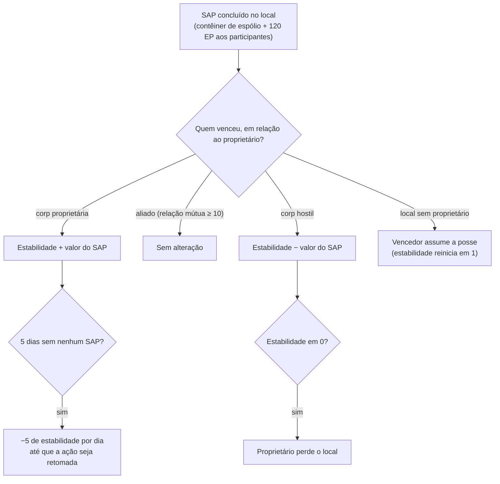

# Intrusão

A **Intrusão** é um modo centrado em **locais de NPC (NPC sites)** — instalações gerenciadas por jogadores ou disputáveis com
**estabilidade**, **defesa** e **instalações**. Você investe itens, eleva defesas e
aprimora instalações para controlar um local e lucrar com ele.

> O nome no cliente para "intrusão" deve ser confirmado. Os locais da interface seguem a
> [visão geral da interface do cliente](/pt/features/ui/). As mecânicas abaixo são confirmadas pelo servidor.

## Locais e estabilidade

- **Informações do local** — detalhes de um local de intrusão.
- **Estabilidade** — o atributo principal do local, um valor de **0 a 150**. Um novo proprietário começa em
  **1**. A estabilidade comanda tudo:
  - **Limiares de bônus** (conteúdo, `intrusionsitestabilitythreshold`): bônus de instalações
    são desbloqueados na estabilidade **20 / 60 / 80**; um conjunto de efeitos de aura (núcleo de intrusão,
    detecção, geo-escaneamento, colhedor, industrial, ocultação, mineração, reparo, sinais — cada um de
    nível 1 a 3, além de efeitos combinados de nível 4) é desbloqueado em níveis em **10, 20, 40, 50, 70, 80 e
    100**; **direitos de atracação** são desbloqueados em **50**; o limite de nós de defesa sobe em **40**.
  - **Pontos de produção** = `estabilidade / 10` (máx. 15) — a moeda para aprimorar
    instalações (um ponto por nível).
  - **Degradação (Decay)**: se nenhum SAP bem-sucedido ocorrer por **5 dias**, o local começa a perder
    **5 pontos de estabilidade por dia** até que uma nova ação seja tomada.
  - **Perda**: se a estabilidade chegar a **0**, o proprietário perde o local (ele se torna
    sem proprietário).
- **Registro de estabilidade** — consulta das alterações na estabilidade de um local.

### Quem altera a estabilidade

As mudanças de estabilidade são provenientes de **SAPs** concluídos (abaixo) e da degradação natural do sistema. O efeito
depende de *quem* vence o SAP em relação ao proprietário atual:

- **O proprietário vence** → a estabilidade **aumenta** pelo valor do SAP.
- **Um aliado vence** (relação mútua ≥ 10) → **nenhuma alteração**.
- **Uma corporação hostil vence** → a estabilidade **diminui** pelo valor do SAP.
- **Local sem dono** → a primeira corporação de jogadores vencedora **assume a propriedade** (a estabilidade
  reinicia em 1).

## SAPs (Pontos de Ataque ao Local / Site Attack Points)

Um **SAP** é um objetivo temporário que surge em um local. Ao concluí-lo, surge um **contêiner de
espólio** na posição do SAP, a estabilidade é alterada e **120 EP** são concedidos a cada
personagem participante. **Cultistas NPC também disputam os SAPs** — se eles pontuarem
primeiro, o SAP contará contra o seu lado. Existem quatro tipos de SAP:

| SAP | Como concluir | Valor de estabilidade |
|---|---|---|
| **Hacking ativo** | use um módulo de invasão (hacking) no SAP (até 120 usos do módulo) | +15 |
| **Hacking passivo** | permaneça dentro de um alcance de 5 metros do SAP por **8 minutos** | +10 |
| **Destruição** | cause dano ao SAP até destruí-lo (dano de NPCs também conta) | +15 |
| **Processamento de espécimes** | entregue **5–6 espécimes de SAP** (em lotes de 2–3, recarga de 1,5 min, alcance 7) | +15 |

- **Entregar um item de SAP** — em uma zona, entregue um espécime a um SAP de processamento de espécimes.
- **Informações do item de SAP** — inspecione os dados dos itens de SAP (seus e gerais).

Os espécimes de SAP são os consumíveis desse modo; eles também contêm um alto valor de energia de núcleo, servindo
também como [combustível de reator PBS](/pt/features/pbs/).

## Defesa e efeitos

- **Definir limite de defesa** — configura o limiar de ativação das defesas automatizadas do local.
- **Definir bônus de efeito** — configura o bônus de aura/efeito em um local (a partir do conjunto de auras
  desbloqueado pela estabilidade).
- **Aprimorar uma instalação** — melhora uma instalação do local: custa **1 ponto de produção**
  (ou seja, 10 de estabilidade), ação restrita a CEO / Vice-CEO / Contador, limitado a um nível máximo.
- **Definir mensagem do local** — define uma mensagem pública exibida para o local.

## Registros (Logs)

- **Meu registro de intrusão** — seu histórico de atividades de intrusão.
- **Registro público** — o feed público de eventos de intrusão.
- **Registro dos meus locais** — atividades ocorridas nos seus locais.
- **Registro de estabilidade** — alterações de estabilidade (veja acima).

## Notas práticas

- **A estabilidade é o atributo central** — ela desbloqueia os níveis de bônus, gera a moeda de
  melhorias e é o que os SAPs hostis removem.
- **SAPs são disputados** — os cultistas NPC competem com você; um SAP perdido custa sua estabilidade.
- **Não deixe um local abandonado** — 5 dias sem um SAP concluído ativam a degradação diária.
- **Os registros contam a história** — use os registros pessoais, públicos e de estabilidade para acompanhar tudo o que acontece em seus locais.

<!-- TODO: only the in-client name for "intrusion" and the UI remain.
     Confirmed: stability 0-150, start 1 (Outpost.cs constants); bonus thresholds from
     intrusionsitestabilitythreshold (facility 20/60/80; aura effects 50-74 at tiers
     10/20/40/50/70/80/100; docking rights 50; defense nodes 40); production points =
     stability/10, facility upgrade costs 1 point, CEO/Deputy/Accountant; decay -5/day
     after 5 days idle (OutpostDecay.cs); owner-win +, ally (standing>=10) 0,
     hostile -; unowned -> winner takes it; stability 0 -> ownership lost; 120 EP per
     SAP participant (EP_WINNER, EpForActivityType.Intrusion); 4 SAP types: active
     hacking (120 module uses, +15), passive (8 min in range 5, +10), destruction
     (kill it, +15), specimen processing (5-6 specimens in 2-3 batches, 1.5 min cd,
     range 7, +15; siegeitems table: def_specimen_sap_item 2-3); SAP increase values
     from entitydefaults #increase option; NPC sap guard/invade units contest SAPs.
     Developer notes: Intrusion/IntrusionSAPSubmitItem.cs (SpecimenProcessingSAP,
     zone submit), IntrusionSAPGetItemInfo.cs / IntrusionSapItemInfo.cs,
     IntrusionSetDefenseThreshold.cs, IntrusionSiteSetEffectBonus.cs,
     IntrusionUpgradeFacility.cs, SetIntrusionSiteMessage.cs; GetIntrusionSiteInfo.cs,
     GetIntrusionLog.cs / GetIntrusionPublicLog.cs / GetIntrusionMySitesLog.cs /
     GetIntrusionStabilityLog.cs, GetStabilityBonusThresholds.cs;
     EventProcessors/AffectOutpostStability.cs; Zones/Intrusion/Outpost.cs,
     OutpostDecay.cs, SAP.cs + *SAP.cs subclasses. -->
