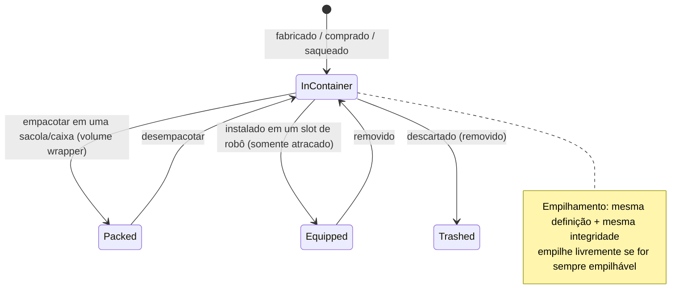

# Itens & inventário

Seu **inventário** é um conjunto de **contêineres** (o contêiner público da base, o compartimento
de carga do seu robô, bolsas/caixas, etc.). Esta página aborda a manipulação de itens dentro deles.

> As localizações na interface seguem a [visão geral da interface do cliente](/pt/features/ui/). As mecânicas
> abaixo foram confirmadas com o servidor.

## Contêineres

- **Listar um contêiner** — visualizar seu conteúdo.
- **Mover itens** — transferir itens entre contêineres aos quais você tem acesso.

Regras de acesso são aplicadas: alguns contêineres (hangar da corporação, inventário do robô, contêineres do sistema)
são restritos — consulte [robôs](/pt/features/robots/) e [grupos](/pt/features/groups/).

## Empacotamento & desempacotamento

- **Empacotar itens** — colocar itens dentro de uma bolsa/caixa (um contêiner "envoltório de volume") para transportá-los
  de forma compacta.
- **Desempacotar itens** — retirar os itens de volta da bolsa/caixa.

O empacotamento também é a forma de compactar um **robô** para armazenamento/transporte: o servidor remove seu
estado dinâmico e componentes, marcando-o como *reembalado (repacked)*. Um robô só pode ser empacotado se estiver
**sem danos**, **não selecionado**, **não segurado** e com o **inventário vazio**.
Desempacotar reconstrói o robô e o repara. Apenas itens com a flag *repackable* no conteúdo podem
ser empacotados; um robô reembalado não pode ser selecionado nem equipado até ser desempacotado
(consulte [robôs](/pt/features/robots/)).

## Empilhamento

Muitos itens podem ser empilhados. Operações de empilhamento:

- **Empilhar itens** / **empilhar em** / **empilhar seleção** — combinar itens do mesmo tipo
  em uma pilha (ou mover uma pilha sobre outra).
- **Desempilhar uma quantidade** — separar uma quantidade específica de uma pilha.

O servidor só agrupa itens que compartilham a **mesma definição e a mesma integridade (health)**.
Itens marcados como *sempre empilháveis* (minérios, munições, a maioria das matérias-primas) empilham livremente;
itens marcados como *não empilháveis* nunca empilham; todo o resto pode empilhar **apenas enquanto reembalado**
(empacotado) — portanto, equipamentos desempacotados ou danificados permanecem individuais.

## Nomeando & usando

- **Renomear um item** — dar um nome personalizado a um item.
- **Usar um item** — ativar um item utilizável (depende do contexto; em uma zona isso também pode
  interagir com objetos da zona — consulte [coleta](/pt/features/gathering/)).
- **Usar item de loteria** — abrir/ativar um item do tipo sorteio/loteria.

## Lixo & reembolso

- **Descartar itens (lixo)** — descartar itens (são excluídos permanentemente).
- **Reembolsar um item** — fluxo administrativo de reembolso da equipe: cria o item e o entrega
  a um personagem, registrado no log de transações. Jogadores não acionam isso diretamente.

## Itens especiais

- **Resgatáveis (Redeemables)** — listar, **resgatar** ou **ativar** itens resgatáveis (códigos/concessões).
- **Pacotes de brindes (Goodie packs)** — listar e **resgatar** pacotes de brindes (conjuntos de itens).
- **Abrir um presente** — um presente contém um item **aleatório** extraído de um conjunto de recompensas
  do servidor (munição, minérios brutos, plasma, kits de pesquisa, módulos, cápsulas, tintas, aceleradores —
  221 definições possíveis, cada uma com sua própria faixa de quantidade).

## Notas práticas

- **O acesso é por contêiner** — você só pode interagir com contêineres que possui ou para os quais recebeu permissão.
- **Empacote para carregar mais** — bolsas/caixas permitem transportar itens a granel de forma compacta.
- **Pilhas economizam espaço** — junte itens semelhantes; desempilhe para retirar exatamente o que precisa.
- **Descartar no lixo é permanente** — itens excluídos desaparecem para sempre.
- **Resgatáveis e pacotes de brindes são de uso único** — resgatar consome o código/item.
- **Robôs empacotados ficam inertes** — desempacote antes de selecioná-los ou equipá-los.
- **Apenas itens empacotados se empilham** — se itens semelhantes não se agruparem, empacote-os (ou repare-os) primeiro.

<!-- TODO: only the inventory UI remains.
     Confirmed: stacking rules (Item.cs CanStackTo: same ED + same health; AttributeFlags
     alwaysStackable/nonStackable; others must be repackaged); pack rules (ItemPacker.cs:
     robot must be undamaged, not selected, not insured, empty inventory; repackable
     flag); unpack rebuilds + repairs (ItemUnpacker.cs); gifts = random draw from
     giftloots (221 defs: ammo x1500-2000, epriton/fluxore x600-1000, reactor plasma
     x10-20k, research kits, paints, capsules, named3 modules, boosters, respec tokens);
     goodie packs are campaign-based (GoodiePackRedeem: campaignID + indy selection);
     ReimburseItem = admin tool (opp_reimburselog). AttributeFlags bit positions:
     nonStackable=10, alwaysStackable=11, repackable, consumable=24, deployable=23.
     Developer notes: ListContainer.cs; RelocateItems.cs; PackItems.cs / UnpackItems.cs;
     StackTo.cs / StackSelection.cs / UnstackAmount.cs; SetItemName.cs; UseItem.cs /
     UseLotteryItem.cs; TrashItems.cs; ReimburseItem.cs (PbsReimburseRequestHander.cs);
     RedeemableItemList.cs / RedeemableItemRedeem.cs / RedeemableItemActivate.cs;
     GoodiePackList.cs / GoodiePackRedeem.cs; GiftOpen.cs. Container access:
     ContainerAccess / ContainerAccessChecker.cs. -->