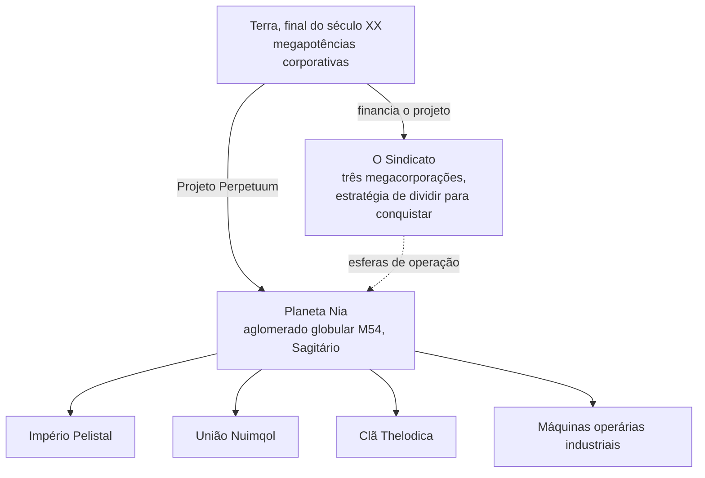

# História & Ambientação

## A descoberta de Nia

A explosão tecnológica do final do século XX na Terra — a internet, a fusão da TI com a medicina,
a pesquisa espacial — derrubou as antigas fronteiras físicas e mentais. A comunicação e o comércio
tornaram-se mais rápidos e baratos, e as grandes corporações cresceram a ponto de se tornarem os governos
de fato de suas regiões.

Foi nesse mundo que ocorreu a descoberta do **planeta Nia**, no aglomerado globular M54 de Sagitário
(a origem do logotipo do projeto). Nia orbita uma de um par de estrelas — sendo o quarto planeta desse
par — e é surpreendentemente semelhante à Terra: temperatura média de superfície em torno de 19 °C e
uma densidade atmosférica próxima à terrestre. Duas peculiaridades o diferenciam. Seus oceanos são
barreiras intransponíveis para qualquer equipamento elétrico — o núcleo denso do planeta e sua rotação
rápida os mantêm eletricamente carregados — e apenas cerca de 17% da superfície é terra firme, a qual
a tectônica de placas acelerada continua fragmentando em ilhas. Nessa terra firme, a vida prospera.

## Os Nians

Os habitantes de Nia fogem à definição usual de "forma de vida": são espécies sintéticas, de forma
não muito diferente dos nossos robôs, mas organizadas em **sociedades** tecnologicamente avançadas e
distintas — cada uma com sua própria indústria, forças armadas e cultura. A conquista que mais importa
para uma Terra faminta por recursos é a sua **tecnologia de produção de energia**.

Três raças alienígenas lutam pela vitória final pelas cadeias de ilhas de seus domínios — o
**Império Pelistal**, a **União Nuimqol** e o **Clã Thelodica** — com uma população **Industrial** dispersa
de máquinas operárias entre elas (esses são os mesmos quatro grupos que você encontra como
[NPCs](/pt/features/npcs/)).

## O Sindicato

O principal investidor do Projeto Perpetuum é o **Sindicato** — uma aliança das três megacorporações
terrestres mais poderosas, cada uma operando sua própria esfera de atividades na superfície:

| Corporação | Domínio |
|---|---|
| **Truhold-Markson** | Gigante norte-americana de bens de consumo; avançando sobre o decadente domínio **Pelistal**. |
| **ICS — Institute of Corporate Security** | Associação euro-russa; operando no território rebelde **Nuimqol**. |
| **Asintec** | Hegemonia industrial asiática com seus vizinhos de alta tecnologia; travando uma ofensiva em grande escala contra o **Clã Thelodica**. |

A estratégia adotada é a clássica *dividir para conquistar*: manter as três esferas equilibradas entre si
faz com que as potências alienígenas continuem lutando umas contra as outras em vez de se unirem. "Agentes"
humanos trabalham na superfície — colhendo os recursos energéticos dos Nians, estudando sua tecnologia e
patrulhando a paz que o Sindicato almeja manter.

É exatamente aí que você entra.

<!--
Developer notes: rewritten 2026 in original prose from the canonical setting.
An earlier version was adapted from the Open Perpetuum community wiki
(perpetuum.miraheze.org: Discovery of Nia, Nia, Syndicate); that text was
fully replaced, not reused.
Consistency with backend: the three alien races + Industrial match the NPC
races (see /pt/features/npcs/); the corporation names match the zone abbreviations
(zone_ICS, zone_ASI, zone_TM — the beta-tier zones in /zones/ are named after
their megacorporations).
-->
