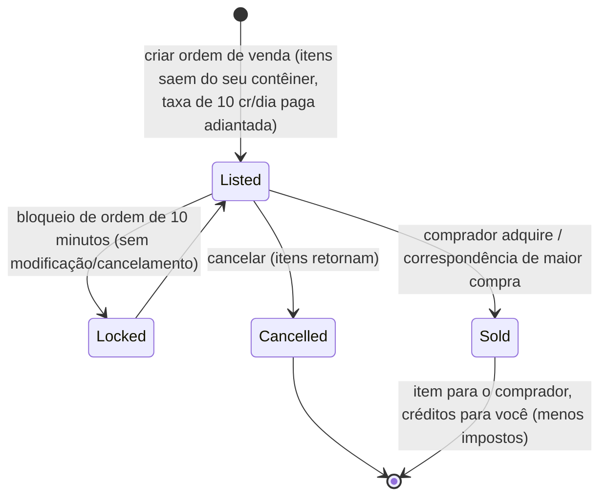

# Mercado & comércio

O **mercado** é onde você compra e vende itens em uma base. Todas as ações de mercado ocorrem
**apenas atracado** (você negocia na base em que está atracado).

> As localizações na interface seguem a [visão geral da interface do cliente](/pt/features/ui/) (a categoria
> **Mercado** na barra superior). As mecânicas abaixo foram confirmadas com o servidor.

## Ordens de mercado

Você coloca dois tipos de ordens no mercado da sua base atual:

### Ordens de venda
Liste itens para venda.
- Escolha o **item**, a **quantidade**, o **preço unitário** e a **duração** em dias
  (mínimo 1).
- O item é retirado do seu contêiner (desempilhado caso você esteja vendendo parte de uma pilha).
- **Taxa de listagem** — você paga `10 créditos × duração` adiantado (reduzível pela
  extensão de *taxa de transação de mercado*); a taxa vai para o banco central da base (fundo de lucro da zona).
- **Proteção de preço (Price guard)** — quando ativada, seu preço deve ficar dentro de **±30%** do
  **preço médio de 14 dias** do item; preços fora dessa faixa são recusados. *(Esta proteção está
  atualmente **desativada** neste servidor.)*
- **Bloqueio de ordem** — uma ordem não pode ser modificada nem cancelada durante **10 minutos** após
  ser criada.
- **Contagem de ordens** — você pode manter 1 + (extensão de *especialista em ordens de venda*) ordens de venda
  abertas (ordens de compra possuem contador próprio).
- **Para minha corporação** — você pode restringir uma ordem de venda apenas aos membros da sua corporação
  (apenas para corporações não padrão).
- Pague a partir da sua carteira **pessoal** ou da carteira da **corporação**, conforme aplicável.

### Ordens de compra
Coloque uma ordem pendente para comprar um item por um determinado preço.
- O mercado a preenche quando surgir uma venda correspondente.

### Gerenciando ordens
- **Modificar uma ordem** — altere preço/quantidade/duração.
- **Cancelar um item / ordem** — retire a ordem (o item retorna ao seu contêiner).
- **Meus itens** — veja suas ordens abertas.
- **Correspondência com maior compra** — uma venda pode ser direcionada automaticamente a uma ordem de compra existente.

## Compra direta

- **Comprar um item** — compra imediata de um item disponível no mercado (sem ordem pendente).

## Navegando no mercado

- **Lista de itens / itens disponíveis / itens no alcance** — navegue pelo que está à venda.
- **Informações do mercado** — detalhes sobre o mercado da base.
- **Preços médios** — média do mercado local, média por definição e média **global**.
  São essas médias que servem de base para a proteção de preço.

## Imposto de mercado

- **Alterar imposto de mercado** — define a alíquota de imposto no mercado. Apenas os **mercados de bases PBS**
  são controlados por jogadores; em todos os outros locais aplica-se o padrão fixo.
- **Registro de impostos** — visualize as alterações fiscais.

O imposto é deduzido do que o **vendedor** recebe em uma venda no mercado. A alíquota padrão é de
**12%** (o vendedor recebe 88% do preço de venda); a alíquota pode ser reduzida pela extensão de
*imposto de transação de mercado* e, em mercados de jogadores, pelo proprietário da base PBS definindo
uma taxa personalizada.

## Trocas diretas entre jogadores

Uma **troca (trade)** é uma negociação ponto a ponto entre dois personagens atracados:

- **Iniciar uma troca** — inicia uma sessão com outro jogador.
- **Definir / retirar minha oferta** — coloque itens/créditos do seu lado.
- **Aceitar** — ambos os lados aceitam para concluir a troca de forma atômica.
- **Cancelar** — aborta a negociação.
- **Troca concluída / estado** — finalização e estado atual.

Um personagem pode **bloquear trocas** em suas configurações (consulte [primeiros passos](/pt/features/getting-started/)).

## A loja de itens

A **loja de itens** é um vendedor com preços fixos em uma base (não gerido por jogadores). O catálogo completo
(todos os itens, quantidades, preços por moeda, requisitos de reputação) é gerado em
[Loja de itens](/content/shop/).

- **Listar** — veja o que a loja vende.
- **Comprar** — adquira um item por créditos.

## Transferindo créditos

- **Transferir créditos** entre seus próprios personagens (consulte [primeiros passos](/pt/features/getting-started/)).

## Notas práticas

- **Tudo ocorre apenas atracado** — você não pode negociar dentro de uma zona.
- **Considere o imposto de 12% na sua precificação** — vendedores recebem 88% do valor anunciado
  por padrão (menos em mercados PBS com impostos altos).
- **A taxa de listagem é paga adiantada** — anúncios de longa duração custam mais, mesmo que o item seja vendido no primeiro dia.
- **Ordens exclusivas da corporação** são uma forma prática de movimentar mercadorias internamente sem exposição pública.
- **As trocas são atômicas** — ambos os lados devem aceitar, ou nada é transferido.
- **O imposto altera o rendimento real** — considere o imposto de mercado ao definir seus preços.

<!-- TODO: only the client UI remains (market and trade screen flows).
     Confirmed: MarketInfoService(0.3, 10, false) registered in
     PerpetuumBootstrapper.cs -> margin +-30% vs 14-day average (MARKET_AVERAGE_DAYSBACK
     14), fee 10 credits/day (Market.MARKET_FEE), CheckAveragePrice=false on this
     server; DEFAULT_MARKET_TAX = 0.12 (seller gets 88%), player-controlled tax only on
     PBSDockingBase markets (MarketTaxHelper); order modify/cancel locked 10 min after
     submit (MARKET_CANCEL_TIME); order count = 1 + expert extension bonus;
     fee paid up front to the base's central bank. -->
     Developer notes: Markets/MarketCreateSellOrder.cs (docked, price guard vs average
     price, corp-only, unstack, corp wallet), MarketCreateBuyOrder.cs,
     MarketModifyOrder.cs, MarketCancelItem.cs, MarketBuyItem.cs, MarketItemList.cs,
     MarketAvailableItems.cs, MarketItemsInRange.cs, MarketGetMyItems.cs,
     MarketGetAveragePrices.cs / MarketGetDefinitionAveragePrice.cs /
     MarketGlobalAveragePrices.cs, MarketTaxChange.cs / MarketTaxLogList.cs;
     Trade*.cs (begin/offer/accept/cancel, atomic); ItemShopList.cs / ItemShopBuy.cs;
     CharacterTransferCredit.cs. -->
