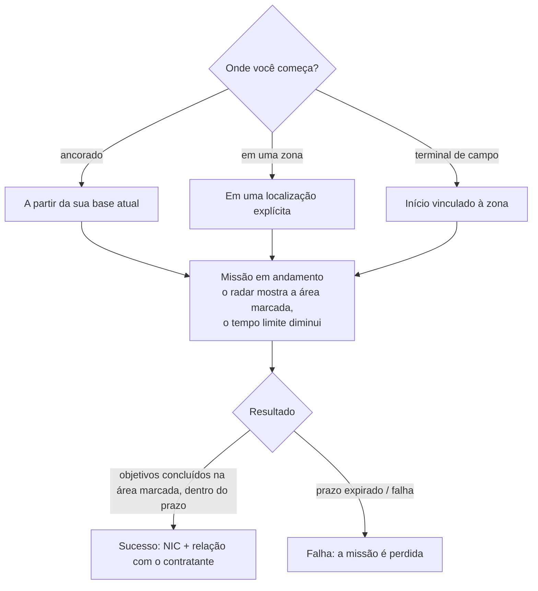

# Missões

**Missões** são objetivos estruturados que você assume em uma zona — entregar itens, abater alvos,
usar estruturas. Elas são a forma de progredir, obter recompensas e movimentar grande parte do conteúdo das zonas
(alarmes, quiosques e alguns ganchos de PBS/transporte são relacionados a missões).

> As localizações na interface seguem a [visão geral da interface do cliente](/pt/features/ui/). As mecânicas abaixo foram confirmadas com base
> no servidor.

## Iniciando uma missão

Você inicia uma missão escolhendo uma **categoria** e um **nível** (os níveis são limitados a uma
faixa válida), em uma **localização**:

- Se você estiver **ancorado**, a missão começa a partir da localização da sua base atual.
- Se você estiver **em uma zona**, você especifica a localização explicitamente.
- As missões também podem começar **a partir de uma zona** diretamente (um início vinculado à zona) ou **a partir de um terminal de campo**.

Nem toda categoria/nível está disponível em todos os lugares — a disponibilidade depende do conteúdo. A
lista completa de missões (tipo, categoria, nível, duração, taxa de recompensa e itens de recompensa)
é gerada em [Missões](/content/missions/).

## Para que servem as missões

As missões atendem a dois propósitos ao mesmo tempo: elas pagam NIC e aumentam a sua **relação**
com a corporação emissora (contratante). Uma melhor relação é um fator essencial para
obter uma **relação de instalações mais alta** nos terminais dessa corporação — a produção e
outras operações nas instalações tornam-se mais baratas e rápidas para você. As relações também podem *cair*: algumas
missões entram em conflito com os interesses de outra corporação, e o resumo informa quando isso
custará reputação a você.

- **Missões de treinamento** — fáceis, destacadas para novatos; faça todas elas, pois as recompensas
  são uma ótima ajuda inicial.
- **Missões regulares** vêm em três vertentes:
  - *Combate* — reconhecimento (escanear robôs inimigos), caça a recompensas (eliminar alvos em um círculo
    marcado), destruir e recuperar (eliminar + recuperar + entregar), reconhecimento e recuperação, recompensas
    especiais (alvos de difícil acesso).
  - *Indústria* — geologia (escanear em busca de um mineral com a carga correta), colheita, exploração
    mineral, exploração avançada (locais de escavação protegidos — leve suporte armado).
  - *Logística* — transporte (entregar um pacote entre terminais) e recuperação
    (um pacote grande através de território perigoso — faça escolta).
- Não existe **missão segura**: se você vir inimigos na rota e
  não tiver equipamento para se defender, peça ajuda antes de perder tudo no caminho.
- **Os objetivos só contam na área marcada** — o mapa da missão indica essa área com um
  círculo vermelho no radar; abates e escaneamentos fora dali não contam para nada. Perca o prazo
  e a missão falhará instantaneamente.
- **Contratos de transporte privado** — um sistema operado pelo Sindicato (segunda aba da janela de
  missões) onde os jogadores disponibilizam contêineres para que outros jogadores os transportem entre terminais,
  com uma recompensa definida e uma **garantia** (colateral) depositada pelo transportador (reembolsada em caso de sucesso, perdida se
  o contêiner for destruído; abortar no meio do caminho reembolsa apenas a metade). Mantenha os contêineres
  pequenos o suficiente para que alguém possa realmente carregá-los.

## Dados e opções da missão

- **Dados da missão** — detalhes de uma missão.
- **Opções da missão** — as escolhas/variantes disponíveis para uma missão.
- **Suprimento da missão** — os suprimentos envolvidos em uma missão.
- **Itens iniciais** — os itens com os quais a missão se inicia.

## Executando uma missão

- **Listar missões em andamento** — o que você está fazendo no momento.
- **Abortar** — cancelar uma missão em andamento.
- **Adicionar participante** — incluir outro personagem na missão (missões multijogador).
- **Registro da missão** — o registro de eventos de uma missão.

## Entrega

- **Entregar** — concluir um objetivo de entrega. Isso pode ser feito **ancorado** (em uma base) ou
  **em uma zona** (em uma localização/eid específica), dependendo da missão.

## Agentes

- **Listar agentes** — os agentes de missão disponíveis (NPCs/facções que emitem missões).

## Terminais de campo

- **Informações do terminal de campo** — inspecionar um terminal de campo em uma zona (uma estrutura que pode iniciar
  ou atender missões).

## Observações práticas

- **As missões são o elo de ligação** — alarmes, quiosques e algumas estruturas são
  objetos de missão (consulte [coleta](/pt/features/gathering/) e [combate](/pt/features/combat/)).
- **Multijogador** — você pode adicionar participantes para cooperar em uma missão.
- **O contexto da entrega importa** — algumas entregas exigem que você esteja ancorado, outras exigem que você esteja em uma
  localização na zona.
- **O nível é ajustado** — solicitar um nível fora do intervalo permitido é corrigido automaticamente, não gerando erro.
- **Abortar é a sua saída** — se uma missão der errado, aborte-a.

## Estruturas de missão

As missões são fixadas nas zonas por meio de **estruturas**. O servidor implementa os seguintes tipos:

| Estrutura | O que faz |
|---|---|
| **Interruptor simples** | interação instantânea — aproxime-se e o objetivo da missão é concluído |
| **Interruptor de alarme** | uma tarefa temporizada — permaneça dentro do alcance por um período (definido pelas opções da missão), verificado a cada 2 s |
| **Suprimento de itens** | temporizado como um interruptor de alarme, depois **gera itens dentro do contêiner do seu robô** |
| **Quiosque** | um ponto de **envio de itens** — entregue à missão os itens exigidos |

<!-- TODO: the full mission list, categories, level ranges and rewards are generated at
     /content/missions/. Verified: mission structure types
     (MissionEngine/MissionStructures: SimpleSwitch, AlarmSwitch, ItemSupply, Kiosk);
     verify the mission UI.
     Developer notes: Missions/MissionStart.cs (category, level clamp, docked vs zone
     location), Missions/MissionDeliver.cs (docked vs zone delivery), MissionAbort.cs,
     MissionData.cs / MissionGetOptions.cs / MissionGetSupply.cs / MissionStartItems.cs,
     MissionListRunning.cs / MissionListAgents.cs / MissionLogList.cs,
     MissionPlayerAddsParticipant.cs, FieldTerminalInfo.cs, MissionStartFromZone.cs;
     Services/MissionEngine/* (MissionProcessor, mission structures incl. AlarmSwitch,
     Kiosk). -->