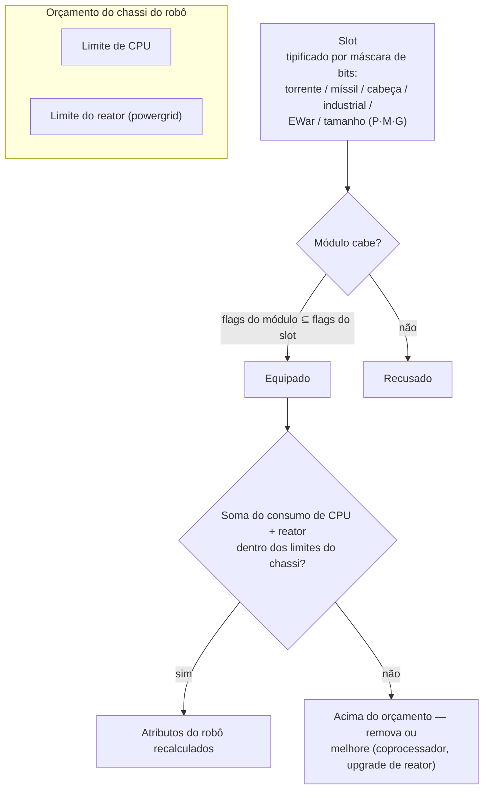

# Módulos e fitting

"Comprar um robô só lhe dá o chassi." Equipá-lo com módulos é onde um
robô se torna o que você precisa que ele seja. *Fitting* refere-se tanto à configuração de módulos
("envie-me o seu fitting") quanto ao orçamento de CPU/reator que ela consome.

## Slots e recursos

O chassi de um robô possui um conjunto fixo de **slots**, definidos por sua estrutura. Cada slot é
tipificado por uma máscara de bits — torreta, lançador de mísseis, cabeça, industrial, EWar/engenharia,
tamanho (pequeno / médio / grande) — e um módulo só cabe em um slot quando sua própria máscara de
tipo é um subconjunto da do slot. Assim, um slot de torreta em um caster aceita módulos de torreta pequenos,
médios *ou* grandes, mas nenhum lançador de mísseis jamais entrará em um
slot de torreta. Módulos de cabeça (coprocessadores, módulos de calibração/tuning) e módulos de chassi/pernas
(placas, frames) ocupam seus próprios slots dedicados.

Cada módulo consome **CPU** e **reator** (powergrid) do chassi — a soma de
tudo o que está equipado deve permanecer abaixo de ambos os limites, e alguns módulos também consomem
**acumulador** (core) por ciclo. A capacidade restante é a *saída disponível*
exibida na janela de fitting. Escala aproximada por chassi (exemplos T1/T2/T3):

| Classe de chassi | CPU | Reator | Exemplo |
|---|---:|---:|---|
| Crawler pequeno | ~250 | ~140 | Castel |
| Mech leve | ~480 | ~300 | Waspish |
| Mech pesado | ~1 100 | ~1 000 | Tyrannos |
| Walker | ~3 200+ | ~1 100+ | Gropho |

Quando estiver com pouca capacidade: **CPU** — módulos coprocessadores (por exemplo, o coprocessador
T3 concede +20% de CPU) ou variantes de módulos T2 (menor consumo). **Reator** —
upgrades de reator (por exemplo, T3 concede +20% de saída de reator) ou blindagem de reator (reduz
a radiação, o que também protege você contra EnWar — veja abaixo).

## As famílias de módulos

Os números específicos de cada modelo estão no [catálogo de itens](/content/) e na
[referência de formatos](/pt/formats/); este é o mapa das famílias.

### Armas e munição

Quatro tecnologias de armas, cada uma com sua própria munição e perfil de alcance:

| Arma | Munição | Perfil de distância | Notas |
|---|---|---|---|
| **Armas de fogo (balísticas)** | Balas | Alcance ideal curto, grande falloff | Projéteis que *nunca erram* — mas sua "precisão" funciona como um raio de área, portanto alvos pequenos ainda recebem dano reduzido devido à dispersão ampla. |
| **Magnéticas (railguns)** | Projéteis sólidos (slugs) | Alcance médio, queda acentuada (falloff) | Alta velocidade de impacto; alto consumo de energia. |
| **Lasers** | Células de energia | Longo alcance | Maior consumo de energia; feixes concentrados. |
| **Mísseis** | Mísseis | Longo alcance | Acertar ou errar é determinado pelo atributo de chance de acerto do *robô*, não pela distância. O dano varia conforme o tamanho do alvo em relação ao raio da explosão — mísseis grandes em alvos pequenos causam muito menos dano. |

O dano diminui com a distância em uma curva de cosseno suave: dano total no
alcance ideal (optimal), zero no ideal + falloff (consulte [queda de dano](/pt/features/combat/#tipos-de-dano)).

A munição é onde você ajusta o dano: tipos de dano primário + secundário permitem que você ajuste fino
contra um alvo (consulte [tipos de dano](/pt/features/combat/#tipos-de-dano)) —
ao custo de uma pequena perda no dano total em comparação à munição puramente primária.

As torretas estão disponíveis em tamanhos pequeno/médio/grande; **combine o tamanho com o robô** (bots
pequenos usam módulos pequenos, mechs e pesados usam médios/grandes).

### Defesa

- **Placas de blindagem** — a reserva principal de pontos de vida; quando a blindagem chega a zero, o robô
  explode. Placas **LWF** (lightweight frame / estrutura leve) trocam durabilidade por velocidade: uma placa LWF
  T2 multiplica a blindagem por ~0,73, mas concede +19% de velocidade, −0,2 de assinatura e
  −0,2 de massa.
- **Gerador de escudo** — uma barreira alimentada pelo acumulador que absorve dano antes da
  blindagem. O escudo consome *seu próprio core* para absorver: um golpe que causaria 100
  de dano em um escudo de 2× drena 50 de core em vez de 100 de blindagem. Enquanto o escudo estiver
  ativo, suas próprias armas não podem disparar. A qualidade da absorção varia com o raio
  do escudo em relação à sua assinatura — escudos grandes em chassis pequenos funcionam melhor.
- **Reparo de blindagem** — módulos de reparo ativo (pequeno/médio/grande); **reparo remoto de
  blindagem** alcança um alvo travado (aliados ou uma PBS), mas possui curto alcance e um
  ciclo mais longo.
- **Endurecedores de blindagem (hardeners)** — pontos passivos de resistência por tipo de dano (variantes
  química / cinética / térmica / explosiva).
- **Liga adaptativa** — um módulo passivo que *aprende* a composição de dano recebida e
  redistribui uma reserva fixa de pontos de resistência para o tipo de dano que você mais
  recebeu.
- **Evasivo / manobra** — módulos de redução de assinatura e NEXUS (abaixo) tornam
  o alvo menor: menos dano de efeitos em área e maior dificuldade para travar a mira.

### Energia

- **Reator** — o limite de saída contínua; upgrades de reator o aumentam, a vedação/blindagem do reator
  reduz a radiação (menos dano de EnWar recebido, a um pequeno custo de reator).
- **Acumulador (core)** — a reserva de energia rápida que alimenta os ciclos dos módulos. Ele
  recarrega com o tempo (`core_recharge_time` do chassi, ~120 ms em um crawler T1);
  **recarregadores de acumulador** aceleram essa recarga.
- **Injetores de energia (core boosters)** — consomem uma carga para restaurar instantaneamente
  o acumulador.
- **Transferidores de energia** — transmitem core do seu robô para um aliado travado na mira (jogadores
  não podem transmitir para NPCs).

### Eletrônicos

- **Sensor booster** — passivo, próprio: reduz o tempo de mira (lock) e amplia o
  alcance de travamento.
- **Remote sensor booster** — ativo, alvo: o mesmo bônus aplicado a um aliado travado
  por ~10,5 s.
- **Coprocessadores** — aumentam o limite de CPU do chassi (T1 +10% … T3 +20%).
- **Estabilizadores de armas** — melhoram a precisão das armas (menor raio de área efetivo)
  e reduzem um pouco a massa.
- **Módulos de calibração (tuning)** (slots de cabeça) — bônus fixos para famílias específicas: módulos
  de dano (+25% de dano por família de armas no T3), upgrades de mineração (+10% de mineração e
  coleta no T3), upgrades de reparador de blindagem (+16% de reparo, −8% de ciclo no T3).

### Guerra Eletrônica (EWar)

Deixe o inimigo cego e surdo:

- **Sensor dampener** — penalidade (debuff) à distância: aumenta o tempo de mira do alvo e reduz
  seu alcance de travamento por ~5,5 s. Só funciona se a força do seu ECM superar a força
  dos sensores do alvo (aleatorizada).
- **Sensor jammer** — instantâneo: redefine *todas* as miras travadas do alvo em um teste de ECM
  bem-sucedido.
- **ECCM** — bônus próprio por 20 s: aumenta a força dos sensores e a resistência a travamentos, além de
  *remover* debuffs vulneráveis a ECM (dampeners, webs).
- **Neuralyzer** — redefine as miras travadas de **todos** os jogadores em um raio de ~1,65 km. Um botão de
  pânico.

Contramedidas: força do sensor (chassi), ECCM e manter distância.

### Furtividade e detecção

- **Módulo de camuflagem (stealth)** — ~10,5 s de furtividade; o consumo varia de acordo com o raio
  da sua assinatura (chassi maior, queima de core mais rápida).
- **Target painter** — debuff de ~10,5 s que remove a força de furtividade do alvo.
- **Módulo de detecção** — aumento passivo na sua força de detecção.

Força de detecção versus força de camuflagem determina se você consegue ver (e travar a mira em) um
alvo camuflado — consulte [detecção e mascaramento](/pt/features/combat/).

### Guerra de Energia (EnWar)

Drene ou corte a energia do inimigo:

- **Drenadores (vampiros de energia)** — sugam o core de um alvo travado e o adicionam ao
  seu próprio acumulador.
- **Neutralizadores** — o mesmo princípio, mas o core drenado é destruído.
- Ambos são enfraquecidos pela **radiação do reator** do alvo — a vedação é uma
  contramedida real.
- **Desmobilizadores (webs)** — redução de velocidade de ~5,5 s no alvo; o efeito
  escala com a massa do alvo (chassis pesados são menos desacelerados) e falha contra
  alvos fora do alcance ideal do módulo.
- **Scorcher** — uma arma elétrica que atinge em cadeia (*chains*) até 5 alvos, atingindo
  escudos e blindagem com dano penetrante.

### Industrial

- **Brocas (drills)** (pequenas / grandes) e **colheitadeiras (harvesters)** (pequenas / grandes) — os módulos
  de coleta; rendimento, tempo de ciclo e uso de acumulador são os atributos que importam.
  A mineração concede EP (com limite diário e penalidade líquida).
- **Geoescaner (geoscanner)** — varre o campo mineral ao seu redor com a precisão da sonda;
  o resultado é um mapa do que está sob o solo (consulte [coleta](/pt/features/gathering/)).
- **Escavadeira (excavator)** — módulo de aura: aumenta o rendimento de mineração/coleta de unidades
  próximas (T3: +50%) ao custo da furtividade.
- **Terraformação** (zonas gamma) — travas de terreno que elevam, rebaixam ou nivelam
  o solo (raio máximo de 5 m) e cultivam plantas de parede; veja a [seção de zonas](/zones/zone-gamma-z106/).
- **Controladores remotos** — torretas e drones sob comando: cada módulo controlador
  possui uma largura de banda (quantos), um alcance operacional e uma vida útil do drone
  (5–10 min por tier). Variantes: tático (dano/ciclo), assalto
  (dano), suporte (reparo remoto), industrial (drones de mineração/coleta),
  caçador. Um módulo **tradutor de comando remoto** amplifica o dano, blindagem,
  rendimento de mineração e capacidade de reparo dos drones (T3: +7,5% cada) e pode estender a largura de
  banda do controlador.

### NEXUS

Sistemas de Utilização de Extensão em Rede: **bônus de esquadrão**. Um módulo NEXUS emite uma
aura ao redor do seu próprio robô que fortalece os **membros da gangue** (e suas torretas/drones)
dentro do raio da aura — padrão de 10 m, renovável a cada 10 s. Regras:

- um robô pode carregar no máximo **3 auras NEXUS**, e no máximo **uma de cada tipo**;
- a aura alcança apenas unidades da sua **gangue**, não aliados avulsos.

A lista de tipos T3 (13): velocidade, blindagem, escudo, farlock (alcance de mira), booster
de mira (tempo de mira), acerto crítico, assalto (ciclo de armas), EW (alcance de EWar),
evasivo (assinatura), reparador, industrial (uso de acumulador durante a coleta),
extrator rápido (ciclo de coleta), recarregador (recarga de core). Cada módulo T3
concede cerca de +7,5% do seu atributo; por exemplo, o NEXUS de velocidade multiplica a velocidade máxima
por 1,075 para cada companheiro de gangue a até 10 m de distância.

### NOX

Contramedidas de nível cultista: módulos **negadores** que *desativam* módulos inimigos dentro
do seu raio — um **negador de escudo** (reduz a absorção do escudo em ~90%), um
**negador de reparo** (reduz a saída de reparo) e um **negador de teleporte** (bloqueia o
teleporte). Cada ativação **consome plasma** do seu compartimento de carga, e usar um
em uma zona aberta (que não seja de treinamento) **marca seu personagem para PvP**.

### Propósito especial

- **Módulo de invasão de cerco (siege hack)** — a ferramenta de SAP ativa: ciclo de 5 s, alcance de 3 m (consulte
  [postos avançados](/pt/features/outposts/)).
- **Autodestruição** — arma uma contagem regressiva de 8 segundos; o feixe é visível a 600 m.
  Limpeza de último recurso.
- **Detector de minas** — amplia o alcance de detecção de minas do chassi.
- **Emissores de blob** — implantam um emissor que espalha um campo blob; o
  módulo modulador de emissão ajusta o campo (consulte [combate](/pt/features/combat/)).
- **Construção de PBS** — o módulo usado para posicionar estruturas PBS em zonas gamma.

## Regras práticas

1. **Não misture suas armas.** Magnética + laser + mísseis em um único bot geralmente
   tem desempenho inferior a focar em qualquer uma das três; misturar curto e longo alcance raramente termina bem.
2. **Atenção à massa.** Cada placa e módulo de escudo adiciona massa e assinatura —
   às vezes a velocidade importa mais do que a defesa.
3. **Não tente fazer de tudo.** Um bot que minera, escaneia e atira não faz nada disso
   tão bem quanto um especialista.
4. **Adequar o tamanho dos módulos** ao robô e deixar uma folga de CPU/reator
   para os módulos de calibração que realmente fazem uma build funcionar.
5. …e sim, alguns fittings de nicho quebram todas as regras acima e ainda funcionam. Apenas pense
   bem antes de montar.

<!--
Developer notes: rewritten 2026 from backend sources; no community-wiki text reused.
Verified against:
- src/Perpetuum/Robots/RobotComponent.cs (slot bitmask fitting: moduleFlagMask & slotFlagMask)
- src/Perpetuum/Modules/SlotFlags.cs (12 slot flag bits)
- src/Perpetuum/Modules/Weapons/WeaponModule.cs + FirearmWeaponModule.cs +
  MissileWeaponModule.cs (accuracy: firearms never miss, explosion radius from
  Accuracy; missiles use ParentRobot.MissileHitChance)
- src/Perpetuum/Modules/Weapons/Damage.cs (cosine falloff, critical 1.75x +/-10%,
  explosion scaling signature/explosionRadius clamped [0,1])
- src/Perpetuum/Units/Unit.cs GetResistByDamageType (resist/(resist+100))
- src/Perpetuum/Zones/DamageProcessors/DamageProcessor.cs (shield draws core,
  electric = penetrating)
- src/Perpetuum/Modules/EffectModules/ShieldGeneratorModule.cs (absorption
  modifier = shieldRadius ratio / shieldAbsorbtion; WeaponModule.cs:112 blocks
  firing while HasShieldEffect)
- src/Perpetuum/Modules/EffectModules/{Webber,SensorDampener,SensorBooster,
  Stealth,TargetPainter,Eccm,Detection,AdaptiveAlloy}.cs (durations from
  effects table: dampener/web 5.5s, stealth/paint/remote-boost 10.5s, ECCM 20s)
- src/Perpetuum/Modules/SensorJammerModule.cs + Neuralyzer.cs (lock reset,
  NEURALYZER_RANGE=1650)
- src/Perpetuum/Modules/{EnergyVampire,EnergyNeutralizer,Scorcher,
  CoreBooster,EnergyTransferer}.cs (EnWar, reactor radiation modifier, chain)
- src/Perpetuum/Modules/GangModule.cs + Zones/Effects/GangEffect.cs +
  EntitiesModule.cs:532-544 (13 aura types, gang-members-only, effects table
  auraradius=10)
- src/Perpetuum/Modules/NoxModule.cs (plasma consumption, PvP flag)
- src/Perpetuum/Modules/RemoteControl/* (bandwidth/range/lifetime, translator
  amplification)
- entitydefaults rows: named1-3 armor plates/hardeners, shield generators
  (absorbtion 2.0-2.3, radius 5-33), LWF (mass_reductor), cpu/powergrid
  upgrades, damage/mining/repairer tuning, NEXUS named3 values, NOX cultist
  values, siege hack (5s/3m), chassis core_max/powergrid_max.
Corrections vs ingested page: NEXUS auras reach gang members only (not "all
friendly units"); no "co-reactor" module exists (reactor upgrades/sealing do
that); demobilizer effect scales with target mass, no "resistance stat";
sensor suppressor = sensor dampener (5.5s debuff).
-->