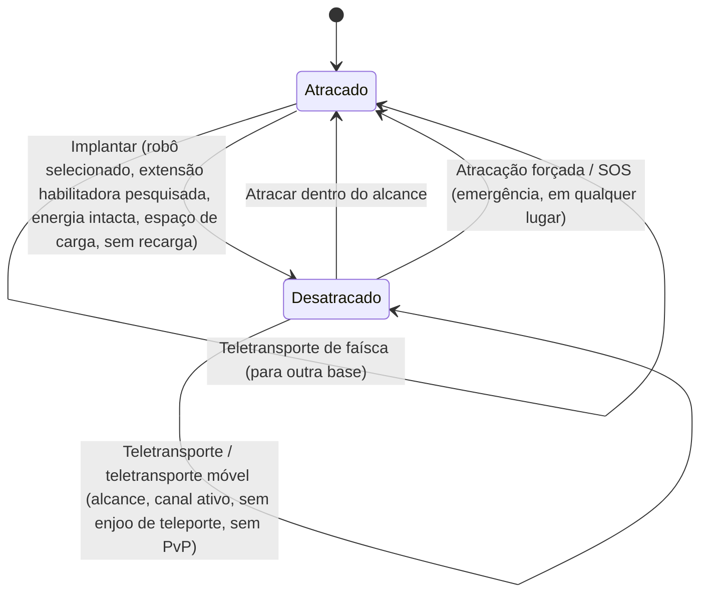

# Movimento & zonas

Você está sempre em um de dois estados: **atracado** em uma base, ou **desatracado** em uma zona
pilotando seu robô ativo remotamente. Tudo nesta página diz respeito à transição entre esses estados
e entre as zonas.

> Os locais da interface seguem a [visão geral da interface do cliente](/pt/features/ui/): o **botão Implantar/Atracar** é o
> alternador central na barra superior. As mecânicas abaixo são confirmadas pelo servidor.

## Atracado vs. desatracado

- **Atracado** — você está em uma base. Seus robôs e itens estão em contêineres. Você não pode
  pilotar um robô, usar teletransportadores ou escanear, mas pode fabricar, negociar, pesquisar e usar as
  instalações da base.
- **Desatracado** — você está em uma zona, pilotando seu robô ativo. Você pode se mover, escanear,
  lutar e interagir com objetos da zona, mas a maioria das atividades exclusivas da base fica bloqueada.

## Desatracando

Pressione **Implantar** (centro da barra superior). O servidor então verifica todos os seguintes requisitos:

1. Você tem um **robô ativo selecionado**.
2. A classe daquele robô possui a **extensão habilitadora** necessária pesquisada no seu
   personagem (veja [pesquisa](/pt/features/research/)).
3. O **sistema de energia** do robô está intacto.
4. O **compartimento do robô** possui capacidade livre.
5. Você não está em um **tempo de recarga de desatracação** (um cronômetro curto após determinados eventos).

Se qualquer verificação falhar, a desatracação será recusada.

## Atracando de volta

- **Atracar** em uma base quando estiver dentro do alcance de atracação.
- **Atracação forçada (Force dock)** é a ação de emergência: ela retira você da zona e atraca você na
  base principal (TMA) imediatamente, mesmo em combate. Use-a quando estiver perdendo uma batalha.
- **SOS** — uma ação de socorro na zona que atraca você na base atual e sinaliza o incidente.

## Fila de entrada na zona

Algumas zonas ficam lotadas e utilizam uma **fila de entrada** ao sair da base / entrar na zona:

- Consultar o status da fila (`zoneGetQueueInfo`).
- Definir sua preferência de tamanho de fila (`zoneSetQueueLength`).
- Cancelar a espera se mudar de ideia (`zoneCancelEnterQueue`).

## Teletransportadores

Os **teletransportadores** são estruturas dentro de uma zona. Para usar um:

- Você deve estar **dentro do alcance do teletransportador**.
- O **canal** (destino) deve estar **ativo** e válido.
- Você **não** pode estar sob efeito de *enjoo de teletransporte (teleport sickness)* — um curto tempo de espera após qualquer teletransporte,
  durante o qual você não pode se teletransportar novamente.
- Certos efeitos (ex.: anulação por *Nox*) ou estar **em combate PvP** podem bloquear os teletransportadores.

Os canais de teletransporte dividem-se em três tipos:

| Tipo | Efeito |
|---|---|
| **Na mesma zona** | Move você para um ponto aleatório na mesma zona |
| **Outra zona** | Move você para um ponto aleatório em uma zona diferente |
| **Saída de treino** | Sai de uma zona de treinamento (com opção de nível de recompensa) |

**Teletransportadores móveis** são itens de teletransporte *com proprietário* (ex.: teletransportadores móveis de fortaleza/mundo).
Regras adicionais se aplicam:

- Apenas o **proprietário ou um membro da frota (gang) do proprietário** pode usá-lo.
- Eles **não podem ser usados enquanto estiver em PvP**.
- Cada uso aplica um **tempo de recarga** àquele teletransportador.

Você pode listar teletransportadores e seus canais, além de consultar canais globais em todo o mundo.

## Teletransportes de faísca (Spark teleports)

Os **teletransportes de faísca** são um sistema de viagem rápida entre bases:

- Você **define** um destino de faísca em uma base e depois o **usa** (enquanto estiver atracado) para saltar para
  outra base instantaneamente.
- Você pode **listar, definir, usar e excluir** seus teletransportes de faísca.
- A base de destino deve **permitir atracação** para você.
- Ao chegar, o servidor seleciona um robô adequado para você (um para o qual você já tenha
  pesquisado as extensões habilitadoras).
- O **número de teletransportes de faísca que você pode manter** é limitado por uma extensão
  (veja [pesquisa](/pt/features/research/)); exceder esse limite é recusado.

## Portais (Gates)

Os **portais** são estruturas de zona que podem ser usadas de qualquer lugar (não têm limitação de alcance como
os teletransportadores). O proprietário de uma base pode **renomear** seus portais.

## Informações da base

Você pode inspecionar qualquer base:

- **Informações** — o que ela é e onde fica.
- **Propriedade** — a quem pertence.
- **Instalações** — o que ela oferece (produção, mercado, loja, …).
- **Meus itens** — seus itens armazenados naquela base.
- **Direitos de atracação** — o proprietário da base pode definir quem tem permissão para atracar lá.

## O que pode dar errado

| Sintoma | Causa provável |
|---|---|
| Desatracação recusada | Nenhum robô ativo, extensão habilitadora ausente, sistema de energia danificado, compartimento do robô cheio ou tempo de recarga de desatracação ativo |
| Teletransporte recusado | Fora de alcance, canal inativo, enjoo de teleporte, efeito Nox ou em PvP |
| Teletransporte móvel recusado | Não é o dono nem membro da frota, ou em PvP |
| Teletransporte de faísca recusado | Base de destino proíbe atracação, nenhum robô válido disponível para seleção ou limite de teletransportes de faísca atingido |
| Preso na entrada da zona | Fila da zona — verifique o status da fila ou cancele |

<!-- TODO(Phase 1): verify client UI flow (dock/undock buttons, teleport screen).
     Developer notes: Dock.cs / Undock.cs / ForceDock.cs (TMA = baseEid 561) /
     ZoneSOS.cs; Zone/TeleportUse.cs (TeleportPlayerValidator, three
     TeleportDescriptionType strategies, mobile-teleport gang/PVP rules);
     Sparks/SparkTeleportUse.cs (docked-only, extension-count limit);
     Zone/ZoneCancelEnterQueue.cs + ZoneEnterQueueService; GateSetName.cs. -->
